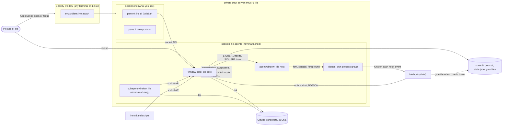

# Irie v1: design and implementation plan

Date: 2026-10-26. Status: v1 plan. Read with [AGENTS.md](../AGENTS.md). Every source is listed in [PROVENANCE.md](../PROVENANCE.md).

Irie runs coding agents from any supplier, cloud or local, side by side in one calm view: a narrow sidebar on the left and the selected agent's live terminal on the right. v1 does this end to end for Claude Code and gives fine control over every agent. You can see who needs you, pause an orchestrator or one of its subagents at its next tool call, freeze a session instantly, raise a task's priority on the fly, and undo what you did. The seams for every other harness also ship in v1: adapters, a normalised event envelope and a socket API.

**Glossary.**
- **Session:** one agent conversation in its own tmux window. It has an orchestrator (the main agent) and any subagents the orchestrator starts.
- **Tool boundary:** the moment just before a tool call runs, or just after one finishes.
- **Hold:** a hook that does not answer until the user releases it.
- **Freeze:** SIGSTOP of a session's whole process tree.
- **Slot:** the right-hand pane where an agent's live terminal is swapped in.
- **Mirror:** a read-only pane that shows one subagent.
- **Profile:** a named launch recipe (harness, model, effort, permission mode, args, env).
- **Context note:** text that Irie puts in front of an agent at a tool boundary or prompt.

---

## 1. Goal and non-goals

### 1.1 Requests and where v1 answers them

| Request | v1 answer | Where |
|---|---|---|
| Sidebar with inner scrolling, header pinned at the top, command bar pinned at the bottom | Bubble Tea sidebar in which only the list scrolls (keys and mouse wheel) | §4.1, M1 |
| Collapsible park section | A "Parked" group at the end of the list. Collapsed, it shows its size and how many of its sessions need you | §4.1, M4 |
| Fine-grained pause of orchestrators and their subagents | Hold one agent (the orchestrator or one subagent) or a whole tree at its next tool call; freeze a session's process tree instantly | §4.3, M5, M6, M8 |
| "Context aware" | v1 reading: whatever Irie does to an agent (hold, freeze, priority, a note from you) reaches it as a context note at its next tool boundary or prompt, including how long it was held. Awareness of sibling agents and context-window gauges come after v1 | §4.3, M5–M7 |
| Reliable headless spawning | Every spawn either becomes a live agent holding its full task, or fails loudly with the reason. Works with no window open (`irie ctl spawn`) | §4.2, M1–M3 |
| Undo/redo | An action log with inverses. The header shows what undo and redo will do | §4.5, M4–M7 |
| Priority for tasks that become urgent on the fly | Badge, move to the top, steering note | §4.3, M7 |
| Default agent: Opus 5.5 on max effort in auto mode | Default profile: `claude-opus-5-5`, `--effort max`, `--permission-mode auto`. Every value can be changed in config | §5.5, M1 |
| Sessions waiting on you in red; rename; jump | States derived from hooks; keys `r`, `/` and `1`–`9` | §4.1, M2, M4 |
| A live read-only pane for each running subagent | One mirror pane per subagent, listed under its parent | §4.4, M8 |
| Irie.app | Opens or focuses the one Irie window in Ghostty; has an icon; found by Spotlight | §7, M9 |
| See every Claude Code session on the machine, and bring one in | An "Outside Irie" group with live busy and idle; "Move into Irie" carries an idle session on in an Irie pane, on request only | §4.6 |

### 1.2 Not in v1

| Not in v1 | Why |
|---|---|
| Ghostty native splits or tabs as the engine | Agents would die when Ghostty quits, and scripting cannot move a live terminal or read its screen. tmux keeps agents alive with no window open and can swap, capture and steer panes. |
| Embedding libghostty | It would mean rewriting Irie as a native app, and it is macOS-only. The UI already talks to the core over a socket (§2.4), so a native front-end can come later without touching the core. |
| Full adapters for harnesses other than Claude Code | In v1 they run in the generic tier: launch, freeze, alive/exited, typed notes. Full adapters follow v1 (§3.2). |
| Routing, budgets, RAM admission, cross-model review | These need usage oracles and capacity probes. v1 ships what they build on: profiles, the local-context preflight and the event envelope (§6.2). |
| Cost tracking via OpenTelemetry; driving agents over ACP | After v1. The event envelope maps onto both. |
| Editing the user's agent config files | Hooks, settings and env are injected per launch, so there is nothing to clean up. |
| Screen-scraping state detectors | They break whenever a vendor changes its UI. Irie reads hooks first; its only screen read is the screen tail it shows when a spawn stalls. |
| Deleting worktrees or branches | Risk of data loss. v1 creates worktrees and never removes them. |
| Windows | Irie needs tmux and POSIX signals. Linux works through plain `irie`. |

### 1.3 After v1, in order

1. Harness adapters: Codex CLI first, then opencode, Gemini CLI and pi, then goose, hermes-agent, Amp and crush (§3.2).
2. Routing, and agents working in tandem (§6.2).
3. Pop an agent out into its own native Ghostty tab (§7.4).
4. Sibling awareness (which agents work in the same repo, and on which branches), context-window gauges, and a focus mode (prioritise one session and pause the rest at their next tool call).
5. Cost tracking through an OTLP receiver, `irie gc` for old worktrees, and desktop notifications when a session turns red.

---

## 2. Architecture

### 2.1 Principles

1. **tmux is the engine.** It keeps agents alive with no window open, swaps panes into view, reports process facts and carries typed input. Ghostty is the window around it.
2. **One writer.** `irie core` owns all state and is the only process that drives tmux. The sidebar, `irie ctl`, the hook shim, the subagent mirrors and any future native front-end are all clients of its socket API.
3. **State is derived, not stored.** The core records facts in an append-only journal and computes each row's state from them.
4. **Inject, never edit.** Hooks, settings and env go in per launch, through `--settings`, argv and env. User config files are not touched.
5. **Fail open, except for a pause.** If Irie is down, hooks return at once and agents keep working. An agent the user paused stays held through its gate file.

### 2.2 Processes



| Process | Runs in | Role | Talks to |
|---|---|---|---|
| `irie` | the user's terminal, or Irie.app | Runs `irie up`, then opens or focuses the Irie window in Ghostty (macOS, from M9) or attaches in the current terminal | tmux, `osascript` |
| `irie up` | any terminal | Idempotent. Starts the server and the core if the socket does not answer `hello`, and waits up to 5 s for it. If the running core or UI is a different version, respawns those panes (`respawn-pane -k`); agents are untouched | tmux, socket |
| `irie attach` | any terminal | `exec tmux -L irie attach -t irie`. Inside another tmux it refuses unless given `--nested`. Inside Irie's own server it runs `switch-client` | tmux |
| `irie core --supervise` | `irie-agents:core` | Holds `core.lock` (flock). Owns the registry, state derivation, gates, notes, undo log, journal, worktrees, spawning, the swap-in and observation. The supervisor restarts it with backoff (1, 2, 4 … 30 s) | socket (server), tmux, hosts (signals), transcripts |
| `irie ui --supervise` | `irie:0.0` | The sidebar, a pure client of the socket. It never calls tmux | socket |
| `irie host --spec <file>` | the first process of every agent pane | Owns the agent's process group; freezes and thaws it; records the exit status | the agent (fork/exec), socket (best effort) |
| `irie hook` | started by the agent for each hook event | Forwards the event, waits while held, prints the harness's reply | socket, gate file |
| `irie mirror` | subagent panes (M8) | Read-only live view of one subagent | socket, transcript |
| `irie ctl` | anywhere | Scripting and tests: `list`, `spawn`, `show`, `watch`, `pause`, and so on | socket |
| `irie placeholder` | the slot when nothing is shown | Shows the keys | none |

### 2.3 tmux layout and swap-in

| Object | Contents | Options |
|---|---|---|
| Server | `tmux -L irie -f $XDG_STATE_HOME/irie/tmux.conf`, generated by the core. The user's own tmux.conf is never read | Socket name from `tmux.socket` |
| Session `irie`, window 0 | Pane 0: `irie ui --supervise`, `ui.sidebar_width` columns wide. Pane 1: the slot | `window-size latest` |
| Session `irie-agents` | Window `core`. One window per agent, each with a single pane running `irie host`. One window per subagent mirror (M8) | Agent windows use `window-size manual`, resized to the slot's size, and `remain-on-exit on` |
| Pane user options | `@irie_session`, `@irie_agent` (`main` or `sub:<id>`), `@irie_role` (`agent`, `mirror` or `placeholder`), `@irie_name`, `@irie_created`, `@irie_vendor_id` | These travel with the pane through swaps. A restarted core rebuilds its registry from them |

Generated tmux.conf, essentials:

| Setting | Reason |
|---|---|
| `status off`, `prefix None` | The sidebar is the status line, and there are no stray tmux commands |
| `bind -n C-] if -F '#{==:#{pane_index},0}' 'select-pane -t irie:0.1' 'select-pane -t irie:0.0'` | Focus toggle between sidebar and slot (`ui.focus_key`) |
| `mouse on` | Click to focus, wheel to scroll |
| `base-index 0`, `pane-base-index 0` | `irie:0.0` is always the sidebar and `irie:0.1` always the slot |
| `remain-on-exit on`, `history-limit 50000` | A dead agent keeps its exit status and last screen |
| `allow-passthrough on`, `focus-events on`, `extended-keys on`, `terminal-features 'xterm*:extkeys'` | What Claude Code's terminal docs ask for (Shift+Enter, progress) |
| `set-titles on`, `set-titles-string Irie` | Sets the Ghostty window title, which is used to find the window (§7.1) |
| `escape-time 10` | Esc reaches agents promptly |

**Swap-in.** The slot holds either the placeholder P or one agent pane A. While A is shown, A's own window holds P. To show B, the core sends one command list, so no client ever draws the in-between state:

```
swap-pane -d -s irie:0.1 -t <P>     # only if an agent A is shown: A goes home, P returns to the slot
swap-pane -d -s <B> -t irie:0.1     # B moves into the slot, P into B's window
select-pane -t irie:0.1             # only when the user asked for focus
```

On every tick the core checks these invariants and repairs any it finds broken:
- `irie:0` has exactly two panes, and pane 0 is the sidebar.
- The slot holds P or exactly one agent or mirror pane.
- Every agent pane is either in the slot or in its own window.
- The slot is zoomed exactly while the Mac app is open ([MAC.md](MAC.md)), and swaps keep the zoom.
- The sidebar is `ui.sidebar_width` wide, except while the slot is zoomed.
- Every agent window has the slot's size, so a swap never resizes an agent: no SIGWINCH and no redraw jump.

The core never kills a pane while it is in the slot; it swaps the pane home first.

### 2.4 Socket API

The socket is a unix stream socket at `<runtime>/irie/core.sock`, mode 0600, in a 0700 directory. There is no TCP listener. Messages are NDJSON, one object per line:
- Request: `{"id":1,"op":"spawn","args":{…}}`.
- Reply: `{"id":1,"ok":true,"result":{…}}` or `{"id":1,"ok":false,"error":{"code":"…","msg":"…"}}`.
- `subscribe` replies once, then streams frames until the client closes:
  - `{"t":"snapshot","sessions":[…],"header":{…}}`
  - `{"t":"upsert","session":{…}}` and `{"t":"remove","id":"…"}`
  - `{"t":"history","undo":"…","redo":"…"}`
  - `{"t":"event","event":{…}}`, sent only when `events:true` was requested.
  - `{"t":"outside","outside":[…],"problem":"…"}`: the Claude Code sessions outside Irie (§4.6), after the first snapshot and whenever they or the problem change. A subscription to one session gets none.
- Frames to the UI are coalesced to at most 10 per second.
- The API version is `1`. Additions keep backwards compatibility.

| Op | Args | Result | From |
|---|---|---|---|
| `hello` | `client`, `api` | `version`, `api`, `features[]`, which name the ops served, `move` among them | M1 |
| `list` | none | `sessions[]`, `outside[]`, `outside_problem?` | M1 (`outside`: §4.6) |
| `subscribe` | `events?`, `session?`, `agent?`, `view?` | frames (above). `view: "app"` is the Mac app: the slot stays zoomed while it is subscribed | M1 (`view`: Mac app) |
| `spawn` | `task`, `cwd?`, `repo?`, `in_place?`, `profile?`, `name?`, `force?` | `session` | M1 (`repo`, `profile` M3; `force` M10) |
| `show` | `session`, `agent?`, `focus` | none | M1 |
| `hook` | `harness`, `session`, `payload` | `context?`, `deny?`. Waits while the agent is held | M2 |
| `rename`, `park`, `unpark`, `close`, `reopen` | `session`, `name?` | none | M4 |
| `undo`, `redo` | none | `label` | M4 |
| `pause`, `resume` | `session` or `all`; `scope`: `main`, `sub:<id>` or `tree` | none | M5 |
| `freeze`, `thaw` | `session` or `all` | none | M6 |
| `priority` | `session`, `level` (0 or 1), `reason?` | none | M7 |
| `note` | `session`, `agent?`, `text` | `note` | M7 |
| `preflight` | `profile` | `ok`, `problems[]` | M10 |
| `attach-info` | none | tmux binary, server socket and the session that holds the slot, for a terminal outside Irie | Mac app ([MAC.md](MAC.md)); per-session targets after v1 |
| `move` | `vendor_id`, `profile?` | `session`. Refuses with `busy` unless the session is listed outside Irie and idle | Sessions outside Irie (§4.6) |

### 2.5 Observation

| Rank | Source | Gives | Notes |
|---|---|---|---|
| 1 | Host and tmux | Alive or exited, exit code, frozen, pane sizes | Process truth. "Exited" and "frozen" override everything else |
| 2 | Hooks (via the shim) | Prompt submitted, tool calls, needs you, turn ended, subagents | The authoritative semantic signal |
| 3 | Transcripts (JSONL) | Catch-up after core downtime; subagent content | Tailing only |
| 4 | Timers | Startup stall (`spawn.ready_timeout`), shown with a `capture-pane` tail | The only screen read |

A hook event older than the last host or tmux fact cannot revive an exited session.

Until M11 the core polls `list-panes -a -F …` once per second for pane ids, options, `pane_pid`, `pane_dead`, `pane_dead_status` and sizes. M11 adds a control-mode client (`tmux -u -C attach -t irie -f ignore-size,no-output`) for push events and keeps a 10 s reconcile as the fallback.

### 2.6 Repository layout

| Path | Contents | From |
|---|---|---|
| `cmd/irie/` | Entry point and subcommand dispatch | M1 |
| `internal/paths/` | XDG and runtime dirs, socket path | M1 |
| `internal/config/` | TOML config, defaults, validation | M1 |
| `internal/tmux/` | Command runner, generated tmux.conf, layout, swap-in, sizes; `control/` from M11 | M1 |
| `internal/ipc/` | NDJSON framing, client, server | M1 |
| `internal/core/` | Registry, spawn, show, derived state, gates, notes, actions/undo, supervisor | M1 |
| `internal/host/` | Pane host: process group, freeze/thaw, exit status | M1 |
| `internal/harness/` | Adapter interface; `claude/` (M1), `generic/` (M3) | M1 |
| `internal/ui/` | Bubble Tea sidebar | M1 |
| `internal/event/`, `internal/journal/` | Envelope, kinds, NDJSON journal | M2 |
| `internal/hook/` | Shim logic | M2 |
| `internal/testutil/` | `BuildIrie`, tmux test server, `ShortDir`; `fakeagent/` from M2 | M1–M2 |
| `internal/repo/`, `internal/worktree/` | Repo lookup, worktrees | M3 |
| `internal/transcript/`, `internal/mirror/` | JSONL follower and parser, mirror view | M8 |
| `internal/ghostty/`, `internal/macapp/`, `internal/loginenv/` | AppleScript driver, Irie.app bundle, login-shell env capture | M9 |
| `tools/mkicon/` | Icon generator | M9 |
| `internal/localmodel/` | Runtime probes and preflight | M10 |
| `e2e/` | Opt-in tests against the real Claude Code | M11 |

---

## 3. Harness support

### 3.1 Support levels

| Level | What works | What the harness must offer |
|---|---|---|
| **G**, generic | Launch in a pane host, freeze and thaw, alive/exited, notes typed in with bracketed paste and Enter | A command line |
| **O**, observed | Working, needs you (red) and done, from the harness's own events | Hooks, a plugin or an event stream that maps to the envelope |
| **H**, held | Pause at the next tool call; context notes at tool boundaries | A pre-tool hook that can wait and can inject text |
| **S**, subagents | A live read-only pane per subagent; per-subagent pause and notes | Subagent events with an id, plus a readable subagent transcript |

### 3.2 Capability matrix

In the Freeze column, "host" means `irie host` sends SIGSTOP to the agent's process tree. Ctrl+Z is never used: it is unreliable in Claude Code and undocumented for several others.

| Harness | Launch: model, and per-launch hook injection | Observe | Hold at the next tool call | Steer | Freeze | Subagents | Irie |
|---|---|---|---|---|---|---|---|
| Claude Code | `--model`, `--effort`, `--permission-mode`; `--settings <file>` | 33 hook events (command handler), JSONL transcript | PreToolUse and PostToolUse. The default 600 s timeout lets the call through; Irie sets `timeout` and `onFailure: "block"` (2.1.295+) | Hook `additionalContext`. Keys: Enter queues for the next tool boundary, Ctrl+X Ctrl+S sends now | host | SubagentStart/Stop; `agent_id` on tool hooks; `subagents/agent-<id>.jsonl` | **v1: G O H S** |
| Codex CLI | `-m`, `-c k=v`; hooks via `CODEX_HOME` or `-c`, behind a trust gate (`--dangerously-bypass-hook-trust` or pre-trust) | 12 hook events, rollout JSONL, OTel | PreToolUse, 600 s. Timeout outcome undocumented | Hook context. Enter injects; `codex queue`; app-server `turn/steer` | host | Child rollouts with `parent_thread_id`; SubagentStart/Stop | G now; full adapter first after v1 |
| Gemini CLI | `-m`; settings only via env (`GEMINI_CLI_SYSTEM_SETTINGS_PATH`) | 11 hook events, JSONL, OTel | BeforeTool. 60 s timeout, then the call goes through; raise `timeout` | Steering behind an experimental flag; Tab queues | host | `chats/<parent>/<sub>.jsonl`; no hook events | G; second wave |
| opencode | `-m provider/model`; `OPENCODE_CONFIG_CONTENT` | Plugin bus, `opencode serve` SSE, SQLite | Plugin `tool.execute.before`, awaited, no timeout | Queue or abort only | host | SQLite `parent_id` | G; second wave |
| pi | `--provider`, `--model`; `-e <extension>` | Extension events, JSONL | `tool_call`, awaited | RPC `steer`; Enter steers | host | None built in | G; second wave |
| goose | `--provider`, `--model`; project plugin dir | Plugin hooks, SQLite, OTel | PreToolUse. 30 s timeout, then the call goes through (`on_failure` from 1.49) | Not documented | host | `parent_session_id` | G; third wave |
| hermes-agent | `-m`, `--provider`; `-p <profile>` or `HERMES_HOME` | Shell and plugin hooks, SQLite | `pre_tool_call`, which blocks the call on timeout (fails closed) | `/steer`; `session.steer` | host | Delegation logs, hooks | G; third wave |
| Amp | Modes, no model flag; project plugin dir | Plugins, `--stream-json` | `tool.call` plugin; timeout undocumented | Enter steers; `steer` flag | host | Server-side | G; third wave |
| crush | `-m`; project config | PreToolUse only; SQLite | PreToolUse. 30 s timeout, then the call goes through; top-level agent only | Not documented | host | `parent_session_id` | G; third wave. Its licence is FSL: run it, never copy its code |
| aider | `--model` | None (a notifications command, a history file) | Not possible | Ctrl-C, then type | host | None | G only |
| Any other CLI | Profile `command` and `args` | tmux only | None | Paste and Enter | host | None | G |

Every hook-capable harness except pi lets a held call through when its hook times out. Irie therefore sets each per-hook timeout above `hold.max`, and blocks on failure wherever the harness allows it. Those switches are Claude Code's `onFailure: "block"`, OpenHarness's `block_on_failure` and hermes-agent's `fail_closed`.

### 3.3 Claude Code adapter (v1)

**Launch.** Default profile:

```
claude --model claude-opus-5-5 --effort max --permission-mode auto \
       --settings <state>/sessions/<id>/claude-settings.json \
       --session-id <uuid> [--name <slug>] "<task>"
```

| Item | Rule |
|---|---|
| Task argument | Passed inline when it is at most 100 KiB, which keeps it under Linux's 128 KiB per-argument limit and macOS's 1 MiB total. Otherwise the argument is: `Your full task is in <path>/task.md. Read all of it before doing anything else.` A task that begins with `-` gets a leading space |
| Session id | Pre-assigned with `--session-id` (a v4 UUID), so Irie knows the vendor id before any hook fires and can reopen the session |
| Reopen (undo of close) | `claude --resume <uuid>` with the same model, effort, mode and settings flags, in the same cwd |
| Resume (move into Irie, §4.6) | `claude <profile flags> --settings <file> --resume <uuid>`: no `--session-id`, since a resumed session keeps its id, and no task, since it waits for input. `--name` is left out; the conversation keeps its own |
| Env | Adds `IRIE_SESSION`, `IRIE_SOCKET` and `IRIE_BIN`. Removes `TMUX` and `TMUX_PANE` (`spawn.hide_tmux`), so an agent's own `tmux` commands cannot reach Irie's server. Removes the inherited variables that tie a process to another Claude Code session or terminal pane (§4.6), unless the profile sets them |
| Versions | `claude --version` must be 2.1.295 or later for `onFailure`. Older versions still spawn, but pause is disabled for that session and the row says why. Optional flags (`--name`) are detected from `claude --help` once per version; an unsupported optional flag is dropped with a warning. Required values (model, effort, permission mode) are never dropped: if the CLI rejects one, the spawn fails visibly |
| `--settings` | From M2. The settings file adds hooks for this session only. Claude Code merges hook lists, so the user's own hooks still run |

**Hooks in `claude-settings.json`.** Every hook uses `{"type":"command","command":"<IRIE_BIN> hook"}`.

| Event | Matcher | Timeout | `onFailure` | Irie use |
|---|---|---|---|---|
| SessionStart | none | 10 s | none | Started; transcript path; queued notes |
| UserPromptSubmit | none | 10 s | none | Working; notes for an idle agent |
| PreToolUse | `*` | `hold.max` + 120 s | `block` | Tool started; hold; AskUserQuestion and ExitPlanMode mean "needs you"; notes |
| PostToolUse, PostToolUseFailure | `*` | `hold.max` + 120 s | none | Tool finished; hold; notes |
| PermissionRequest | `*` | 10 s | none | Needs you (permission). Never answered |
| Notification | none | 10 s | none | `permission_prompt` and `agent_needs_input` mean "needs you" |
| Elicitation | none | 10 s | none | Needs you |
| Stop | none | 10 s | none | Turn ended |
| StopFailure | none | 10 s | none | Turn failed: `rate_limit`, `authentication_failed`, `billing_error`, … |
| SubagentStart, SubagentStop | none | 10 s | none | Child rows and mirror paths |
| SessionEnd | none | 1 s | none | Session ended (Claude Code allows 1.5 s by default) |

**Payload fields Irie relies on.** The fake agent used in tests must produce exactly these.

| Field | Events | Use |
|---|---|---|
| `session_id`, `transcript_path`, `cwd`, `hook_event_name`, `permission_mode` | all | Vendor id, tailer, sanity checks, display |
| `agent_id`, `agent_type` | Tool events fired inside a subagent; SubagentStart/Stop | Per-subagent hold, child rows |
| `tool_name`, `tool_input`, `tool_use_id` | PreToolUse, PostToolUse | Detail line; question detection |
| `notification_type`, `message` | Notification | Reasons for "needs you" |
| `error` | StopFailure | Error reason |
| `agent_transcript_path` | SubagentStop | Confirms the mirror's path |
| `reason` | SessionEnd | Why the session ended |

**Replies.** The shim always exits 0.
- **PreToolUse, PostToolUse, PostToolUseFailure, UserPromptSubmit, SessionStart:** print `{"hookSpecificOutput":{"hookEventName":"<event>","additionalContext":"<notes>"}}` only when there is something to say; otherwise print nothing.
- **PreToolUse after `hold.max`:** print `permissionDecision: "deny"` with a `permissionDecisionReason`.
- **Never `"allow"`:** that would bypass the user's permission rules.
- **All other events:** print nothing.

### 3.4 Adapter interface

```go
// internal/harness
type Harness interface {
	ID() string    // "claude-code", "generic"
	Levels() Levels // G, O, H, S flags
	// Launch returns argv, extra env and files to write (e.g. a settings file) for a new session.
	Launch(p config.Profile, s Spawn) (argv []string, env map[string]string, files map[string][]byte, err error)
	Reopen(p config.Profile, s Spawn) (argv []string, env map[string]string, err error)
	// Normalize turns one raw hook payload into envelope events (§5.1).
	Normalize(raw []byte) ([]event.Event, error)
	// Respond renders the core's reply in the harness's own hook output dialect.
	Respond(e event.Event, r HookReply) []byte
	SubagentTranscript(parent event.Event, agentID string) string
}
```

---

## 4. v1 must-haves

### 4.1 Session list

**Layout, from top to bottom:**
- **Header** (pinned, 1–2 lines): `Irie`, then counts (`●3 working  ●1 needs you  ✓2 done  ‖1 paused  ◆0 frozen`, cut down to glyph and number when narrow), then the undo and redo labels from M4 (`↶ rename "api-fix"  ↷ –`). When the core is unreachable the header says `core offline` and the UI retries every second.
- **List:** scrolls.
- **Status strip** (1 line): the selected row's detail (current tool, why it needs you, copied files) or the last error.
- **Command bar** (pinned): grows from 1 to 8 lines with the input, then scrolls inside itself.

**Rows.** Each row reads `[!][glyph] name … age`, with subagents indented under their parent (M8). Prioritised sessions come first, latest first; the rest stay in creation order. State changes never reorder the list. The Parked group comes after them. Its header reads `▸ Parked 4 · 1 needs you` and turns red when any parked session needs you; expanded, it shows its rows. The Outside Irie group (§4.6) comes last. Red marks only the rows that need you (§5.3); each state also has its own glyph, so red is never the only cue.

| Key (list focus) | Action |
|---|---|
| `↑` `↓`, `j` `k`, wheel, PgUp/PgDn, Home/End | Move the selection or scroll. The wheel scrolls the view without moving the selection |
| Enter, click | Show the session in the slot and focus it |
| Space | Show it, keep focus in the sidebar |
| `Ctrl+]` (tmux binding) | Toggle focus between sidebar and slot |
| Tab, `:` | Focus the command bar (`:` pre-fills a colon) |
| `/` | Fuzzy jump: the list filters as you type, Enter shows the match (M4) |
| `1`–`9` | Jump to the nth visible row (M4) |
| `r` | Rename inline (M4) |
| `z` | Park or unpark; `Z` collapses or expands Parked (M4) |
| `x` `x` | Close the session (M4) |
| `u`, `U` | Undo, redo (M4) |
| `p`, `P` | Pause or resume this agent, or the whole tree (M5) |
| `f`, `F` | Freeze or thaw this session, or all (M6) |
| `!`, `n` | Toggle priority; write a note (M7) |
| `m` `m` | Move the selected session under Outside Irie into Irie (§4.6). The first press says what the move ends; any other key cancels |

| Edge case | Behaviour |
|---|---|
| Pane shorter than 6 rows | Header 1 line, command bar 1 line, at least 1 list row; the status strip is hidden |
| 200 or more sessions | Only visible rows are rendered |
| Name wider than the sidebar | Cut with an ellipsis; the full name is in the status strip |
| Two clients of different sizes | `window-size latest`; the slot follows, and agent windows are resized to match |
| The shown session exits | Its pane stays in the slot with its exit status; the row shows exited |
| The selected session disappears | The selection moves to the next row |
| Collapsing Parked while a parked row is selected | The selection moves to the Parked header |

| Failure | Effect | Recovery |
|---|---|---|
| `irie ui` crashes | Sidebar blank for under 2 s | The supervisor restarts it. All state is in the core |
| Core crashes | Header says `core offline` | The supervisor restarts the core, which rebuilds from tmux options, `state.json` and gate files |
| Slot pane killed by hand | Layout invariant broken | The core recreates the placeholder within a tick |

**Tests:** model tests in M1 and M4 (pinned header and command bar at three heights, scrolling, park counts, jump ranking), plus tmux integration tests for the swap-in.

### 4.2 Command bar and spawning

| Input | Meaning |
|---|---|
| Plain text | A new task, kept verbatim, with no length cap |
| `@name`, `@path` | Run in a new worktree of that git repo (M3). A path that is not a git repo runs in place. M1 accepts only absolute or `~` paths and runs in place |
| `@name!` | Run in the repo's main checkout, without a worktree (M3) |
| `+profile` | Use that profile instead of `spawn.default_profile` (M3) |
| `:command args` | `:pause [tree\|all]`, `:resume …`, `:freeze [all]`, `:thaw [all]`, `:prio [reason]`, `:note <text>`, `:rename <name>`, `:park`, `:unpark`, `:close`, `:reopen`, `:jump <text>`, `:undo`, `:redo`, `:detach`, `:move [name]` (§4.6) |
| Enter / Shift+Enter or Ctrl+J / Tab / Esc | Submit / new line / complete `@`, `+` or `:` / clear and leave |
| A paste over 8 KiB | Shown as a chip (`[paste 2.1 MB · 31,204 lines]`) and sent intact on submit |

**Spawn pipeline.** Reliable headless spawning means the task never travels through tmux and is never typed into a TUI:
1. Parse the first line: `@…` and `+…` tokens are removed, and the rest is the task.
2. Resolve the working directory: a worktree (rules below), the main checkout (`@name!`), a plain path, or with no token `spawn.default_cwd`. Empty means a new scratch dir under `$XDG_DATA_HOME/irie/scratch/`, so an untargeted task never runs in `$HOME`.
3. Write `sessions/<id>/task.md` and `spec.json` (argv, env, cwd).
4. In one command list, run `new-window -d -t irie-agents: -n <slug> -P -F '#{pane_id}' '<irie> host --spec <path>'` and set the pane options and the window size.
5. The host calls `setpgid`, makes the agent the foreground process group of its terminal, execs it, then waits with `WUNTRACED` and writes `exit.json`.
6. The agent receives the task as an argument (§3.3).
7. Readiness (M2): if `SessionStart` and `UserPromptSubmit` arrive within `spawn.ready_timeout`, the session is working. If the pane dies first, it is failed, with the exit code and the last 5 screen lines. If neither happens, it is stalled (red), with the same tail; a first-run trust prompt or a login prompt is the usual cause. A resumed conversation (§4.6) waits for input, so `SessionStart` with source `resume` alone makes it ready, and idle.
8. The journal records `spawn.requested`, then `session.started` or `spawn.failed`.

`irie ctl spawn` runs `irie up` first, so a script can spawn with no window open.

**Worktree rules (M3).**

| Rule | Detail |
|---|---|
| Location | `worktree.root/<repo>/<slug>` (default `$XDG_DATA_HOME/irie/worktrees`). Outside the repo, so tools that scan the repo never see nested checkouts and Claude Code does not load the main checkout's CLAUDE.md a second time from a parent directory |
| Branch | `worktree.branch_prefix` + slug, e.g. `irie/fix-flaky-test`; `-2`, `-3` on collision. Based on `worktree.base` (default: the main checkout's `HEAD`) |
| Untracked local files | A worktree holds tracked files only, so a repo's untracked local settings never arrive on their own. Irie copies, when present: every path matched by the repo's `.worktreeinclude` (gitignore syntax, the convention Claude Code and others use), plus `worktree.copy` (default `.claude/settings.local.json` and `CLAUDE.local.md`). The status strip lists what was copied |
| Submodules | `git submodule update --init --recursive` when `.gitmodules` exists (`worktree.submodules`) |
| Dirty main checkout | Uncommitted changes are not carried over, and the status strip says so |
| Repo names | `@name` resolves through `repos.aliases`, then git repos found two levels under `repos.roots`, then recently used repos. An ambiguous name lists the candidates instead of guessing |
| Removal | Never automatic in v1 |

| Edge case or failure | Behaviour |
|---|---|
| `claude` not on PATH | The pane exits with 127, and the session is failed with the shell's message |
| A flag value rejected (e.g. `auto` unknown to this CLI or account) | Failed, with the CLI's own message. No silent fallback to another mode |
| Trust or login prompt at first start | Stalled (red). Swap it in and answer. Claude Code keys trust on a repo's root, and in a worktree on its main checkout's root, so trusting a repo once covers every worktree of it (checked in M3) |
| Two tasks with the same first words | Slugs `x` and `x-2` |
| Core down when a spawn is requested | `irie up` restarts it; spawn ids make retries idempotent |
| The task names a repo that does not exist | Nothing is spawned; the status strip lists the closest names |

**Tests:** argv and task-size goldens (M1); readiness, stall and failure via the fake agent (M2); worktree contents and grammar (M3).

### 4.3 Pause, freeze, priority and context notes

| | Pause | Freeze | Priority |
|---|---|---|---|
| Scope | One agent (`main` or one subagent), one tree, or all | A session's whole process tree, or all sessions | One session |
| Takes effect | At the next tool boundary | At once | Badge and order at once; the note at the next tool boundary or prompt |
| Mechanism | The hook shim waits | `irie host` sends SIGSTOP, later SIGCONT | Ordering plus the notes channel |
| What the agent is told | On release: "held for X" | After thaw, at its next tool boundary, and only if it was working: "frozen for X" | A steering note |
| Keys | `p` (row), `P` (tree), `:pause all` | `f`, `F` (all) | `!`, `:prio <reason>` |

**Pause.**
- **Gate state.** Each session has `{main, subs{agent_id}, tree}`, held in the core and mirrored to `sessions/<id>/gate.json`. The file is written before the row shows "pausing".
- **Holding.** Every PreToolUse, PostToolUse and PostToolUseFailure hook asks the core. If the calling agent is gated, the core keeps the request open; a payload with no `agent_id` comes from `main`. The row changes from "pausing" to "paused" and shows the held tool.
- **Release.** Release answers every waiting shim with the `notes.held` text and any notes queued meanwhile.
- **`hold.max` (default 24 h).** The shim releases itself just before the harness timeout. On PreToolUse it denies the call with: "[Irie] Still paused by the user; this call did not run. Retry the same call to keep waiting." The retry is held again. The harness timeout is `hold.max` + 2 min with `onFailure: "block"`, so a timeout never lets a call through.
- **Core down.** The shim polls `gate.json` every 500 ms: while gated it keeps holding; with no gate it returns at once.

**Freeze.**
- **Stop.** The core sends SIGUSR1 to the host (`pane_pid`). The host sends SIGSTOP to the agent's process group. It then walks the agent's descendants (darwin: `sysctl kern.proc.all` via `golang.org/x/sys/unix`; linux: `/proc`) and stops every process outside that group. It repeats the walk until no new process appears, at most 3 passes, and records what it stopped.
- **Thaw.** SIGUSR2 makes the host send SIGCONT to the recorded processes, descendants first, then to the group.
- **Stops the host did not cause.** The host continues them within 100 ms, for example the agent's own Ctrl+Z handling, so an agent never wedges. tmux would do the same for its direct child, which is why the agent runs under a host and not as the pane's first process.
- **Input.** While a session is frozen the core turns off its pane's input (`select-pane -d`), so keystrokes don't pile up, and turns it back on at thaw.
- **Long freezes.** After `freeze.warn_after` the row warns that network streams may have dropped.
- **Close while frozen.** SIGTERM, then SIGCONT, then SIGKILL after 5 s.

**Priority.**
- **Level.** 0 or 1, with an optional reason. The field is an integer, so more levels can come later.
- **Order.** Prioritised sessions sit at the top, latest first. Prioritising a parked session unparks it.
- **Notes.** Raising priority queues `notes.priority`. Clearing it sends `notes.priority_cleared`, but only if the first note was delivered.
- **Paused or frozen sessions.** Priority does not resume them; the status strip says "paused, p to resume".

**Notes channel (how agents stay "context aware").**
- **Queue.** Notes queue per session and agent.
- **Delivery.** A note goes out at the agent's next PreToolUse, PostToolUse or PostToolUseFailure as `additionalContext`, or with its next prompt (UserPromptSubmit) if the agent is idle. Each note is delivered at most once.
- **Generic harnesses.** Bracketed paste plus Enter, and only while the session is not frozen.
- **Size.** Notes are at most 2,000 characters. Longer text goes to `sessions/<id>/note-<n>.md`, and the note points to that file.

| Edge case | Behaviour |
|---|---|
| Pause while the agent is thinking or streaming | "pausing" until its next tool boundary |
| Pause an idle agent | "pausing (idle)": the first tool call of the next turn is held |
| A long-running tool (build, tests) | Held right after it finishes, at PostToolUse |
| Parallel tool calls | Each call is held; one release frees them all |
| Typing into a held agent | Claude Code holds typed input until the hook returns. To steer a held agent, send a note: it arrives with the release |
| Esc in a held agent | Claude Code cancels the hook. The gate stays set, so the next tool call is held again |
| Pause plus freeze | Both are shown; thawing returns the session to paused |
| A gated subagent finishes | Its gate is removed with it |
| Freeze while a hold is waiting | The shim is frozen too; thawing resumes the wait |
| A process that left the tree (a daemon re-parented to init or launchd) | Not frozen; listed in the status strip |

| Failure | Effect | Recovery |
|---|---|---|
| Core crashes during a hold | The shim keeps holding from `gate.json` | The new core reloads its gates |
| Shim killed or crashed | PreToolUse with `onFailure: "block"` blocks the call | The model retries and is held again |
| Claude Code older than 2.1.295 | Pause would leak on timeout | Pause is disabled for that session, and the row says why |
| No host (a pane Irie did not start) | Nothing to signal | Freeze is disabled for that row |
| An API stream times out during a freeze | Claude Code retries on its own | The frozen note tells the model to re-check its state |

**Tests:** M5, M6 and M7.

### 4.4 Subagent panes

1. **Start.** On `SubagentStart` (`agent_id`, `agent_type`) Irie adds a child row under the parent and opens a mirror window in `irie-agents` running `irie mirror --session <id> --agent <agent_id>`. The mirror pane's input is off (`select-pane -d`).
2. **Content.**
   - **Sources.** Live tool activity comes from hook events for that `agent_id`, through `subscribe`. Text comes from the subagent transcript at `<dir of transcript_path>/<session_id>/subagents/agent-<agent_id>.jsonl`; `agent_transcript_path` at SubagentStop confirms the path.
   - **Rendering.** The mirror shows assistant text, tool calls (`→ Bash  go test ./...`) and results (`← ok 1.2 s`, errors in red), with timestamps. A status line on top says working, paused or finished.
3. **Finish.** On `SubagentStop` the row shows finished. The mirror stays for `subagents.keep_finished` (default 10 min), then closes. Finished subagents collapse into one `✓ 3 finished` child line.
4. **Row actions.** A subagent row supports show (swap the mirror in), `p` (pause that subagent only) and `n` (a note delivered through that subagent's own tool hooks).

| Edge case or failure | Behaviour |
|---|---|
| The transcript does not exist yet | The mirror shows hook events only and retries every 500 ms |
| Many subagents | Beyond `ui.max_sub_rows` (6), rows collapse into `+4 more` |
| Unknown or malformed transcript lines | Skipped. The format is observed, not a published schema |
| The tailer fails | The mirror shows the error and keeps showing hook events |
| The parent session is closed | Its mirrors close |

**Tests:** M8.

### 4.5 Undo and redo

| Action | Inverse | Notes |
|---|---|---|
| Rename | Rename back | |
| Park / unpark | Unpark / park | |
| Priority on / off | Off / on | Cancels a note that has not been delivered. If it was delivered, sends `notes.priority_cleared` |
| Pause / resume | Resume / pause | Releasing still sends the "held for" note |
| Freeze / thaw | Thaw / freeze | |
| Close | Reopen (`claude --resume <uuid>` in the same cwd) | Closing keeps the worktree. A session that never started is spawned again with its original task |
| Spawn | Close | Redo reopens it |
| Note | Cancel | Only while undelivered; delivered notes are shown as such |

**Rules.**
- The history is linear and 100 actions deep, kept in `state.json`.
- A new action clears the redo stack.
- `u` undoes and `U` redoes. The header shows the labels of both.
- Not undoable: the agents' own edits (use the agent's own rewind) and worktree contents.

**Tests:** every action round-trips (do, undo, redo) to an identical state (M4–M7).

### 4.6 Sessions outside Irie

People also run Claude Code in other terminals and in the background, so the agents Irie started are only some of theirs. Irie lists every live Claude Code session on the machine in an "Outside Irie" group, with live busy and idle, and moves an idle one in on request: the same conversation then carries on in an Irie pane, with live states. Nothing moves unless the user asks.

**Discovery.**
- **Source.** `claude agents --json` prints the active sessions, interactive and background, as a JSON array and exits ("for scripting; does not require a TTY"). Claude Code's agent view docs call it the supported way to read session state from outside. Irie reads `sessionId` (the full id that `--resume` takes), `id` (a background session's short id, which `claude stop` takes), `name`, `kind`, `status` (`busy`, `waiting`, `idle`, or another value, kept as it comes), `waitingFor`, `state`, `pid`, `cwd` and `startedAt`. Only stdout is parsed, since the CLI may warn on stderr. Ids that are not well formed are dropped, because they go on a command line, and display strings lose their control characters, because they reach terminals.
- **Command.** The default profile's `command`, or the first Claude Code profile's when the default runs another harness, with the environment an agent of that profile gets (§3.3). A profile that points elsewhere is respected.
- **When.** Every 3 s, only while someone looks: a tmux client attached to session `irie` (`session_attached`), or a Mac app view. A `list` also refreshes a list older than that, since whoever lists is looking. One run costs about 0.1 s of CPU, so this costs about 4% of one core while anyone looks and nothing otherwise, and a session that turns idle can be moved within 3 s. Runs never overlap, and each has a 5 s timeout.
- **Irie's own.** Sessions Irie hosts are left out: those whose `sessionId` is a live Irie session's vendor id (the id Irie passed with `--session-id`, or resumed with `--resume`), and those whose `pid` runs under a live agent pane's host, which catches an agent after `/clear` changed its id and a `claude` started by a wrapper script. The process table comes from `ps -A -o pid= -o ppid=`, read only when both lists have something to match.
- **Failure.** When the command is missing, times out or prints bad JSON, the core keeps the last list and sends the problem with it once: `problem` in the outside frame, `outside_problem` in `list`. The sidebar shows it in the status strip. The log gets a line when a problem starts and one when it ends; the journal gets nothing.
- **Order.** Oldest first, by `startedAt`. A status change never reorders or regroups the rows.

**Wire.** Outside sessions travel apart from Irie's rows, so rows, derived states and the journal are unchanged. `list` gains `outside[]`, and a subscription gets an `outside` frame after its first snapshot and whenever the list or its problem changes (§2.4). Each entry carries `movable` and, when it cannot move, `why`, so every client applies the same rule.

**Move into Irie** (`move`, with `vendor_id` and an optional `profile`).
1. It takes its turn with spawns and lists the sessions again, so the decision rests on what Claude Code says now. It refuses, with `busy`, a session that is not idle: busy, waiting for the user, or without a live process. It refuses with `not_found` a session that is not listed, and with `bad_args` one that already runs in Irie or whose folder is gone.
2. It ends the outside copy: `claude stop <id>` for `kind: background`, so its supervisor does not start it again, and SIGTERM to `pid` for an interactive one. It waits up to 5 s for the process to exit; Claude Code's SessionEnd hooks get 1.5 s by default. It never sends SIGKILL. If the process does not exit, nothing is spawned and the error says so; the session may still run where it was.
3. It spawns an Irie session in place, with no worktree, in exactly the same `cwd`, because Claude Code finds a conversation by its folder: `claude <profile flags> --settings <file> --resume <sessionId>` (§3.3). A resumed session keeps its id unless `--fork-session` is given, so there is no `--session-id`, and it waits for input, so there is no task. The row keeps the session's name (numbered when an Irie row has it), Irie's per-launch settings and hooks, and the chosen profile; by default, the profile that lists the sessions.
4. `SessionStart` with source `resume` makes it ready, and idle, so it is never stalled for want of `UserPromptSubmit` (§4.2).
5. The journal records `spawn.requested` with `resume` (the vendor id) and `kind`.

If the outside copy stopped but Irie could not start the session, the error says so and names `claude --resume <id>` and its folder.

**Clients.**
- **`irie ctl`.** `list` shows the sessions under `OUTSIDE IRIE`, and `move [--wait] [+PROFILE] <session-id|name>` moves one in.
- **The sidebar.** The group comes last, after Parked, under a header with its count. Each row is one line, with the glyph and colour of the Irie state it matches (§5.3): busy as working, idle as idle, waiting for the user as needs you, and a dim `·` for anything else. Selecting a row puts what it is doing, its folder and how it runs in the status strip. `m` `m` moves it in, as `x` `x` closes: the first press says that its copy outside Irie ends, with anything it runs in the background, and any other key cancels. `:move [name]` moves it at once. Enter or Space says that it runs outside Irie instead of failing.
- **The Mac app.** An "Outside Irie" section after the cards, with the same one-line rows. The details panel has Move into Irie, off with the reason while the session can't move, and Copy Session ID, and a move asks first ([MAC.md](MAC.md)).

**Agents keep their own identity.** An agent inherits the tmux server's environment, which came from whatever first ran `irie up`. When that was a Claude Code session in a terminal pane, every agent would carry that session's markers. These are the variables Claude Code's environment reference documents: `CLAUDECODE`, `CLAUDE_CODE_CHILD_SESSION`, `CLAUDE_CODE_SESSION_ID`, `CLAUDE_PID`, `CLAUDE_CODE_MESSAGING_SOCKET` and `CLAUDE_CODE_MESSAGING_TOKEN`, `CLAUDE_CODE_BRIDGE_SESSION_ID`, `CLAUDE_CODE_REMOTE_SESSION_ID`, and `CLAUDE_EFFORT`, the other session's effort. Agents would also carry the terminal pane's ids and its control capability: names ending in `_PANEL_ID`, `_SURFACE_ID` or `_SOCKET_CAPABILITY`, that terminal's other `*_ID` and `*_SOCKET*` variables, and `WINDOWID`. Claude Code would take each agent for a nested session, leave it out of `claude agents` and `--resume`, and hand it the other session's inbox. It ignores the inherited marker when it sees tmux, but Irie hides `TMUX`. So the pane host drops these variables before it starts an agent, unless the profile sets them, and the core drops them from its own runs of the CLI. A core restarted on a running server therefore fixes every agent it spawns from then on. Starting the server from a clean login environment was the other option. It would reach a running server only when the server restarts, it needs the login-shell capture of §7.2, and `env -i` also drops variables that launchd rather than a shell profile sets, such as `SSH_AUTH_SOCK` on macOS.

**Tests:** parsing, with warnings on stderr and unknown statuses; leaving out Irie's own by vendor id and by pid; outside frames only on a change; the order kept across status changes; refusals of busy, waiting and unknown sessions; a move of each kind, its resume argv and readiness; the resume argv golden; the sidebar's group at three heights, and a single `m` moving nothing; and an agent of a server started with `CLAUDECODE=1` and a pane id inheriting neither.

---

## 5. Data and config

### 5.1 Event envelope

One JSON object per journal line and per `event` frame:

| Field | Type | Meaning |
|---|---|---|
| `v` | int | Envelope version, `1` |
| `seq` | uint64 | Assigned by the core; strictly increasing within a journal |
| `ts` | string | RFC 3339 UTC with milliseconds |
| `session` | string | Irie session id: `s` plus 12 base32 characters, sortable by time |
| `agent` | string | `main` or `sub:<vendor agent id>`; empty for session-wide events |
| `source` | enum | `hook`, `host`, `tmux`, `transcript`, `irie`, `user` |
| `harness` | string | `claude-code`, `generic`, … |
| `kind` | enum | See §5.2 |
| `vendor` | object | The harness's own ids, verbatim: `session_id`, `prompt_id`, `tool_use_id`, `agent_id`, `agent_type`, `hook_event` |
| `data` | object | Kind-specific; every string capped at 2 KiB |

```json
{"v":1,"seq":4182,"ts":"2026-10-26T14:02:11.408Z","session":"s0k3j9x2m4a7q","agent":"sub:a1b2c3","source":"hook","harness":"claude-code","kind":"tool.started","vendor":{"session_id":"6f1c…","tool_use_id":"toolu_01…","agent_id":"a1b2c3","agent_type":"Explore","hook_event":"PreToolUse"},"data":{"tool":"Bash","summary":"go test ./..."}}
```

### 5.2 Event kinds

| Kind | Data | From | Nearest standard term (ACP / OSC 7501) |
|---|---|---|---|
| `spawn.requested` | `task_bytes`, `cwd`, `repo`, `worktree`, `branch`, `profile`; for a move (§4.6) `resume` (the vendor id) and `kind`, and no `task_bytes` | irie | none |
| `spawn.failed` | `reason`, `exit`, `tail` | irie, host | error |
| `session.started` | `transcript`, `model`, `permission_mode` | SessionStart | `session/new` |
| `prompt.submitted` | `chars` | UserPromptSubmit | user message / working |
| `tool.started` | `tool`, `summary` | PreToolUse | `tool_call` pending / working |
| `tool.finished`, `tool.failed` | `tool`, `ms` | PostToolUse, PostToolUseFailure | `tool_call_update` completed / failed |
| `input.needed` | `reason`: `permission`, `question`, `plan`, `elicitation`, `stalled` | PermissionRequest, Notification, PreToolUse(AskUserQuestion, ExitPlanMode), Elicitation, readiness timer | `request_permission` / blocked |
| `turn.ended` | none | Stop | stop reason `end_turn` / done |
| `turn.failed` | `error` | StopFailure | error |
| `subagent.started`, `subagent.finished` | `agent_type`, `transcript` | SubagentStart, SubagentStop | none (an ACP RFD covers subagents) |
| `session.ended` | `reason` | SessionEnd | `session/close` |
| `pane.exited` | `code`, `signal` | tmux, host | none |
| `gate.set`, `gate.held`, `gate.released` | `scope`, `tool`, `held_ms` | irie, shim | blocked |
| `freeze.on`, `freeze.off` | `pids`, `frozen_ms` | irie, host | none |
| `priority.set` | `level`, `reason` | irie | none |
| `note.queued`, `note.delivered` | `note`, `kind` | irie, shim | none |
| `ui.renamed`, `ui.parked`, `ui.unparked`, `ui.closed`, `ui.reopened`, `ui.undo`, `ui.redo` | `before`, `after` | irie | none |

### 5.3 Derived state

Each row shows the first state in this table that applies; the table is in precedence order. Pausing, paused and frozen also show as flags next to the main glyph.

| State | Glyph | Colour | From |
|---|---|---|---|
| failed | `✕` | red | `spawn.failed` |
| exited | `·` | dim (red if the code is not 0) | `pane.exited`, `session.ended` |
| frozen | `◆` | cyan | `freeze.on` without a later `freeze.off` |
| paused | `‖` | yellow | `gate.held` |
| needs you | `●` | **red** | `input.needed`, `turn.failed`. Cleared by the next prompt or tool event |
| stalled | `!` | **red** | Readiness timer |
| pausing | `‖` | dim yellow | `gate.set` with no hold yet |
| working | `●` | default | `prompt.submitted`, `tool.*` |
| starting | `◌` | dim | `spawn.requested` |
| done | `✓` | green | `turn.ended`, not yet viewed. Turns into idle when you show the session. `ui.red_on_done = true` shows it red instead |
| idle | `○` | dim | done and viewed |

### 5.4 Files

Irie uses the XDG defaults on macOS too (`~/.config`, `~/.local/state`, `~/.local/share`, `~/.cache`), so paths match Linux. Directories are 0700 and files 0600.

| Path | Contents | Written by |
|---|---|---|
| `$XDG_CONFIG_HOME/irie/config.toml` | User config (§5.5) | user |
| `$XDG_STATE_HOME/irie/tmux.conf` | Generated tmux config | core |
| `$XDG_STATE_HOME/irie/state.json` | Snapshot (atomic rename): per session the id, name, cwd, worktree, branch, profile, vendor ids, parked, priority and order; plus the undo and redo stacks | core |
| `$XDG_STATE_HOME/irie/journal/YYYY-MM-DD.ndjson` | Event envelopes, kept `journal.keep_days` days | core |
| `$XDG_STATE_HOME/irie/sessions/<id>/` | `spec.json`, `task.md`, `claude-settings.json`, `gate.json`, `exit.json`, `host.json`, `note-<n>.md` | core, host |
| `$XDG_STATE_HOME/irie/{core,ui}.log` | Logs | core, ui |
| `$XDG_STATE_HOME/irie/ghostty.json` | Id of the Irie window's Ghostty terminal | `irie` (M9) |
| `$XDG_RUNTIME_DIR/irie/`, or `$TMPDIR/irie-<uid>/` if unset (macOS) | `core.sock`, `core.lock`, `app.lock`. macOS limits socket paths to about 104 bytes, so this path must stay short | core |
| `$XDG_DATA_HOME/irie/worktrees/<repo>/<slug>/` | Worktrees | core |
| `$XDG_DATA_HOME/irie/scratch/<slug>/` | Working dir for tasks that name no repo | core |
| `$XDG_CACHE_HOME/irie/env.json` | Captured login-shell environment | `irie app-launch` |
| `~/Applications/Irie.app` | The launcher | `irie install-app` |

### 5.5 Config and defaults

`$XDG_CONFIG_HOME/irie/config.toml`. Every key is optional, and an unknown key is an error that names it. The values shown are the defaults.

```toml
[ui]
sidebar_width = 34            # columns
focus_key = "C-]"             # tmux key that toggles sidebar <-> slot
max_sub_rows = 6
red_on_done = false
ghostty = "auto"              # auto | off  (M9: open/focus the Irie window in Ghostty)

[spawn]
default_profile = "claude"
default_cwd = ""              # "" = new scratch dir per task
ready_timeout = "30s"
hide_tmux = true              # remove TMUX/TMUX_PANE from agent env

[profiles.claude]             # the default agent
harness = "claude-code"
command = "claude"
model = "claude-opus-5-5"
effort = "max"
permission_mode = "auto"
args = []
env = {}

# [profiles.local]            # example: Claude Code on a local model (§6.1)
# harness = "claude-code"
# model = "gpt-oss:20b"
# env = { ANTHROPIC_BASE_URL = "http://127.0.0.1:11434", ANTHROPIC_AUTH_TOKEN = "ollama" }
# local = { runtime = "ollama", min_context = 65536, enforce = true }

# [profiles.aider]            # example: generic harness
# harness = "generic"
# command = "aider"
# args = ["--model", "ollama_chat/gpt-oss:20b"]
# task = "paste"              # arg | paste

[repos]
roots = []                    # e.g. ["~/code"]; scanned two levels deep for git repos
aliases = {}                  # e.g. { web = "~/code/website" }

[worktree]
root = ""                     # "" = $XDG_DATA_HOME/irie/worktrees
base = "HEAD"
branch_prefix = "irie/"
copy = [".claude/settings.local.json", "CLAUDE.local.md"]   # plus the repo's .worktreeinclude
submodules = true

[hold]
max = "24h"

[freeze]
warn_after = "5m"

[subagents]
keep_finished = "10m"

[notes]
held = "[Irie] The user paused you at a tool boundary for {{.Duration}} ({{.From}}–{{.To}} UTC). Re-check anything time-sensitive before you continue."
frozen = "[Irie] The user froze this session for {{.Duration}} ({{.From}}–{{.To}} UTC). Network calls or child processes may have failed meanwhile; re-check before you continue."
priority = "[Irie] The user raised this task's priority at {{.At}} UTC.{{if .Reason}} Reason: {{.Reason}}.{{end}} Focus on finishing it, defer optional work and report blockers early."
priority_cleared = "[Irie] This task's priority is back to normal ({{.At}} UTC)."
note = "[Irie] Note from the user: {{.Text}}"

[tmux]
path = ""                     # "" = PATH, then /opt/homebrew/bin, /usr/local/bin, /usr/bin
socket = "irie"

[journal]
keep_days = 30
tool_input = "summary"        # summary | none

[env]
capture = "login-shell"       # login-shell | none  (used when started from Irie.app)
```

---

## 6. Local models

### 6.1 What v1 needs

Claude Code reaches a local model through any server that speaks the Anthropic Messages API (`/v1/messages`): Ollama, LM Studio and llama-server all do. A profile sets `ANTHROPIC_BASE_URL`, a placeholder `ANTHROPIC_AUTH_TOKEN` and the model tag (see `profiles.local` above). The danger is context size. Ollama defaults to a 4096-token context below 24 GiB of VRAM and silently cuts longer prompts, so an agent loses its instructions without any error. Before spawning on a local profile, v1 runs a preflight (M10):

| Runtime | Context probe | Fix shown on refusal |
|---|---|---|
| Ollama | Send a 1-token `POST /v1/messages` so the model loads exactly as the agent will load it, then read `context_length` from `GET /api/ps` | Set `OLLAMA_CONTEXT_LENGTH` (for the macOS app: `launchctl setenv`, then restart Ollama), or bake `PARAMETER num_ctx` into a Modelfile. The OpenAI and Anthropic shims cannot set the context per request |
| LM Studio | `GET /api/v1/models`, field `loaded_instances[].config.context_length` | `lms load <model> --context-length <n>` |
| llama-server | `GET /props` (`n_ctx`) and `GET /slots` (context per slot) | `-c <n>`, which is the total and is divided across `-np` slots |

**Preflight rules.**
- **Threshold.** Refuse below `min_context` (default 65536, Ollama's guidance for coding agents). A refusal names the runtime, the measured context and the fix.
- **Unreachable runtime.** Refused: "not reachable at <url>".
- **Bypass.** `enforce = false` in the profile, or `irie ctl spawn --force`, spawns anyway with a "low context" badge.
- **Env.** Set `CLAUDE_CODE_AUTO_COMPACT_WINDOW` to the measured context when it is at least 100k (that variable's minimum). Below that, warn that Claude Code will compact too late for long sessions. Also set `CLAUDE_CODE_DISABLE_NONESSENTIAL_TRAFFIC=1`.
- **Expectations.** Local sessions carry a `local` tag. Anthropic does not support Claude Code on non-Claude models, so tool-use quality is the model's own. Ollama's shims ignore `tool_choice`.

### 6.2 After v1: routing and agents in tandem

| Step | What | Builds on |
|---|---|---|
| Tiers | Profiles named by tier (`+fast` for a local model, `+strong` for cloud). A task keeps its profile for its whole life | v1 profiles |
| Budget-aware choice | A per-task router skips a supplier whose subscription window is nearly used up and prefers local when it fits. Inputs: Claude Code's status-line `rate_limits`, captured by an Irie status-line helper; CodexBar's `usage --format json` and `guard` for other suppliers | Envelope, profiles |
| RAM admission | Before a local spawn, check model weights plus per-session KV cache against free memory and memory pressure (Ollama `/api/ps`, LM Studio's model list, llama-server `/slots`). Refuse or queue | M10 probes |
| Failover at a boundary | A `StopFailure` with `rate_limit` offers to reopen the task on another profile | Events, reopen |
| In tandem: delegation | An orchestrator runs `irie ctl spawn +profile "<subtask>"` (or an MCP tool that wraps it) to start a sibling on another supplier or on a local model. The sibling's result comes back as a note | Socket API, notes |
| In tandem: review | When a turn ends, an optional reviewer profile from a different supplier reviews the worktree's diff. Its findings become a normalised record plus a note to the worker; at most two rounds | Worktrees, notes, adapters for other suppliers |
| Shared context | A per-repo roster of active agents, their tasks and branches, delivered as a note at spawn | Envelope |

---

## 7. Ghostty and Irie.app

A native Mac app now comes first on macOS: [MAC.md](MAC.md). This section is the plan from before it.

### 7.1 The Irie window

From M9, `irie` and Irie.app drive Ghostty through its macOS AppleScript dictionary (Ghostty 1.3.0 and later). There is one dedicated Irie window.

| Situation | `irie` or Irie.app does |
|---|---|
| No Irie server | `irie up`, then opens a Ghostty window running `irie attach` |
| Server up, no client attached | Opens a Ghostty window running `irie attach` |
| A client is attached and the stored Ghostty terminal still exists | Focuses it: activates Ghostty, then focuses that terminal |
| A client is attached in some other terminal | Opens a Ghostty window as well (tmux allows several clients) |
| Not macOS, Ghostty older than 1.3, `ui.ghostty = "off"`, or the user ran `irie attach` | Attaches in the current terminal |
| Already inside Irie's tmux | Nothing; prints a hint |

**Mechanics.**
- **Probe.** `osascript`: `tell application "Ghostty" to get version` must be at least 1.3.0, and `sdef` must list the verbs used.
- **Open.** `new window`, then run `exec '<irie>' attach` in it. Use a command or configuration parameter if the dictionary offers one; otherwise `input text` plus return. Store the new terminal's id in `ghostty.json`.
- **Focus.** Focus that stored terminal. If the id is gone, use the window whose title is `Irie` (tmux sets it).
- **Fallback when AppleScript is unavailable.** `open -na Ghostty.app --args --title=Irie -e '<irie>' attach`.
- **First use.** macOS asks once for the Automation permission ("Irie wants to control Ghostty").

### 7.2 Irie.app

```
~/Applications/Irie.app/Contents/
  Info.plist          CFBundleName and CFBundleDisplayName "Irie", CFBundleIdentifier (open decision 1),
                      CFBundleExecutable irie-launch, CFBundleIconFile Irie, CFBundlePackageType APPL,
                      LSUIElement true (it exits at once and needs no Dock icon of its own)
  MacOS/irie-launch   #!/bin/sh
                      exec '<absolute path to irie, written at install>' app-launch "$@"
  Resources/Irie.icns
```

| Part | Design |
|---|---|
| `irie app-launch` | Takes `app.lock` (flock), so a double launch opens one window. Captures the login environment, runs `irie up` with it, then follows §7.1. It usually finishes in under 1 s |
| Environment | A GUI launch lacks the user's shell PATH and variables, so `claude`, `git` and `node` would not be found. App-launch runs `$SHELL -l -i -c` to print a marker followed by `env -0`, with a 10 s timeout, and parses what follows the marker. The result is cached for 24 h and becomes the tmux server's global environment when app-launch starts the server. `env.capture = "none"` turns this off; `tmux.path` pins tmux |
| Icon | `tools/mkicon` draws a 1024 px master in pure Go (`image`, no fonts, no text): a rounded square with a deep-green ground and a warm sun rising over two calm wave lines. It writes the 10 iconset sizes, and `iconutil -c icns` builds `Irie.icns` at install. The output is deterministic, so it can be tested |
| Install | `irie install-app [--dir ~/Applications]` is idempotent and replaces an older bundle. It signs ad hoc (`codesign --force --sign -`; a locally built file carries no quarantine flag), then registers the app with Launch Services (`lsregister -f`) and runs `mdimport` on it so Spotlight finds it at once. Check with `mdfind 'kMDItemFSName == "Irie.app"'`. `irie uninstall-app` removes the app |

### 7.3 Linux and other terminals

Plain `irie` attaches in the current terminal, and everything outside §7.1 and §7.2 works the same. The Ghostty-specific parts are optional.

### 7.4 Later: pop-out tabs

An agent can open in its own native Ghostty tab running `tmux -L irie attach` on a session linked to the agent's window. A pane lives in one place only, so a popped-out agent is never swapped into the slot: its row shows `↗`, Enter focuses its tab, and its window goes back to `window-size manual` when it is popped back in.

---

## 8. Milestones

### 8.1 Rules for build sessions

- **Scope.** One milestone per session and per PR. Read AGENTS.md and this file first; nothing else is needed.
- **Where to build.** In the repo's main checkout, on a branch `m<N>-<slug>`, not in a git worktree: the repo's untracked local files live only in the main checkout.
- **Done means.** `go vet ./...` is clean and `go test ./...` passes. The milestone ends with its manual check, which the user runs in Ghostty.
- **Test isolation.** Tests never touch a real Irie:
  - Point `XDG_CONFIG_HOME`, `XDG_STATE_HOME`, `XDG_DATA_HOME`, `XDG_CACHE_HOME` and `XDG_RUNTIME_DIR` at temp dirs.
  - Use a tmux socket named `irie-test-<random>`, and kill that server in `t.Cleanup`.
  - Put sockets under `testutil.ShortDir(t)` (`/tmp/irie-t-XXXX`), because macOS caps socket paths at about 104 bytes.
- **Missing tools.** Tests that need tmux skip with `t.Skip("tmux not installed")`; CI installs tmux. Tests against the real Claude Code run only when `IRIE_E2E_CLAUDE=1` is set (M11).
- **The irie binary in tests.** `testutil.BuildIrie(t)` builds `./cmd/irie` once per package into a temp dir and passes it to the core as `IRIE_BIN`.
- **The fake agent.** From M2, harness behaviour is tested with `internal/testutil/fakeagent`, which follows the contract in §3.3 exactly: flags, settings file, payload fields and replies. Fixtures are synthetic and use `/home/alice`; never record real transcripts.
- **Dependencies.**
  - From M1: Bubble Tea, Bubbles and Lip Gloss v2 (`charm.land/bubbletea/v2`, `charm.land/bubbles/v2`, `charm.land/lipgloss/v2`; MIT; confirm the paths with `go get`), and `github.com/BurntSushi/toml` (MIT).
  - From M6: `golang.org/x/sys` (BSD-3-Clause).
  - Any other dependency needs a reason in the PR.
  - Each one is added to PROVENANCE.md under "Third-party code", with version and licence.
- **Sources and licences.**
  - Record every source used in PROVENANCE.md in the same PR.
  - Take ideas only, never code, from GPL, AGPL, FSL or rider-licensed projects (for example claude-squad, crush, ntm).
  - Do not copy agent-deck's status detector: its header credits an AGPL source.
- **Commits.** `TZ=UTC git commit`.

### M1. Launch and look (the first usable build)

**Goal:** the smallest Irie you can open and use. `irie` starts or attaches to the private tmux server and draws the sidebar beside the slot. A typed task starts Claude Code in its own window, and Enter on a row swaps its live terminal in.

**Build:**
- **Module and commands.**
  - `go.mod` (module path: open decision 1); the dependencies from §8.1, each with a PROVENANCE row.
  - Subcommands: `irie` (the same as `attach` until M9), `up`, `attach`, `core [--supervise]`, `ui [--supervise]`, `host --spec <file>`, `placeholder`, `version`, `config path|print`.
- **Config.** `paths`; `config` with the `ui`, `spawn`, `profiles` and `tmux` sections of §5.5.
- **tmux.** Runner using `-L`, the generated tmux.conf (§2.3), layout creation and repair, swap-in, size sync, and a once-a-second `list-panes` poll.
- **Socket and core.** `ipc`; core ops `hello`, `list`, `subscribe`, `spawn`, `show` (§2.4); `core.lock`; the supervisor with backoff. `up` respawns the core and UI panes when their version differs from its own.
- **Host.**
  - Reads the spec and starts the agent with `SysProcAttr{Setpgid: true, Foreground: true, Ctty: 0}`, ignoring SIGTTOU and SIGTTIN.
  - Runs a `wait4(WUNTRACED)` loop that continues stops it did not cause.
  - When the agent exits, takes the terminal back, writes `exit.json` and exits with the agent's code.
- **Claude adapter.** `harness/claude`: the argv of §3.3 without `--settings`, the UUID, and the task-size rule.
- **Sidebar.**
  - `ui`: header (title and counts), scrolling list, status strip, and a multi-line command bar with bubbles' `CharLimit` set to 0, so the textarea's default limit never caps a task.
  - Enter on a row sends `show` with focus; Space sends `show` without focus.
- **Tasks and registry.**
  - Task tokens: `@/abs/path` or `@~/path` runs in that directory (in place until M3). With no token, the task runs in a new scratch dir.
  - The registry lives in pane options, so a restarted core rebuilds it from tmux.

**Not in M1:** hooks and red states, worktrees, park, rename, jump, undo, `state.json`, the Ghostty driver, pause, freeze, priority.

**Tests:**
- `config`: the defaults match §5.5 (`claude-opus-5-5`, `max`, `auto`); a file overrides each one; an unknown key is an error that names it.
- `paths`: XDG overrides are honoured; the socket path stays under 104 bytes even with a 90-byte `$TMPDIR`.
- `harness/claude`: an argv golden for the default profile; a 2 MiB task gives the pointer argument and a byte-identical `task.md`; newlines survive.
- `ui` (no tmux needed): at 34×6, 34×24 and 34×80, the first line is the header and the last line is the command bar. With 100 rows and the last one selected, that row is visible. The wheel moves the offset, not the selection. Typing 3 lines grows the bar and shrinks the list.
- `tmux` and `core` (private test server):
  - **Layout.** `up` gives `irie:0` two panes and runs `irie-agents:core`.
  - **Spawn.** A test profile (`command = "/bin/sh"`, `args = ["-c", "echo ready; sleep 600"]`) creates a window carrying `@irie_session`.
  - **Swap-in.** `show A` puts A at `irie:0.1`. `show B` sends A home and puts B in the slot, with both pane sizes unchanged.
  - **Repair and restart.** Killing the slot's pane brings the placeholder back within 2 s. Restarting the core gives the same rows.
- `host`: the child's pgid differs from the host's pid; `#{pane_current_command}` is the child; a child that exits with 3 gives `exit.json` with 3 and a dead pane with status 3.

**Manual check:**
1. In Ghostty, run `irie`. The sidebar ("Irie", an empty list, the command bar) appears beside the placeholder.
2. Type `@~/code/<a repo> describe this repo in one paragraph` and press Enter. A row appears.
3. Press Enter on the row. Claude Code's live screen appears on the right, and `Ctrl+]` toggles focus.
4. Quit Ghostty and run `irie` again. The row is still there, and the agent kept running.

### M2. Live states

**Goal:** rows show working, needs you (red), done, idle, stalled, failed and exited, from Claude Code's hooks. Spawns confirm or fail loudly, and `irie ctl` makes Irie scriptable.

**Build:**
- **Events and journal.** `event` (§5.1, §5.2); `journal` (daily NDJSON, 0600, `journal.keep_days`).
- **Shim.** `irie hook` reads stdin and caps strings at 2 KiB. It sends the `hook` op with a 200 ms connect timeout and prints the reply in the harness's dialect. It exits 0 on every error.
- **Claude adapter.** `harness/claude` writes the settings file (§3.3) and passes it with `--settings`; it adds `Normalize`, `Respond` and the version check.
- **Core.** The `hook` op, derived state (§5.3), and readiness with stall and failure detection (`capture-pane` tail). `TMUX` is removed from the agent's env.
- **CLI.** `irie ctl list|spawn|show|watch`, where `watch` prints events as NDJSON.
- **Fake agent.** `testutil/fakeagent` accepts the Claude flags Irie passes and reads `--settings`. It runs a step script (`prompt`, `tool:<name>`, `ask`, `permission`, `stop`, `stopfail:<error>`, `sub:<id>:<steps>`, `sleep:<d>`, `exit:<n>`) by calling the configured hook commands with Claude-shaped JSON, and logs every reply to a file.

**Tests:**
- **State sequences from scripts.**
  - `prompt,tool:Bash,stop` → working, then done.
  - `permission` → red; then `tool:Bash` → working.
  - `tool:AskUserQuestion` → red.
  - `stopfail:rate_limit` → red, with the reason `rate_limit`.
- **Readiness.** No hooks within a 1 s `ready_timeout` → stalled, with the screen tail. `exit:1` at start → failed.
- **Core stopped.** `irie hook` exits 0 within 300 ms and prints nothing.
- **Journal.** Every line validates against §5.1.
- **Headless.** `irie ctl spawn` with no client attached reaches working.

**Manual check:** ask an agent to ask you a question before it starts. Its row turns red. Answer it, and the row goes back to normal; when the agent finishes, the row shows `✓`; view it and the row shows `○`.

### M3. Repos, worktrees, any task size, profiles

**Goal:** an `@repo` task runs in a new worktree that carries the repo's local files. Tasks can be any size. `+profile` works, and there is a generic harness.

**Build:** `repo` (aliases, roots scan, recently used, completion); `worktree` (the rules in §4.2); the command-bar grammar with Tab completion; paste chips over 8 KiB; `harness/generic` (`task = "arg"` or `"paste"`).

**Tests:**
- **Worktree contents.** A temp repo has untracked `.claude/settings.local.json`, `CLAUDE.local.md` and `.env`, and a `.worktreeinclude` listing `.env`. The worktree gets all three; its tracked files equal `HEAD`; its branch is `irie/<slug>`.
- **Names and targets.**
  - The same slug again → `-2`.
  - A dirty main checkout → a status-strip warning.
  - `@name!` → the main checkout.
  - A non-git `@path` → in place.
  - An ambiguous `@name` → candidates are listed and nothing is spawned.
- **Size and harnesses.** A 5 MiB task gives an identical `task.md`. A generic profile running `/bin/cat` with `task = "paste"` shows the task text.

**Manual check:** type `@<repo> add a short CONTRIBUTING section`. A new worktree appears under `~/.local/share/irie/worktrees/<repo>/`, with the repo's local settings in it and Claude working there.

### M4. Manage the list

**Goal:** a collapsible Parked group, rename, jump, close and reopen, undo and redo, and state that survives restarts.

**Build:** actions with inverses (§4.5); `state.json` (atomic write), reconciled with tmux at start; ops `rename`, `park`, `unpark`, `close`, `reopen`, `undo`, `redo`; the keys in §4.1; the undo and redo labels in the header; fuzzy jump.

**Tests:**
- **Park and jump.**
  - Park, unpark and collapse give the right counts, including the red count.
  - Jump ranking: `ffx` finds `fix-flaky-x`.
  - Digits jump to the nth visible row.
- **Undo.** Every action, undone and redone, gives an identical state.
- **Close and reopen.** Close swaps the pane out before killing it. Reopen runs `claude --resume <uuid>` in the same cwd; the fake agent checks the flags.
- **Restart.** A core restart keeps names, park state, the priority field and both stacks. A session whose pane vanished while the core was down is listed as closed and can be reopened.

**Manual check:**
1. Park two sessions and collapse Parked.
2. Rename one, and press `u` to undo the rename.
3. Close a session with `x` `x`, and press `u`: it comes back with its conversation.

### M5. Pause at the next tool call

**Goal:** `p` holds the selected agent at its next tool boundary, and `P` holds the whole tree. On resume, the agent is told how long it was held.

**Build:** gates and `gate.json`; held hook requests in the core; the shim's fallback to the gate file; the `pausing` and `paused` states; self-release at `hold.max` with a deny; the notes channel (a queue, delivered in hook replies) with the `held` template; ops `pause` and `resume` (`main`, `sub:<id>`, `tree`, `all`); undo inverses.

**Tests (fake agent):**
- **Pause and resume.** Pausing `main` makes the next PreToolUse wait, and the fake agent's step counter stops. Resuming lets it proceed, and the reply log holds the held note with a duration.
- **Scope.**
  - A pause during a long tool holds at PostToolUse.
  - A tree pause holds calls that carry an `agent_id`.
  - A `sub:<id>` pause holds only that id.
- **Robustness.**
  - Stop the core mid-hold: the agent stays held through the gate file. Start the core and resume: it is released.
  - With `hold.max = 2s`, the call is denied with the retry text, and the retried call is held again.
- **Permission safety.** No test output contains `"permissionDecision":"allow"`.

**Manual check:** give an agent a long task and press `p`. The row shows "pausing", then "paused" with the held tool. After a minute press `p` again: the agent continues and mentions the pause.

### M6. Freeze

**Goal:** `f` stops a session's whole process tree at once, and `F` stops all sessions. Thawing resumes the tree and tells the agent.

**Build:**
- **Host.** SIGUSR1 and SIGUSR2 handling; the tree walk (`x/sys/unix` on darwin, `/proc` on linux); stop and continue order; continuing stops it did not cause; frozen status in `host.json`.
- **Core.** Ops `freeze` and `thaw` (a session or `all`); pane input off and on; the frozen state and its warning; the frozen note; close while frozen; undo inverses.

**Tests:**
- **Freeze and thaw.** For a tree of host → `sh` → (`sh`, plus a child in its own process group), every process is `T` within 100 ms of freeze, and none is after thaw.
- **Foreign stops.** SIGTSTP to an agent that is not frozen → it runs again within 100 ms.
- **Input.** A frozen pane has `pane_input_off` set to 1.
- **Close.** Closing a frozen session exits within 6 s.
- **Note.** The fake agent gets the frozen note at its next tool hook, but only if it was working when frozen.

**Manual check:** freeze a busy agent. Its screen stops and ignores keys, and the row shows `◆`. Thaw it after a minute: it carries on and mentions the freeze.

### M7. Priority and notes

**Goal:** `!` badges a session, moves it to the top and steers it. `n` or `:note` sends any note to an agent.

**Build:** priority ordering; the note templates; the `note` op; paste delivery for generic harnesses; undo (cancel an undelivered note, otherwise send the cleared note).

**Tests:**
- **Ordering.** Three prioritised sessions are ordered latest first. Prioritising a parked session unparks it.
- **Delivery.** A note is delivered exactly once, at the next tool hook. An idle agent gets it with its next prompt. Generic delivery uses bracketed paste and keeps newlines.
- **Undo.** Before delivery, the note is never delivered. After delivery, the cleared note is sent.

**Manual check:** press `!` on a busy agent. It gets a badge and moves to the top, and at its next tool call it acknowledges the new priority.

### M8. Subagent panes

**Goal:** a live read-only pane for each running subagent, listed under its parent, with pause and notes per subagent.

**Build:**
- **Rows and mirrors.** SubagentStart and SubagentStop handling; child rows; mirror windows; retention.
- **Transcripts.** `transcript` (a follower and a tolerant parser); deriving and confirming the transcript path.
- **Catch-up.** At core start, read the main transcript: a `system` line with subtype `turn_duration` means the turn ended.
- **Row actions.** `p` and `n` on subagent rows.

**Tests:**
- **Mirror lifecycle.** The fake agent writes a synthetic subagent JSONL and fires SubagentStart, two PreToolUse events with that `agent_id`, and SubagentStop. A child row appears, the mirror pane has input off, tool lines render within 500 ms, and the mirror is removed after retention.
- **Per-subagent pause.** A subagent pause holds only that agent.
- **Parser.** Unknown and malformed lines are skipped.
- **Catch-up.** A session whose transcript's last turn ended is marked done.

**Manual check:** ask an agent to run two subagents in parallel. Two child rows appear. Press Enter on one to see its live read-only view; press `p` on it and only that subagent is held.

### M9. The Irie window in Ghostty, and Irie.app

**Goal:** `irie` and Irie.app open the one Irie window in Ghostty, or focus it. Irie.app lives in `~/Applications`, has an icon and is found by Spotlight.

**Build:**
- **Ghostty driver.** `ghostty`: an `osascript` driver with version and `sdef` probes, open, focus, and finding the window by its stored id, then by title.
- **Commands.** Bare `irie` switches to open-or-focus (on macOS with Ghostty 1.3 or later and `ui.ghostty = "auto"`). New: `irie app-launch` and `loginenv`.
- **App.** `irie install-app` and `uninstall-app` (§7.2); `tools/mkicon`.

**Tests:**
- **Decisions.** The decision table of §7.1, run against fakes of tmux and Ghostty.
- **Bundle.** It passes `plutil -lint` (on darwin) and contains the icns.
- **Icon.** `mkicon` writes all 10 sizes, byte-identical across two runs.
- **Env capture.** It parses NUL-separated output after the marker and gives up after 10 s.
- **No Ghostty.** The Ghostty probes skip.

**Manual check:**
1. In Spotlight type "Irie" and press Enter. A Ghostty window titled Irie opens.
2. Press Enter on it in Spotlight again. The same window comes forward.
3. Close the window and launch Irie again. It reattaches, with every agent still running.

### M10. Local models: context preflight

**Goal:** a Claude Code profile pointed at Ollama, LM Studio or llama-server refuses to spawn when the server's context is below `min_context`, and says how to fix it.

**Build:** `localmodel` probes (§6.1); the preflight in spawn; env shaping; per-runtime fix texts; `irie ctl preflight <profile>`; `irie ctl spawn --force`.

**Tests:**
- **Probes.** For each runtime, against an `httptest` fake: context 4096 is refused with that runtime's fix text; 65536 is allowed; an unreachable runtime is refused with "not reachable at <url>".
- **Override.** `--force` spawns with the "low context" badge.
- **Env.** `CLAUDE_CODE_AUTO_COMPACT_WINDOW` is set only when the context is at least 100k.

**Manual check:** point a `+local` profile at Ollama with its default settings. The spawn is refused, with a message naming `OLLAMA_CONTEXT_LENGTH`. Set it, restart Ollama, and the spawn works.

### M11. Control-mode events and real-Claude smoke tests

**Goal:** tmux pushes events instead of being polled, and a smoke suite against the real Claude Code guards the hook contract.

**Build:**
- **Control-mode client.** `tmux/control`: `tmux -u -C attach -t irie -f ignore-size,no-output`. It parses `%begin`/`%end`/`%error`, `%window-add`, `%window-close`, `%sessions-changed` and `%exit`, and subscribes to `pane_dead` with `refresh-client -B`. It reconnects with backoff.
- **Polling.** Drops to a 10 s reconcile and stays as the fallback.
- **E2E suite.** In `e2e/`, behind `IRIE_E2E_CLAUDE=1`: spawn, red on a question, the pause/resume note, freeze/thaw, a subagent mirror.

**Tests:** the parser on synthetic control-mode output, including octal escapes and invalid UTF-8; killing the control client brings polling back within 2 s; the e2e suite is skipped by default.

**Manual check:** run `irie ctl watch` while spawning and closing sessions. Events appear at once.

---

## 9. Risks

| Risk | Effect | Mitigation |
|---|---|---|
| Claude Code changes hook behaviour (`onFailure`, `additionalContext`, `agent_id`, how `--settings` merges) | Holds leak or notes vanish | Version gate; flags detected from `--help`; the fake agent follows the documented contract; the opt-in real-Claude smoke suite (M11) |
| Hooks let calls through on timeout or crash | A paused agent runs a tool | `onFailure: "block"`; timeouts above `hold.max`; the shim exits 0 on its own errors; gate files (§4.3) |
| SIGSTOP side effects | API streams or MCP servers time out during long freezes | Warning after 5 min; the frozen note; pause, not freeze, is the tool for long stops |
| Swap-in reflow, size voting between clients, focus quirks | Agent screens jump or garble | Agent windows sized to the slot; `-d` swaps; the repair tick; tests compare pane sizes (M1) |
| tmux control mode is unstable (EOFs reported on macOS, a reported crash bug) | Missed events | Polling first; control mode last (M11), with polling as fallback |
| `--permission-mode auto` or `--effort max` unavailable for an account or version | Spawns fail | Visible failure with the CLI's message; values are plain config strings |
| First-run trust or login prompts in new worktrees | The agent waits at startup | Stall detection turns the row red and shows the screen tail |
| A GUI launch lacks the user's PATH and env | `claude` or `git` not found from Irie.app | Login-shell env capture; `tmux.path`; absolute paths |
| Ghostty's AppleScript surface is new (1.3.0) | Open or focus needs fallbacks | `sdef` probe, title match, `open -na … -e` fallback. Linux and other terminals are unaffected |
| Agents run `tmux` commands | They could break Irie's server | `TMUX` removed from the agent env; a private `-L` socket |
| Licence contamination | The project could not ship under Apache-2.0 | The rules in §8.1; PROVENANCE checked in every PR |
| Event volume | Two shim processes per tool call; redraw storms | The shim answers in under 10 ms; UI frames coalesced to 10/s; no spinners; ages tick once a second |
| A local runtime silently truncates prompts | The agent loses its instructions without an error | Preflight refuses below `min_context` (M10) |
| Disk growth | Worktrees and the journal fill the disk | Journal retention; worktree sizes shown in the status strip; `irie gc` after v1 |
| Two cores race at start | Double spawns | `flock` on `core.lock`; `irie up` is idempotent; spawn ids |
| Supplier policy shifts on billing or third-party tools | A feature becomes non-compliant | Irie only launches the unmodified CLI under the user's own login. It never reads or relays credentials |
| Huge tasks or pastes | The UI lags | Paste chips; tasks handed over as files |

---

## 10. Open decisions

| # | Decision | Options | Recommendation |
|---|---|---|---|
| 1 | Public Go module path and macOS bundle id (blocks M1 and M9) | a. `github.com/<org>/irie` under a project-owned organisation (never a personal account), bundle id `io.github.<org>.irie`. b. The placeholder `example.com/irie` now, renamed in one commit before publishing. c. A project domain | **a.** Create the organisation before M1, because renaming a Go module later touches every import |
| 2 | How a task names a repo (M3) | a. Explicit `@name` or `@path`, with Tab completion. b. As a, plus a suggestion chip when a known repo name appears as a word ("→ @irie? Tab"). c. Infer silently from the text | **a** for v1: it is predictable and never creates a worktree by accident. Add **b** after v1 if it is missed |
| 3 | What "park" does (M4) | a. Organisation only: parked sessions keep running and still turn red when they need you. b. Park also pauses at the next tool call, and unpark resumes. c. Park freezes | **a.** Pause and freeze stay on their own keys; b can be added later as a separate key |
| 4 | Where subagent panes appear (M8) | a. As child rows; a mirror is swapped into the one slot like any session. b. Selecting an orchestrator splits the slot: the orchestrator on top, its running subagents' mirrors stacked below. c. Both, with a toggle | **a** for v1, because it reuses the swap-in with no new layout states. Add **b** after v1 |

**Decided 2026-10-26:**
- **Decision 1:** option a. The module path is `github.com/irie-hq/irie` and the bundle id is `io.github.irie-hq.irie`. The organisation is created before publishing; if the name is lost first, rename it in one commit.
- **Decisions 2, 3 and 4:** option a.
