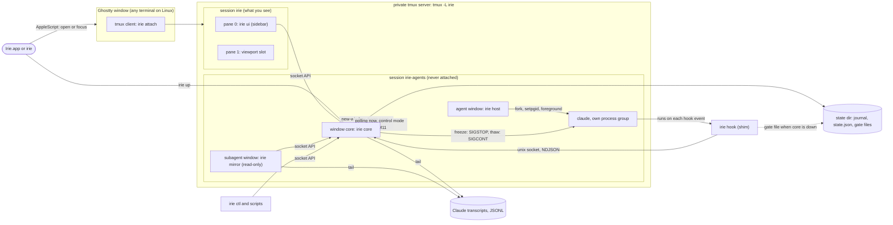

# Irie v1: design and implementation plan

Date: 2026-10-26. Status: v1 plan. Read with [AGENTS.md](../AGENTS.md). Every source is listed in [PROVENANCE.md](../PROVENANCE.md).

Irie runs coding agents from any supplier, cloud or local, side by side in one calm view: a narrow sidebar on the left and the selected agent's live terminal on the right. v1 does this end to end for Claude Code and gives fine control over every agent. You can see who needs you, pause an orchestrator or one of its subagents at its next tool call, freeze a session instantly, raise a task's priority on the fly, and undo what you did. The seams for every other harness also ship in v1: adapters, a normalised event envelope and a socket API.

**Glossary.**
- **Session:** one agent conversation in its own tmux window. It has an orchestrator (the main agent) and any subagents the orchestrator starts.
- **Tool boundary:** the moment just before a tool call runs, or just after one finishes.
- **Hold:** a hook that does not answer until the user releases it.
- **Freeze:** SIGSTOP of a session's whole process tree.
- **Slot:** the right-hand pane where an agent's live terminal is swapped in.
- **Mirror:** a read-only pane that shows one subagent.
- **Profile:** a named launch recipe (harness, model, effort, permission mode, args, env).
- **Context note:** text that Irie puts in front of an agent at a tool boundary or prompt.

---

## 1. Goal and non-goals

### 1.1 Requests and where v1 answers them

| Request | v1 answer | Where |
|---|---|---|
| Sidebar with inner scrolling, header pinned at the top, command bar pinned at the bottom | Bubble Tea sidebar in which only the list scrolls (keys and mouse wheel) | §4.1, M1 |
| Collapsible park section | A "Parked" group at the end of the list, folded until you open it, so a parked session goes out of sight at once. Folded, it shows its size and how many of its sessions need you. A parked session is out of the way: it leaves the *to verify* count. A park is undone like any step, and in the Mac app a card parked from under the pointer stays put until the pointer leaves it, so a second click takes it back ([park.md](proposals/park.md)) | §4.1, §4.5, M4 |
| Fine-grained pause of orchestrators and their subagents | Hold one agent (the orchestrator or one subagent) or a whole tree at its next tool call; freeze a session's process tree instantly | §4.3, M5, M6, M8 |
| "Context aware" | v1 reading: whatever Irie does to an agent (hold, freeze, priority, a note from you) reaches it as a context note at its next tool boundary or prompt, including how long it was held. Awareness of sibling agents and context-window gauges come after v1 | §4.3, M5–M7 |
| Reliable headless spawning | Every spawn either becomes a live agent holding its full task, or fails loudly with the reason. Works with no window open (`irie ctl spawn`) | §4.2, M1–M3 |
| Undo/redo | An action log with inverses. The header shows what undo and redo will do | §4.5, M4–M7 |
| Priority for tasks that become urgent on the fly | Badge, move to the top, its process tree gets the machine first, steering note | §4.3, M7 |
| Put a session where you want it in the list | Drag it, in either sidebar. The core keeps one order, which survives restarts | §4.1 |
| Default agent: Opus 5.5 on max effort in auto mode | `+claude`: `claude-opus-5-5`, `--effort max`, `--permission-mode auto`. It was the default profile until M10; since then the default is `auto`, which sends hard work and orchestration to `+claude` (§6.4). Every value can be changed in config | §5.5, M1, M10 |
| Sessions waiting on you in red; rename; jump | States derived from hooks; keys `r`, `/` and `1`–`9` | §4.1, M2, M4 |
| A live read-only pane for each running subagent | One mirror pane per subagent, listed under its parent | §4.4, M8 |
| Irie.app | Opens or focuses the one Irie window in Ghostty; has an icon; found by Spotlight | §7, M9 |
| See every Claude Code session on the machine, and bring one in | An "Outside Irie" group with live busy and idle; "Move into Irie" carries an idle session on in an Irie pane, on request only | §4.6 |
| Fewer tokens through local and free models that Irie sets up, in the spawn list with their cost, weighing the machine's memory | Built-in `+sonnet` and `+local`; Irie's own Ollama server; `irie setup local`; what each profile costs in the `+` list; sessions' cost and memory in the sidebar; a memory check before a model loads | §6.1, §6.3, M10 |
| Route each task by cost, normalised by accuracy; keep orchestration on Opus; delegate to local; fail over at usage limits; set up local models from the sidebar | `+auto`, the default: the lowest cost per success among profiles accurate enough for the task's class, learning from ratings and re-runs; `irie ctl delegate`; failover; `:setup`, `:models`, `:rate`, `:route` | §6.4, M10 |
| A jot dog that watches the jots and sees each through | When a jot's turn ends with work not committed, or not yet in its repo's land branch (such as `live`), the dog sends its agent back to finish once, then its row says what is left until the work lands; `irie ctl dog` lists every jot that is not through | §4.8 |
| A trod bot that keeps orchestrators going at night until their tasks are through, set up with your own rules and guidelines, and never over the week's allotment | While you are away at night (its hours, and a Mac with no input), an agent that asks you something is told to decide itself; a turn an API error stopped, a jot that is not through and a session a usage limit stopped are sent on; the Mac stays awake while there is work; past `trod.max_plan_use` it sends nothing on, and freezes what would spend past the week's cap. Every note carries `trod.rules` and `trod.guidelines`; `irie ctl trod` says what it did | §4.10 |

### 1.2 Not in v1

| Not in v1 | Why |
|---|---|
| Ghostty native splits or tabs as the engine | Agents would die when Ghostty quits, and scripting cannot move a live terminal or read its screen. tmux keeps agents alive with no window open and can swap, capture and steer panes. |
| Embedding libghostty | It would mean rewriting Irie as a native app, and it is macOS-only. The UI already talks to the core over a socket (§2.4), so a native front-end can come later without touching the core. |
| Full adapters for harnesses other than Claude Code | In v1 they run in the generic tier: launch, freeze, alive/exited, typed notes. Full adapters follow v1 (§3.2). |
| Budgets beyond the plan's windows, cross-model review | These need usage oracles and adapters for other suppliers. v1 routes by cost per success (§6.4) on profiles with what each costs, the plan's use from the status line, the local preflight with its memory check, and the event envelope (§6.2, §6.3). |
| Cost tracking via OpenTelemetry; driving agents over ACP | After v1. Cost comes from Claude Code's status line instead (§6.3), and the event envelope maps onto both. |
| Editing the user's agent config files | Hooks, settings and env are injected per launch, so there is nothing to clean up. |
| Screen-scraping state detectors | They break whenever a vendor changes its UI. Irie reads hooks first; its only screen read is the screen tail it shows when a spawn stalls. |
| Deleting worktrees or branches | Risk of data loss. v1 creates worktrees and never removes them. |
| Windows | Irie needs tmux and POSIX signals. Linux works through plain `irie`. |

### 1.3 After v1, in order

1. Harness adapters: Codex CLI first, then opencode, Gemini CLI and pi, then goose, hermes-agent, Amp and crush (§3.2).
2. Routing, and agents working in tandem (§6.2).
3. Pop an agent out into its own native Ghostty tab (§7.4).
4. Sibling awareness (which agents work in the same repo, and on which branches), context-window gauges, and a focus mode (prioritise one session and pause the rest at their next tool call).
5. Cost for harnesses other than Claude Code, `irie gc` for old worktrees, and desktop notifications when a session turns red.

---

## 2. Architecture

### 2.1 Principles

1. **tmux is the engine.** It keeps agents alive with no window open, swaps panes into view, reports process facts and carries typed input. Ghostty is the window around it.
2. **One writer.** `irie core` owns all state and every rule, and is the only process that drives tmux. The sidebar, the Mac app, `irie ctl`, the hook shim, the subagent mirrors and any other front-end are all clients of its socket API, which [CORE.md](CORE.md) describes for whoever writes one: irie-core. A client keeps no rules of its own, not even what the words in its task bar mean (`input`).
3. **State is derived, not stored.** The core records facts in an append-only journal and computes each row's state from them.
4. **Inject, never edit.** Hooks, settings and env go in per launch, through `--settings`, argv and env. User config files are not touched.
5. **Fail open, except for a pause.** If Irie is down, hooks return at once and agents keep working. An agent the user paused stays held through its gate file.
6. **Restart without disturbing.** A hard requirement: restarting or replacing any part of Irie (the core, the sidebar, the placeholder, Irie.app, an install) never stops, restarts or signals an agent or any process an agent started. Only the user's own close, pause, freeze, promote or move acts on an agent. `tools/live.sh` checks every agent's process after an install and fails loudly if one changed.

### 2.2 Processes



| Process | Runs in | Role | Talks to |
|---|---|---|---|
| `irie` | the user's terminal, or Irie.app | Runs `irie up`, then opens or focuses the Irie window in Ghostty (macOS, from M9) or attaches in the current terminal | tmux, `osascript` |
| `irie up` | any terminal | Idempotent. Starts the server and the core if the socket does not answer `hello`, and waits up to 5 s for it. If the running core or UI is a different version, respawns those panes (`respawn-pane -k`); agents are untouched | tmux, socket |
| `irie attach` | any terminal | `exec tmux -L irie attach -t irie`. Inside another tmux it refuses unless given `--nested`. Inside Irie's own server it runs `switch-client` | tmux |
| `irie core --supervise` | `irie-agents:core` | Holds `core.lock` (flock). Owns the registry, state derivation, gates, notes, undo log, journal, worktrees, spawning, the swap-in and observation, and runs the freeze dog, which restarts a frozen Irie.app (§2.4). The supervisor restarts it with backoff (1, 2, 4 … 30 s) | socket (server), tmux, hosts (signals), transcripts |
| `irie ui --supervise` | `irie:0.0` | The sidebar, a pure client of the socket. It never calls tmux | socket |
| `irie host --spec <file>` | the first process of every agent pane | Owns the agent's process group; continues stops it did not cause, but leaves a frozen agent stopped; says who it is in `host.json`; records the exit status | the agent (fork/exec), socket (best effort) |
| `irie hook` | started by the agent for each hook event | Forwards the event, waits while held, prints the harness's reply | socket, gate file |
| `irie statusline` | started by Claude Code for each status line update (§6.3) | Forwards the session's cost, context and plan use, then runs the user's own status line | socket |
| `irie team-tmux` | the `tmux` an agent with agent teams finds first on its PATH (§2.3) | Takes Claude Code's teammate panes to the team server, a tmux session each; sends every other tmux call where it would go without Irie | tmux (exec) |
| `irie remote serve --supervise` | `irie-agents:irie-remote`, while `remote.on` ([PHONE.md](PHONE.md)) | The phone app's gateway: HTTPS on the local network, a client of the socket that relays a phone's ops and subscriptions. The core starts it, and starts it again after an install or a change of its settings | the core (socket), phones (HTTPS) |
| `irie runtime -- ollama serve` | `irie-agents:irie-ollama`, started on first need (§6.3) | Irie's own Ollama server, in a process group of its own, so its model runners stop with it | the agents (HTTP on 127.0.0.1) |
| `irie mirror` | subagent panes (M8) | Read-only live view of one subagent | socket, transcript |
| `irie ctl` | anywhere | Scripting and tests: `list`, `spawn`, `show`, `watch`, `pause`, and so on | socket |
| `irie placeholder` | the slot when nothing is shown | Shows the keys | none |

### 2.3 tmux layout and swap-in

| Object | Contents | Options |
|---|---|---|
| Server | `tmux -L irie -f $XDG_STATE_HOME/irie/tmux.conf`, generated by the core. The user's own tmux.conf is never read. The core runs every tmux command with `-u`: without a UTF-8 locale, as when Irie.app starts the server, tmux would print a tab, or any non-ASCII character of a name, as `_` | Socket name from `tmux.socket` |
| Session `irie`, window 0 | Pane 0: `irie ui --supervise`, `ui.sidebar_width` columns wide. Pane 1: the slot | `window-size latest` |
| Session `irie-agents` | Window `core`. One window per agent, each with a single pane running `irie host`. One window per subagent mirror (M8). Window `irie-ollama` for Irie's own Ollama server, once a local profile needs it (§6.3) | Agent windows use `window-size manual`, resized to the slot's size, and `remain-on-exit on` |
| Session `irie-view` | Only while the Mac app splits: a dead first pane, and the window of the session shown beside its teammates, linked from `irie-agents` and current (see Agent teams below) | That window takes `window-size latest`, so it follows the app's client of this session |
| Pane user options | `@irie_session`, `@irie_agent` (`main` or `sub:<id>`), `@irie_role` (`agent`, `mirror`, `placeholder` or `runtime`), `@irie_name`, `@irie_named`, `@irie_created`, `@irie_vendor_id` | These travel with the pane through swaps. A restarted core rebuilds its registry from them, and finds its Ollama server by `runtime`. `@irie_name` is the session's name, which `rename` and Claude Code's titles change (§4.2); `@irie_named` is `1` when the user chose it, else `0`. The agent's window keeps the name it was born with, since nothing reads it |

Generated tmux.conf, essentials:

| Setting | Reason |
|---|---|
| `status off`, `prefix None` | The sidebar is the status line, and there are no stray tmux commands |
| `bind -n C-] if -F '#{==:#{pane_index},0}' 'select-pane -t irie:0.1' 'select-pane -t irie:0.0'` | Focus toggle between sidebar and slot (`ui.focus_key`) |
| `mouse on` | Click to focus, wheel to scroll |
| `base-index 0`, `pane-base-index 0` | `irie:0.0` is always the sidebar and `irie:0.1` always the slot |
| `remain-on-exit on`, `history-limit 50000` | A dead agent keeps its exit status and last screen |
| `allow-passthrough on`, `focus-events on`, `extended-keys on`, `terminal-features 'xterm*:extkeys'` | What Claude Code's terminal docs ask for (Shift+Enter, progress) |
| `set-titles on`, `set-titles-string Irie` | Sets the Ghostty window title, which is used to find the window (§7.1) |
| `escape-time 10` | Esc reaches agents promptly |
| `set-hook -g window-resized "if -F -t irie:0.1 '#{window_zoomed_flag}' '' 'resize-pane -t irie:0.0 -x <width>'"` | Keeps the sidebar's width when a client resizes `irie:0`. The hook fires for every window, an agent's too, so it asks `irie:0` whether it is zoomed: resizing the sidebar would end the Mac app's zoom |

**Swap-in.** The slot holds either the placeholder P or one agent pane A. P also draws the conversation of the session you picked, so in the conversation view a shown session's own pane stays home and P stays in the slot (§4.7). While A is shown, A's own window holds P. To show B, the core sends one command list, so no client ever draws the in-between state:

```
swap-pane -d -s irie:0.1 -t <P>     # only if an agent A is shown: A goes home, P returns to the slot
swap-pane -d -s <B> -t irie:0.1     # B moves into the slot, P into B's window
select-pane -t irie:0.1             # only when the user asked for focus
```

On every tick the core checks these invariants and repairs any it finds broken:
- `irie:0` has exactly two panes, and pane 0 is the sidebar.
- The slot holds P or exactly one agent or mirror pane.
- Every agent pane is either in the slot or in its own window.
- The slot is zoomed exactly while the Mac app is open ([MAC.md](MAC.md)), and swaps keep the zoom.
- The sidebar is `ui.sidebar_width` wide, except while the slot is zoomed.
- While the Mac app splits a session, its pane is out of the slot, and `irie-view` holds its window and no other agent's, current and at `window-size latest`. With no split there is no `irie-view`.
- Every agent window but the split one has the slot's size, so a swap never resizes an agent: no SIGWINCH and no redraw jump.

The core never kills a pane while it is in the slot; it swaps the pane home first.

**Agent teams.** With `spawn.teammates = "panes"`, Claude Code sessions may start agent teams, whose teammates are Claude Code sessions of their own, each in a terminal pane (`teammateMode: "tmux"`). They run on the team server, `tmux -L irie-teams` with its own generated `tmux-teams.conf`, never on Irie's: a teammate's pane is not Irie's to place, and no agent of Irie's is resized for it.

| Object | Contents |
|---|---|
| Anchor | Per session, a tmux session named after it whose one pane is dead (`true` under `remain-on-exit on`). The agent starts with `TMUX` naming the team server and `TMUX_PANE` the anchor, so Claude Code takes the anchor for its own pane |
| Shim | `sessions/<id>/bin/tmux`, first on the agent's `PATH` (spec `path`), runs `irie team-tmux`. Claude Code's calls on the team server (`-S` its socket) go on, but `split-window` makes a new session `<id>-<n>`, detached, with the environment in `sessions/<id>/team.env`, and `list-panes` of the anchor's window lists the anchor and its teammates, as if they shared it. Claude Code's questions about its terminal (`display-message` on its pane, `show-options`) go there too. Any other call, such as the agent's own use of tmux, goes where it would without Irie: `TMUX` and `TMUX_PANE` are taken out |
| Teammate | One tmux session each, which a view shows by attaching to it. Its environment is the agent's without `IRIE_SESSION`, `TMUX` and `TMUX_PANE`, and with `IRIE_TEAM_OF` naming the session. So the hooks and status line it inherits through `--settings` never speak for its session; they only hold its tool calls while the session is frozen (§4.3). tmux continues a pane's first process whenever it stops, and a teammate's pane has no host, so that hold is how a teammate pauses. The team server itself starts with only what tmux and a login need (`HOME`, `PATH`, `LANG` and the like) |
| Row | `team`: each teammate's session, name, colour and agent type (from its command line), title and whether it works (from Claude Code's spinner in it), and whether it is dead |
| End | The core never stops the team server, so a restart leaves every teammate running. Once a session is gone, its anchor and teammates' sessions go, which ends them; Claude Code itself kills its teammates' panes when it exits |

The Mac app shows a session that has teammates beside them in its terminal view, as cmux shows a team: the session's terminal on the left and its teammates' in a column on the right, one under another at equal heights, each a live terminal you click into and type to ([MAC.md](MAC.md)). The session's own terminal there is a second client of Irie's server, attached to `irie-view` (`show` with `split`), so only that agent takes the split's size. The slot meanwhile shows the session's conversation, and every other agent keeps the slot's size.

### 2.4 Socket API

The socket is a unix stream socket at `<runtime>/irie/core.sock`, mode 0600, in a 0700 directory. The core has no TCP listener; the phone app reaches it through its own gateway, `irie remote serve`, a client of this socket that lets a phone use only a phone's ops ([PHONE.md](PHONE.md)). Messages are NDJSON, one object per line:
- Request: `{"id":1,"op":"spawn","args":{…}}`.
- Reply: `{"id":1,"ok":true,"result":{…}}` or `{"id":1,"ok":false,"error":{"code":"…","msg":"…"}}`.
- `subscribe` replies once, then streams frames until the client closes:
  - `{"t":"snapshot","sessions":[…],"header":{…}}`
  - `{"t":"upsert","session":{…}}` and `{"t":"remove","id":"…"}`
  - `{"t":"history","undo":"…","redo":"…"}`: the labels of what `undo` and `redo` would do next, empty when nothing (§4.5), after the first snapshot and whenever they change. A subscription to one session gets none.
  - `{"t":"header","header":{…}}` when the plan's use, the machine's memory (§6.3) or how busy it is changes. A snapshot carries the header too. `load` is how busy the machine is: its CPUs, the work waiting to run over the last minute (to the half), the kernel's memory pressure (1, 2 or 4) and the ptys in use of the most there can be, read every 5 s. A core advertises it to the cores it is paired with ([multi-host](proposals/multi-host.md) §4.2). The header also says `red_on_done` when `ui.red_on_done` is set, so every sidebar draws done in red (§5.3).
  - `{"t":"event","event":{…}}`, sent only when `events:true` was requested.
  - `{"t":"outside","outside":[…],"problem":"…"}`: the Claude Code sessions outside Irie (§4.6), after the first snapshot and whenever they or the problem change. A subscription to one session gets none.
  - `{"t":"closed","closed":[…]}`: the closed sessions that `reopen` can bring back, the last closed first (§4.5), after the first snapshot and whenever they change. A subscription to one session gets none.
  - `{"t":"conversation","conversation":{…}}`, sent only when `conversation:true` was requested for one session: its whole conversation first (`reset`), then the items that changed and what it waits on you for (§4.7).
  - `{"t":"ping","ping":N}`: the freeze dog's ping, the only frame of a `view: "watch"` subscription (below).
- Frames to the UI are coalesced to at most 10 per second.
- **The freeze dog.** A window of Irie's own, such as the Mac app, asks to be watched with `subscribe`, `view: "watch"`, its `pid` and, for the Mac app, its `bundle`, on a connection of its own. The core pings it once a second, one ping at a time, and the window answers each on the same connection from its main loop, `{"pong":N,"front":…,"hidden":…}`: whether its app is the active one, and whether it is hidden. A ping left unanswered for `ui.freeze_dog` (10 s) means the window no longer answers its user. The core then has `sample` write down where the process is stuck, in a report in `<state>/freezes/` (the newest ten are kept); force quits it with SIGKILL once the stacks are read, about 1.3 s later; waits for it to go; and opens the bundle again as it stood, with `/usr/bin/open`, `open -g` or `open -j` and the arguments `--freeze-dog <seconds>`, which the app says in a notice, and `--background` when it was not in front. Agents are untouched (§2.1, principle 6). The dog's clock waits while the core itself is held up, since a late look restarts every unanswered ping's time; a process under a debugger is left be; and the dog restarts windows three times in ten minutes at most, so an app that freezes as it opens is not opened again and again. The dog has a lock of its own, so a busy core never holds a ping or an answer up. `hello` lists `watch` when the core has the dog.
- The API version is `1`. Additions keep backwards compatibility.

| Op | Args | Result | From |
|---|---|---|---|
| `hello` | `client`, `api` | `version`, `api`, `features[]`, which name the ops served, `move` among them | M1 |
| `list` | none | `sessions[]`, `outside[]`, `outside_problem?` | M1 (`outside`: §4.6) |
| `subscribe` | `events?`, `session?`, `agent?`, `view?`, `conversation?`, `pid?`, `bundle?` | frames (above). `view: "app"` is the Mac app: the slot stays zoomed while it is subscribed. `view: "watch"`, with `pid` and `bundle`, asks the freeze dog to watch a window (above). `conversation` needs `session`; with `agent: "sub:<id>"` it follows that helper's own conversation (§4.4) | M1 (`view`: Mac app; `conversation`: §4.7; `watch`: the freeze dog) |
| `spawn` | `task`, `cwd?`, `repo?`, `in_place?`, `profile?` (`auto` routes it), `name?` (the user's, §4.2), `force?`, `delegate?`, `parent?`, `permission_mode?`, `continues?`, `jot?` (typed in a task bar: it may add to the jot before), `apart?` (a session a jot was added to, to take it back from and start it apart) | `session`; for a jot added to the one before, `added`, the session it went to and `until`, when it is typed; for `apart`, `late` when that agent had it already | M1 (`repo`, `profile` M3; `force`, `delegate`, `parent`, `permission_mode`, `continues` M10; `jot`, `apart`: "More for the last jot", §4.2) |
| `input` | `text`, as typed; `session?`, the selected session; `outside?`, the selected session outside Irie; `repo?`, `in_place?`, `profile?`, `model?`, the client's menus; `pastes[]?`, each `label` and `text`; `apart?`, a session a jot was added to, to start it apart instead | `did`: `spawned`, `added` (a jot that went to the agent of the jot before, §4.2), `answered`, `ran` or `asked`; `op`, the op it ran; `text`, to show as it is; `session?`; `show?`; `choice?`, as `undo`'s; `until?`, for `added`, when it is typed in. Reads what a person typed, a task, a status question or a `:` command, and runs the op it means through this table (§4.2, [CORE.md](CORE.md) §3) | irie-core |
| `show` | `session`, `agent?`, `focus` | none | M1 |
| `complete` | `text`, an `@` or `+` token | `items[]`; for `+`, `notes[]`: what each profile runs and costs (§6.3) | M3 (`notes` M10) |
| `hook` | `harness`, `session`, `payload` | `context?`, `deny?`. Waits while the agent is held | M2 |
| `status` | `session`, `payload`: Claude Code's status line JSON | `state`, `subagents[]`: the session's, for Irie's own status line; `color?`, the session's own colour while it works | M10 (§6.3) |
| `theme` | `theme`: one of `ui.theme`'s palettes | none. The Mac app's palette, which `color` follows from then on instead of `ui.theme` | §6.3 |
| `local` | `start?` | the local server, the machine's memory, and each model weighed against it | M10 (§6.3) |
| `route` | `task`, `parent?` | where `+auto` would run it: class, choice, reason, every profile weighed | M10 (§6.4) |
| `rate` | `session`, `verdict`: `good` or `bad` | none | M10 (§6.4) |
| `result` | `session` | `text`: what its agent said at the end of its last turn | M10 (§6.4) |
| `tool` | `name`: `setup` or `models` | `session`, running `irie setup local` or `irie ctl local` | M10 (§6.4) |
| `rename` | `session`, `name` | `session`, with the name it got: whitespace and control characters made single spaces, cut at 200 bytes, numbered (`-2`) when another row has it. The name is then the user's, which Claude Code's titles leave be (§4.2). Refuses an empty name with `bad_args`. Records `ui.renamed` when the name changed | M4 |
| `park`, `unpark` | `session` | none. Park puts the session in the Parked group at the end of the list and leaves its place in the order, so `unpark` brings it back there; each row says `parked`. When it changed, it records `ui.parked` or `ui.unparked` and a step of the history, which `undo` takes back (§4.5) | M4 (§4.1) |
| `close`, `reopen` | `session`; for `reopen` it may be left out, which reopens the session closed last | none; `reopen`: `session` | M4 (§4.5) |
| `undo`, `redo` | none; to answer a question, `choice_id` and `choice` (its option's key) | `label`, `did`: `undone`, `redone`, `settled`, `skipped`, `cancelled` or `asked`; when `asked`, `choice`: `id`, `question`, `options[]` (`key`, `label`, `detail`, `recommended?`). Nothing to do is `not_found`; an answer to a question that no longer fits the history's head is `stale` (§4.5) | M4 |
| `pause`, `resume` | `session` or `all`; `scope`: `main`, `sub:<id>` or `tree` | none | M5 |
| `freeze`, `thaw` | `session` or `all` | `sessions[]`, those it froze or thawed | M6 |
| `priority` | `session`, `level` (0 or 1), `reason?` | none. Level 1 also puts the session at the top of the list | M7 |
| `reorder` | `session`, `before?` | none. Puts the session just before `before`, or last. Not `move`, which brings a session in from outside Irie | §4.1 |
| `note` | `session`, `agent?`, `text` | `note` | M7 |
| `preflight` | `profile`, `model?`, `remember?`, `force?` | `ok`, `problems[]`, `warnings[]`, the context and memory the model got | M10 |
| `attach-info` | none | tmux binary, server socket and the session that holds the slot, for a terminal outside Irie | Mac app ([MAC.md](MAC.md)); per-session targets after v1 |
| `move` | `vendor_id`, `profile?` | `session`. Refuses with `busy` unless the session is listed outside Irie and idle. A local profile is checked as for a spawn (§6.1) before the outside copy ends | Sessions outside Irie (§4.6) |
| `dog` | none | `jots[]`: the jots that are not through, each with its `loose` (below), looked at afresh: the open ones in the list's order, then those that closed on their own (`spawn.close_when_done`) in the last day as `closed`; a jot you closed is done and never listed | The jot dog (§4.8) |
| `config` | `set[]?`, each a `key`, dotted as in the file (`spawn.default_profile`), and a `value` of the type the key takes: a duration as a string such as `"30s"`, and null to take the key out, so its default applies | `path`, `config`: every key in effect, defaults too, by the file's names, and `problem?`: why the file would not load as it stands. With `set` it first edits the file in place and runs on the result (§5.5); what would not load is refused with `bad_args` and changes nothing | The Mac app's Settings window ([MAC.md](MAC.md)) |
| `flip` | none | `terminal`: flips the slot between the picked session's conversation and its raw terminal, and focuses the slot (§4.7) | Conversation view (§4.7) |
| `conversation` | `session`, `agent?`, `limit?` | `session`, `agent?`, `transcript?`, `items[]`, `needs?`, `pending[]`, `more?`: the session's conversation, read from its Claude Code transcript (§4.7), or with `agent: "sub:<id>"` that helper's, read from its own (§4.4) | Conversation view (§4.7) |
| `send` | `session`, `text` | none. Types the text to the agent as a person would; refuses with `busy` while it waits on you in its terminal, before it is ready, once it has ended, and a message of several lines while the agent takes no bracketed paste (§4.7) | Conversation view (§4.7) |
| `screen` | `session` | `lines[]`: what its terminal shows now, as plain text, without the blank lines under the last; `options[]`, each `key`, `label` and `selected`: while it waits on you, the numbered choices of the prompt at the bottom, as Claude Code draws a permission, a question or a plan, and none otherwise | The phone app ([PHONE.md](PHONE.md)) |
| `keys` | `session`, `keys[]`, `text?` | none. Presses each key in its terminal, a letter or digit or one of Enter, Escape, Up, Down, Left, Right, Tab, BTab, Space, BSpace, PageUp, PageDown, Home and End, never Ctrl+C, then types `text`, with no control character, without Enter. Takes its turn with `send`; refuses with `busy` once the session has ended or while it is frozen | The phone app ([PHONE.md](PHONE.md)) |
| `pair` | `minutes?`, 10 by default, a week at most | `on`, `name`, `urls[]`, `code`, `until`: opens a six-digit code that pairs a phone with this machine, as `irie remote pair` does, and the setup page's addresses, the Bonjour name first. The gateway takes the code from the state folder; a phone can't open one | The Mac app ([PHONE.md](PHONE.md)) |
| `peers` | `reload?` | `name`, this machine's, and `peers[]`, each `name`, `url`, `up`, `since`, `problem?`, `version?`, `sessions`, `load?`, `memory?`: the other machines' cores this one is paired with, as it last heard from each; `reload` first reads `peers.json` again, as `irie peer add` and `remove` ask (§2.8) | `irie peer` ([multi-host](proposals/multi-host.md)) |

### 2.5 Observation

| Rank | Source | Gives | Notes |
|---|---|---|---|
| 1 | Host and tmux | Alive or exited, exit code, frozen, pane sizes | Process truth. "Exited" and "frozen" override everything else |
| 2 | Hooks (via the shim) | Prompt submitted, tool calls, needs you, turn ended, subagents | The authoritative semantic signal |
| 3 | Transcripts (JSONL) | Catch-up after core downtime; subagent content | Tailing only |
| 4 | Timers | Startup stall (`spawn.ready_timeout`), shown with a `capture-pane` tail | The only screen read |

A hook event older than the last host or tmux fact cannot revive an exited session.

Until M11 the core polls `list-panes -a -F …` once per second for pane ids, options, `pane_pid`, `pane_dead`, `pane_dead_status` and sizes. M11 adds a control-mode client (`tmux -u -C attach -t irie -f ignore-size,no-output`) for push events and keeps a 10 s reconcile as the fallback.

### 2.6 Repository layout

| Path | Contents | From |
|---|---|---|
| `cmd/irie/` | Entry point and subcommand dispatch | M1 |
| `core/` | irie-core's contract for Go clients: the wire types and op names, generated from `internal/ipc`, the socket's place, a client, and the language a person types (`Read`, `Said`) ([CORE.md](CORE.md)) | irie-core |
| `internal/paths/` | XDG and runtime dirs, socket path | M1 |
| `internal/config/` | TOML config, defaults, validation | M1 |
| `internal/tmux/` | Command runner, generated tmux.conf, layout, swap-in, sizes; `control/` from M11 | M1 |
| `internal/ipc/` | NDJSON framing, client, server | M1 |
| `internal/core/` | Registry, spawn, show, derived state, gates, notes, actions/undo, supervisor | M1 |
| `internal/host/` | Pane host: process group, freeze/thaw, exit status | M1 |
| `internal/harness/` | Adapter interface; `claude/` (M1), `generic/` (M3) | M1 |
| `internal/ui/` | Bubble Tea sidebar | M1 |
| `internal/event/`, `internal/journal/` | Envelope, kinds, NDJSON journal | M2 |
| `internal/hook/` | Shim logic | M2 |
| `internal/testutil/` | `BuildIrie`, tmux test server, `ShortDir`; `fakeagent/` from M2; `fakeollama/` and `ollamafake/` from M10 | M1–M2, M10 |
| `internal/repo/`, `internal/worktree/` | Repo lookup, worktrees | M3 |
| `internal/transcript/`, `internal/mirror/` | JSONL follower and parser, mirror view | M8 |
| `internal/ghostty/`, `internal/macapp/` | AppleScript driver, Irie.app bundle | M9 |
| `internal/loginenv/` | The login shell's environment, for a server the Mac app starts (§7.2) | §2.7 |
| `internal/ready/` | What a computer has of what Irie needs, and how to get the rest: `irie setup`, the first `irie`, the `ready` op | §2.7 |
| `tools/release.sh`, `site/install.sh` | A release's downloads, and the one-line installer | §2.7 |
| `tools/mkicon/` | Icon generator | M9 |
| `internal/localmodel/` | Ollama client, memory estimates and the machine's memory, preflight, setup suggestions, `irie runtime` | M10 |
| `internal/statusline/` | `irie statusline`: cost, context and plan use from Claude Code's status line | M10 |
| `e2e/` | Opt-in tests against the real Claude Code | M11 |

### 2.7 Install and first run

Getting from nothing to a first finished task takes one line in a terminal, or on a Mac one line and Spotlight, and no knowledge of what Irie needs: Irie says what is missing, in plain words, and offers each fix, which runs only after a yes.

```
curl -fsSL https://irie-people.github.io/irie/install.sh | sh
```

| Part | Design |
|---|---|
| Downloads | `tools/release.sh` builds them on a Mac: `irie` for darwin and linux on arm64 and amd64 (no cgo, `-trimpath`), each as `irie-<os>-<arch>.tar.gz` with LICENSE; Irie.app for Apple silicon and Intel as `Irie-macos.zip` (`IRIE_MAC_UNIVERSAL=1 mac/build.sh`: the Intel slice draws its terminals with SwiftTerm, since GhosttyKit builds for the Mac's own processor only, and `lipo` joins the two), its version stamped from the tag, with a universal `irie` inside in `Contents/Helpers` (not `MacOS`, where on a disk that ignores case `irie` and the app's own `Irie` would be one file), signed ad hoc from the inside out; and `SHA256SUMS`. The names carry no version, so `releases/latest/download/<name>` finds the latest without an API call. The release workflow's `downloads` job runs it on macos-15 when release-please publishes a release, and attaches the files to it; run by hand with a tag, it builds them again. A release made with `GITHUB_TOKEN` starts no other workflow, so the job lives in release-please's own |
| The installer | `site/install.sh`, served as `https://irie-people.github.io/irie/install.sh`. POSIX sh, with everything in `main`, so a download cut short runs nothing. It picks the download from `uname` (a shell under Rosetta counts as arm64), checks its SHA-256 against `SHA256SUMS` before anything moves, puts `irie` in `$XDG_DATA_HOME/irie/bin`, where `tools/live.sh` keeps it too, with one rename, so running processes keep their file, and links `~/.local/bin/irie` to it (an older plain file there becomes `irie.old`). On macOS 14 or later, the app's least, it replaces `~/Applications/Irie.app`, or `/Applications/Irie.app` when that is where it is and can be written, registers it with Launch Services and Spotlight, and reopens it only when that copy was open. curl marks no download for quarantine, so Gatekeeper never stops the unsigned app. When a release has no download for the system it builds with `go install …@<tag>`, given Go. Last it runs `irie setup` on `/dev/tty`, since its own input is curl's, or `irie setup --check` with no terminal. `IRIE_VERSION`, `IRIE_NO_APP`, `IRIE_NO_SETUP` and `IRIE_DOWNLOADS` (a mirror, and the tests) change it |
| `irie setup` | `internal/ready` checks five needs, in the order a newcomer meets them: tmux, 3.2 or later (the first with `-N`); Claude Code, the claude profile's command, where a version older than `MinVersion` warns; signed in, from `claude auth status --json`, of which only `loggedIn` and `authMethod` are read, since the rest names the person; git, where on a Mac `xcode-select -p` comes first, because macOS's own `/usr/bin/git` opens Apple's installer when the Command Line Tools are missing; and, from a terminal only, `irie` on the PATH. Each is ok, missing, warn or unknown. tmux, Claude Code and the sign-in block agents; git blocks only tasks in a repo. Each problem carries a fix: a command, run after a yes (Homebrew, or Homebrew's own installer and then Homebrew on a Mac without it; apt, dnf, yum, pacman, zypper or apk; Claude Code's official installer; `claude auth login`; `xcode-select --install`), or a line added once to the shell's startup file, after `# Added by irie setup`. `irie setup` offers the fixes in order and checks again after each, so installing Claude Code brings the offer to sign in. `--check` and `--json` change nothing, and exit 1 while something blocks |
| The first `irie` | When no core answers, outside tmux, `irie` runs the check first. With something missing it shows the list and, in a terminal, offers the fixes of what blocks. Only a missing tmux stops it: an agent on another profile may need nothing more. The check runs once a server start and takes about 0.3 s |
| The server's PATH | A new server gets `~/.local/bin` at the end of its PATH when that folder exists and the PATH lacks it (`ready.PathEnv`). The installers of Irie and of Claude Code put their programs there, and a terminal finds them only once a startup file says so, which `irie setup` offers. A running server keeps its environment |
| From the app | Opened with no Irie running, the app runs `irie up --login-env` (§7.2), once a launch and only before it has ever reached a core, so a core that restarts is left to the supervisor. It asks the core's `ready` op, the same check in the server's environment, which is the agents', every 4 s while something blocks. A fix runs as the `ready` tool: a session running `irie setup`, whose terminal the app shows ([MAC.md](MAC.md)) |
| A first task | Both sidebars offer `+haiku Write a haiku about my city. Ask me which city first.` with no sessions. It makes the agent ask before it works, so a newcomer sees a session start, ask and finish in about a minute, on Claude's quickest model, in a scratch folder of its own. The Mac app follows it with a card of steps, the walkthrough of [learning.md](proposals/learning.md) §5.1 in brief |
| Not yet | A signed and notarized app, and so a direct download of it that opens without a warning; Ghostty in the Intel slice; a Homebrew tap; and a tmux of Irie's own for a Mac without Homebrew, which needs a terminfo of its own, as macOS's lacks `tmux-256color` |

---

### 2.8 Peers: Irie on more than one machine

A core can be paired with another machine's, which then is its peer ([multi-host](proposals/multi-host.md)). `irie peer add` pairs through that machine's phone gateway ([PHONE.md](PHONE.md)) as a phone does, with a pairing link that `irie remote pair --link` prints there, and keeps the token and the fingerprint of its Irie authority in `peers.json` (mode 0600), so the core trusts no other certificate for it. The core then follows the peer's sessions over HTTPS and shows them after its own, each as a row of its own: `host` names the machine, and its id is the machine's name, a slash and that core's own id (`Asahi/s38…`). A client sends that id back as it is, and the core passes the call on: `send`, `close`, `rename`, `park`, `unpark`, `priority`, `freeze`, `thaw`, `rate`, `result`, `screen`, `keys` and `conversation`, and a subscription to that session. `reorder` refuses, since a peer's rows keep that machine's order. `show` picks the row and the slot draws its conversation, since its terminal is on its own machine. `^name` among the first line's words starts the task on that machine, which reads its own `@` and `+` words; `^` and a word that names no machine stay in the task as typed.

The peer's sessions run on under its own core whatever happens to this one. When its stream ends, or brings nothing for 40 s (its gateway pings every 15 s), its rows stay with `host_down`, the time it went, and calls about them say `peer_down`. The core follows it again after 1, 2, 4 … 30 s. A phone hears none of the peers' rows: it pairs with each machine itself.

## 3. Harness support

### 3.1 Support levels

| Level | What works | What the harness must offer |
|---|---|---|
| **G**, generic | Launch in a pane host, freeze and thaw, alive/exited, notes typed in with bracketed paste and Enter | A command line |
| **O**, observed | Working, needs you (red) and done, from the harness's own events | Hooks, a plugin or an event stream that maps to the envelope |
| **H**, held | Pause at the next tool call; context notes at tool boundaries | A pre-tool hook that can wait and can inject text |
| **S**, subagents | A live read-only pane per subagent; per-subagent pause and notes | Subagent events with an id, plus a readable subagent transcript |

### 3.2 Capability matrix

In the Freeze column, "host" means `irie host` sends SIGSTOP to the agent's process tree. Ctrl+Z is never used: it is unreliable in Claude Code and undocumented for several others.

| Harness | Launch: model, and per-launch hook injection | Observe | Hold at the next tool call | Steer | Freeze | Subagents | Irie |
|---|---|---|---|---|---|---|---|
| Claude Code | `--model`, `--effort`, `--permission-mode`; `--settings <file>` | 33 hook events (command handler), JSONL transcript | PreToolUse and PostToolUse. The default 600 s timeout lets the call through; Irie sets `timeout` and `onFailure: "block"` (2.1.295+) | Hook `additionalContext`. Keys: Enter queues for the next tool boundary, Ctrl+X Ctrl+S sends now | host | SubagentStart/Stop; `agent_id` on tool hooks; `subagents/agent-<id>.jsonl` | **v1: G O H S** |
| Codex CLI | `-m`, `-c k=v`; hooks via `CODEX_HOME` or `-c`, behind a trust gate (`--dangerously-bypass-hook-trust` or pre-trust) | 12 hook events, rollout JSONL, OTel | PreToolUse, 600 s. Timeout outcome undocumented | Hook context. Enter injects; `codex queue`; app-server `turn/steer` | host | Child rollouts with `parent_thread_id`; SubagentStart/Stop | G now; full adapter first after v1 |
| Gemini CLI | `-m`; settings only via env (`GEMINI_CLI_SYSTEM_SETTINGS_PATH`) | 11 hook events, JSONL, OTel | BeforeTool. 60 s timeout, then the call goes through; raise `timeout` | Steering behind an experimental flag; Tab queues | host | `chats/<parent>/<sub>.jsonl`; no hook events | G; second wave |
| opencode | `-m provider/model`; `OPENCODE_CONFIG_CONTENT` | Plugin bus, `opencode serve` SSE, SQLite | Plugin `tool.execute.before`, awaited, no timeout | Queue or abort only | host | SQLite `parent_id` | G; second wave |
| pi | `--provider`, `--model`; `-e <extension>` | Extension events, JSONL | `tool_call`, awaited | RPC `steer`; Enter steers | host | None built in | G; second wave |
| goose | `--provider`, `--model`; project plugin dir | Plugin hooks, SQLite, OTel | PreToolUse. 30 s timeout, then the call goes through (`on_failure` from 1.49) | Not documented | host | `parent_session_id` | G; third wave |
| hermes-agent | `-m`, `--provider`; `-p <profile>` or `HERMES_HOME` | Shell and plugin hooks, SQLite | `pre_tool_call`, which blocks the call on timeout (fails closed) | `/steer`; `session.steer` | host | Delegation logs, hooks | G; third wave |
| Amp | Modes, no model flag; project plugin dir | Plugins, `--stream-json` | `tool.call` plugin; timeout undocumented | Enter steers; `steer` flag | host | Server-side | G; third wave |
| crush | `-m`; project config | PreToolUse only; SQLite | PreToolUse. 30 s timeout, then the call goes through; top-level agent only | Not documented | host | `parent_session_id` | G; third wave. Its licence is FSL: run it, never copy its code |
| aider | `--model` | None (a notifications command, a history file) | Not possible | Ctrl-C, then type | host | None | G only |
| Any other CLI | Profile `command` and `args` | tmux only | None | Paste and Enter | host | None | G |

Every hook-capable harness except pi lets a held call through when its hook times out. Irie therefore sets each per-hook timeout above `hold.max`, and blocks on failure wherever the harness allows it. Those switches are Claude Code's `onFailure: "block"`, OpenHarness's `block_on_failure` and hermes-agent's `fail_closed`.

### 3.3 Claude Code adapter (v1)

**Launch.** Default profile:

```
claude --model claude-opus-5-5 --effort max --permission-mode auto \
       --settings <state>/sessions/<id>/claude-settings.json \
       --session-id <uuid> [--name <name>] "<task>"
```

| Item | Rule |
|---|---|
| Task argument | Passed inline when it is at most 100 KiB, which keeps it under Linux's 128 KiB per-argument limit and macOS's 1 MiB total. Otherwise the argument is: `Your full task is in <path>/task.md. Read all of it before doing anything else.` A task that begins with `-` gets a leading space |
| Session id | Pre-assigned with `--session-id` (a v4 UUID), so Irie knows the vendor id before any hook fires and can reopen the session |
| Name | `--name` only with a name the user chose (§4.2). Without it Claude Code titles the session from its first prompt, with its small fast model, and writes each title to the transcript as an `ai-title` line, which the row's name follows. With it Claude Code writes `custom-title` and `agent-name` lines and no titles |
| Reopen (undo of close) | `claude --resume <uuid>` with the same model, effort, mode and settings flags, in the same cwd |
| Resume (move into Irie, §4.6) | `claude <profile flags> --settings <file> --resume <uuid>`: no `--session-id`, since a resumed session keeps its id, and no task, since it waits for input. `--name` is left out; the conversation keeps its own |
| Env | Adds `IRIE_SESSION`, `IRIE_SOCKET` and `IRIE_BIN`. Removes `TMUX` and `TMUX_PANE` (`spawn.hide_tmux`), so an agent's own `tmux` commands cannot reach Irie's server. With agent teams (`spawn.teammates = "panes"`, §2.3) `TMUX` and `TMUX_PANE` name the session's anchor on the team server instead, the tmux shim's dir goes first on `PATH`, and `CLAUDE_CODE_EXPERIMENTAL_AGENT_TEAMS=1` is set, unless the profile sets it; a `0` in the user's own settings still turns teams off. Removes the inherited variables that tie a process to another Claude Code session or terminal pane (§4.6), unless the profile sets them. A local profile also gets the environment that points Claude Code at its model (§6.1), under the profile's own `env` |
| Versions | `claude --version` must be 2.1.295 or later for `onFailure`. Older versions still spawn, but pause is disabled for that session and the row says why. Optional flags (`--name`) are detected from `claude --help` once per version; an unsupported optional flag is dropped with a warning. Required values (model, effort, permission mode) are never dropped: if the CLI rejects one, the spawn fails visibly |
| `--settings` | From M2. The settings file adds hooks for this session only. Claude Code merges hook lists, so the user's own hooks still run. With `usage.status_line` it also sets `statusLine` to `irie statusline`; that key does not merge, so Irie's runs the user's own (§6.3). With agent teams it sets `teammateMode` to `tmux`. Claude Code passes the file on to split-pane teammates |

**Hooks in `claude-settings.json`.** Every hook uses `{"type":"command","command":"<IRIE_BIN> hook"}`.

| Event | Matcher | Timeout | `onFailure` | Irie use |
|---|---|---|---|---|
| SessionStart | none | 10 s | none | Started; transcript path; queued notes |
| UserPromptSubmit | none | 10 s | none | Working; notes for an idle agent |
| PreToolUse | `*` | `hold.max` + 120 s | `block` | Tool started; hold; AskUserQuestion and ExitPlanMode mean "needs you"; notes |
| PostToolUse, PostToolUseFailure | `*` | `hold.max` + 120 s | none | Tool finished; hold; notes |
| PermissionRequest | `*` | 10 s | none | Needs you (permission). Never answered |
| Notification | none | 10 s | none | `permission_prompt` and `agent_needs_input` mean "needs you" |
| Elicitation | none | 10 s | none | Needs you |
| Stop | none | 10 s | none | Turn ended; the jot dog may send it on (§4.8) |
| StopFailure | none | 10 s | none | Turn failed: `rate_limit`, `authentication_failed`, `billing_error`, … |
| SubagentStart, SubagentStop | none | 10 s | none | Child rows and mirror paths |
| SessionEnd | none | 1 s | none | Session ended (Claude Code allows 1.5 s by default) |

**Payload fields Irie relies on.** The fake agent used in tests must produce exactly these.

| Field | Events | Use |
|---|---|---|
| `session_id`, `transcript_path`, `cwd`, `hook_event_name`, `permission_mode` | all | Vendor id, tailer, sanity checks, display |
| `agent_id`, `agent_type` | Tool events fired inside a subagent; SubagentStart/Stop | Per-subagent hold, child rows |
| `tool_name`, `tool_input`, `tool_use_id` | PreToolUse, PostToolUse | Detail line; question detection |
| `notification_type`, `message` | Notification | Reasons for "needs you" |
| `error` | StopFailure | Error reason |
| `last_assistant_message`, `stop_hook_active`, `background_tasks`, `session_crons` | Stop | The turn's result (§6.4); whether the jot dog may send it on (§4.8) |
| `agent_transcript_path` | SubagentStop | Confirms the mirror's path |
| `reason` | SessionEnd | Why the session ended |

**Replies.** The shim always exits 0.
- **PreToolUse, PostToolUse, PostToolUseFailure, UserPromptSubmit, SessionStart:** print `{"hookSpecificOutput":{"hookEventName":"<event>","additionalContext":"<notes>"}}` only when there is something to say; otherwise print nothing.
- **PreToolUse after `hold.max`:** print `permissionDecision: "deny"` with a `permissionDecisionReason`.
- **Stop:** when the jot dog sends the turn on (§4.8), print `{"hookSpecificOutput":{"hookEventName":"Stop","additionalContext":"<what is left>"}}`: feedback that goes on with the turn, under Claude Code's own loop guards. Otherwise print nothing.
- **Never `"allow"`:** that would bypass the user's permission rules.
- **All other events:** print nothing.

### 3.4 Adapter interface

```go
// internal/harness
type Harness interface {
	ID() string    // "claude-code", "generic"
	Levels() Levels // G, O, H, S flags
	// Launch returns argv, extra env and files to write (e.g. a settings file) for a new session.
	Launch(p config.Profile, s Spawn) (argv []string, env map[string]string, files map[string][]byte, err error)
	Reopen(p config.Profile, s Spawn) (argv []string, env map[string]string, err error)
	// Normalize turns one raw hook payload into envelope events (§5.1).
	Normalize(raw []byte) ([]event.Event, error)
	// Respond renders the core's reply in the harness's own hook output dialect.
	Respond(e event.Event, r HookReply) []byte
	SubagentTranscript(parent event.Event, agentID string) string
}
```

---

## 4. v1 must-haves

### 4.1 Session list

The sidebar is a terminal program that reads like a web page, and like the Mac app: rounded cards with padding, a tree of repos, plain words, and a mouse that lights up what it points at. It paints every cell in the palette of `ui.theme` (§5.3, §5.5).

**Layout, from top to bottom:**
- **Header** (pinned, 1–2 lines): a title bar on the palette's ground, a shade deeper than the sidebar: `Irie` and its tagline while there is room, then counts (`◐3 working  ●1 needs you  ✓2 to verify  ‖1 paused  ◆0 frozen`, cut down to glyph and number when narrow), then, on a second line from 10 rows, the undo and redo labels from M4 (`↶ rename "api-fix"  ↷ –`), each cut to its share of the width when narrow. Needs you counts every red row (needs you, stalled and failed), to verify leaves out the parked sessions, paused counts pausing too, and a zero count is faint. When the core is unreachable the header says `core offline` and the UI retries every second.
- **Tabs** (1 line, from 10 rows): `List │ Repo`, the view in use on the selection fill. A click on a tab, or `v`, switches. The sidebar opens in Repo.
- **List:** scrolls. Groups of sessions, each under a header that folds it.
- **Status strip** (1 line): the selected row's detail in plain words ("Running the tests", "Asks: may it run rm -rf build?"), with the call it is about ("Bash · go test ./..."), what it costs and its name, and its folder on the right while that leaves the rest a third of the line; or the last error. A row's `detail` is the plain words the core records on each tool event (`phrase`), and its `command` is the call; a journal line from before the phrases gives the call as the detail. From 24 rows it is a **details card**: a rounded card with the selected session's name in its border, then its state with what it costs and how it was routed, its detail, its exact call, and its branch and folder. An error or a message takes the card's four lines.
- **Command bar** (pinned): from 10 rows a rounded box, edged in the accent while it has the keyboard, with the placeholder "What should we work on?". It grows from 1 to 8 lines with the input, then scrolls inside itself. The terminal's own cursor marks the place, so a screen magnifier or reader can follow the typing.

**Groups.** The List view is one list, with no header. The Repo view has a group per repo (a session's `repo`, its main checkout), named by the repo's folder, with parent folders added when two repos share a name (`code/irie`, `forks/irie`), in the order their first session started, then "Not in a repo". In both, the parked sessions wait in the Parked group after the rest, folded until you open it. A header reads `▾ irie  4`; Enter, Space or a click folds it to `▸ irie  4 · 1 needs you`, which counts in red what inside needs you. Within a group sessions follow the core's one order (below), so a state change never moves a card: it changes only the card's glyph and colours. A finished turn stays where it is, marked *to verify* (§5.3), until you have checked its work and park or close it (§4.5). Parked, it is no longer to verify: it says *Parked* under a quiet name and leaves the count. An earlier State view grouped the sessions into "Needs you", "Working" and "To verify", which moved a card whenever its state changed; the List view replaced it.

**Cards.** Each session is a rounded card a column in from each side of the pane, with a column of padding: the state's glyph, any flag beside it (§5.3: `◆` for a frozen session under a state that comes first), an `↑` in the accent for a promoted session, the name and the age on its first line, its detail in plain words on the second (red when it needs you, and the state in words when it has none), then up to three of its running helpers, `↳ Explore  Reading DESIGN.md`, and `and N more`. A card that needs you is tinted and edged in red. The selected card takes the selection fill, edged in the accent while the list has the keyboard; the card under the pointer takes the hover fill. Where the list has fewer than 8 rows, or the pane fewer than 24 columns, each session is a one-line row instead, `[glyph][↑] name … age`, in the same palette, the selected one with an accent edge. Sessions outside Irie are always one-line rows. Subagent rows (M8) sit in their parent's card, as its helpers.

**Order.** The core keeps one order, which both sidebars draw and each row carries as `order`: a new session goes last, promoting one puts it first, and dragging one with the mouse puts it where it is dropped (`reorder`). The order lives in the `@irie_order` option of the `irie-agents` session, so a restarted core keeps it, and a closed session keeps its place for its reopen. Each group draws its sessions in that order, so a promoted session heads its group, and the groups keep their own order. A card or row dragged with the mouse moves among the others of its group as the pointer crosses them, in either view, and only once the pointer is where it would land, so cards of different heights never trade places back and forth; dropped, it stays, and dropped on another group it goes back. State changes never reorder a group, and only you scroll the list: frames from the core and a growing command bar leave what is on screen where it is, and only a task you just started scrolls into view, its group unfolding. The Parked group comes after the groups. Parking a session (`z`, `park`) moves it there and leaves its place in the one order, so unparking brings it back to that place; promoting a parked session unparks it (§4.3). A card or row dropped across the Parked group's edge is parked, or unparked, where it lands, as long as it would land in that group: any session can go into Parked, and a parked one comes back only into its own group. Park is organisation only: a parked session keeps running and still turns red when it needs you (§10, decision 3). In the Mac app a card parked or unparked from under the pointer, with its button or its menu, stays where it is, in its new state, until the pointer leaves it, so what would slide under the pointer never takes a second click meant for it ([MAC.md](MAC.md)). Parked starts folded, so a session parked goes out of sight at once, and the selection on it goes to the header; once opened, it stays open, and the selection goes with a session parked into it. Its header reads `▸ Parked 4 · 1 needs you` and turns red when any parked session needs you; expanded, it shows its rows. The Outside Irie group (§4.6) comes last, and folds like the others. Red marks only the rows that need you (§5.3); each state also has its own glyph, so red is never the only cue.

**Colour.** While a session works, the Mac app and the phone apps wash its card in a colour of its own, and Irie's status line draws its state in it (§6.3). There are six, spread round the whole colour wheel but the needs red, at one low chroma, so the view stays calm ([MAC.md](MAC.md)). The core gives each session one the first time it lists it, from the top of the list down, and each row carries it as `hue` (1 to 6). So that cards side by side stand apart, the colour sits at least 100° round the wheel from the card just above, and as near opposite as it can. It is not the colour of the card above that, nor of the one above in its repo, and of those choices it is one the fewest sessions have. Parked cards take theirs among the parked. A session keeps its colour wherever it moves. The colours live in the `@irie_hues` option of the `irie-agents` session, as the order does, so a restarted core keeps them, and a closed session keeps its colour for its reopen.

| Key (list focus) | Action |
|---|---|
| `↑` `↓`, `j` `k`, wheel, PgUp/PgDn, Home/End | Move the selection over the cards and headers that show, or scroll. The wheel scrolls the view without moving the selection |
| Enter, click | Show the session in the slot and focus it; on a header, fold or unfold its group |
| Space | Show it, keep focus in the sidebar; on a header, fold or unfold its group |
| `v`, a click on a tab | Switch between the List and Repo views; the selected session stays selected |
| The pointer | Lights the card, header or tab under it; the light goes out at the margins and when the pane loses focus |
| `Ctrl+]` (tmux binding) | Toggle focus between sidebar and slot |
| `Ctrl+\` (tmux binding, `ui.flip_key`) | Flip the slot between the shown session's conversation and its raw terminal (§4.7) |
| Tab, `:` | Focus the command bar (`:` pre-fills a colon) |
| `/` | Fuzzy jump: the list filters as you type, Enter shows the match (M4) |
| `1`–`9` | Jump to the nth visible row (M4) |
| `r` | Rename: the command bar opens with `:rename` and the row's name, to edit; Enter renames it, Esc keeps the name. The name survives restarts of the sidebar and the core (M4), and Claude Code's titles leave it be (§4.2) |
| `z` | Park or unpark; `Z` collapses or expands Parked (M4) |
| `x` `x` | Close the session (M4, §4.5). The first press says what it closes; any other key cancels. `:close` closes it at once, and `:reopen` brings back the session closed last |
| `u`, `U` | Undo, redo (M4, §4.5). When the core asks first, a small menu covers the bottom of the list, in a box edged in the accent where it fits, with only whole cards above it: the question, then numbered options, the recommended one first and marked so, the highlighted one on the selection fill with an edge; `1`–`4` or the arrows and Enter pick, Esc cancels, and the status strip says what the highlighted option will do |
| `p`, `P` | Pause or resume this agent, or the whole tree (M5) |
| `f`, `F` | Freeze or thaw this session, or all (M6) |
| `!`, `n` | Toggle priority; write a note (M7) |
| Drag a card or row (mouse) | Put the session where it is dropped, among the others of its group, or across the Parked group's edge, which parks or unparks it; dropped on another group, it goes back. A click opens a card, row or header when the button comes up on it |
| `m` `m` | Move the selected session under Outside Irie into Irie (§4.6). The first press says what the move ends; any other key cancels |
| `+`, `-` | Rate the session's work good or bad, which teaches the router (M10, §6.4) |

| Edge case | Behaviour |
|---|---|
| Pane shorter than 6 rows | Header 1 line, command bar 1 line, at least 1 list row; the status strip is hidden |
| Pane shorter than 10 rows | No tabs, and the command bar has no box |
| A list shorter than 8 rows, or a pane narrower than 24 columns | One-line rows instead of cards. Typing never turns cards into rows: the rule counts a one-line command bar |
| 200 or more sessions | Only visible rows are rendered |
| Name wider than the sidebar | Cut with an ellipsis; the status strip, or the details card's border, shows as much of it as fits |
| Folding a group while one of its sessions is selected | The selection moves to the group's header |
| Two clients of different sizes | `window-size latest`; the slot follows, and agent windows are resized to match |
| The shown session exits | Its pane stays in the slot with its exit status; the row shows exited |
| The selected session disappears | The selection moves to the next row |
| Collapsing Parked while a parked row is selected | The selection moves to the Parked header |

| Failure | Effect | Recovery |
|---|---|---|
| `irie ui` crashes | Sidebar blank for under 2 s | The supervisor restarts it. All state is in the core |
| Core crashes | Header says `core offline` | The supervisor restarts the core, which rebuilds from tmux options, `state.json` and gate files |
| Slot pane killed by hand | Layout invariant broken | The core recreates the placeholder within a tick |

**Tests:** model tests in M1 and M4 (pinned header and command bar at three heights, scrolling, park counts, jump ranking), the grouping in both views, folding, hover, clicks on tabs, headers and cards, the fallback to rows, and every cell on the palette, plus tmux integration tests for the swap-in.

### 4.2 Command bar and spawning

| Input | Meaning |
|---|---|
| Plain text | A new task, kept verbatim, with no length cap; or, when it reads as more for the jot just sent, a message to that jot's agent ("More for the last jot", below) |
| `@name`, `@path` | Run in a new worktree of that git repo (M3). A path that is not a git repo runs in place. M1 accepts only absolute or `~` paths and runs in place |
| `@name!` | Run in the repo's main checkout, without a worktree (M3) |
| `+profile` | Use that profile instead of `spawn.default_profile`, which is `auto` (M3; `+auto` and `+ollama:<model>` M10) |
| (the Mac app's sheet) | A model for this one task, `model` in `spawn`: an alias Claude Code's `--model` takes (`fable`, `opus`, `sonnet`) or a model's full name. Only a Claude Code profile takes it; a core that does lists `spawn-model` in `hello` |
| `:command args` | `:pause [tree\|all]`, `:resume …`, `:freeze [all]`, `:thaw [all]`, `:prio [reason]`, `:note <text>`, `:rename <name>`, `:park`, `:unpark`, `:close`, `:reopen`, `:jump <text>`, `:undo`, `:redo`, `:detach`, `:move [name]` (§4.6). From M10: `:setup [local]` and `:models` open a tool session in the slot; `:rate good\|bad` rates the selected session; `:route <task>` says where `+auto` would run a task |
| Enter / Shift+Enter or Ctrl+J / Tab / Esc | Submit / new line / complete `@`, `+` or `:` / clear and leave |
| A paste over 8 KiB | Shown as a chip (`[paste 2.1 MB · 31,204 lines]`) and sent intact on submit |

The core reads the bar's text, not the client (`input`, [CORE.md](CORE.md) §3), so every client's bar takes the same words and every `:` command the core knows. The words above are the plan; the core reads `:rename`, `:rate`, `:close`, `:reopen`, `:undo`, `:redo`, `:freeze`, `:thaw`, `:prio`, `:park`, `:unpark`, `:move`, `:route`, `:setup` and `:models`, and a status question such as "hows the parser?", which it answers from the rows and which starts nothing.

**Spawn pipeline.** Reliable headless spawning means the task never travels through tmux and is never typed into a TUI:
1. Parse the first line: `@…` and `+…` tokens are removed, and the rest is the task.
2. Resolve the working directory: a worktree (rules below), the main checkout (`@name!`), a plain path, or with no token `spawn.default_cwd`. Empty means a new scratch dir under `$XDG_DATA_HOME/irie/scratch/`, so an untargeted task never runs in `$HOME`.
3. Write `sessions/<id>/task.md` and `spec.json` (argv, env, cwd).
4. In one command list, run `new-window -d -t irie-agents: -n <id> -P -F '#{pane_id}' '<irie> host --spec <path>'`, set the pane options and the window size, and name the window after the session.
5. The host calls `setpgid`, makes the agent the foreground process group of its terminal, execs it, then waits with `WUNTRACED` and writes `exit.json`.
6. The agent receives the task as an argument (§3.3).
7. Readiness (M2): if `SessionStart` and `UserPromptSubmit` arrive within `spawn.ready_timeout`, the session is working. If the pane dies first, it is failed, with the exit code and the last 5 screen lines. If neither happens, it is stalled (red), with the same tail; a first-run trust prompt or a login prompt is the usual cause. A resumed conversation (§4.6) waits for input, so `SessionStart` with source `resume` alone makes it ready, and idle.
8. The journal records `spawn.requested`, then `session.started` or `spawn.failed`.

`irie ctl spawn` runs `irie up` first, so a script can spawn with no window open.

**More for the last jot.** Context remembered a moment after a task is sent belongs to that task's agent, not to a new one. A task typed to `input`, in a task bar, the command bar or with `irie ctl input`, is a jot (`jot` in `spawn`, which `input` sets). It goes to the agent of the jot sent just before it, as a message, when all of these hold:
- it comes within `spawn.follow_up_window` (2 minutes) of that jot, or of the last jot added to it;
- it asks for the same place and agent: no `@repo`, folder, `+profile`, model or name of its own, unless the same;
- that jot is still starting, or its agent is still there: not ended, failed or closed;
- it reads as more for that jot. It starts with words that go on from it (`also`, `and`, `oh`, `plus`, `btw`, `PS`, `actually`, `I forgot`, `I meant`, `make sure`, `don't`, `one more thing`, `same`, `then`, `more context`, `update:`, `note:` …) or point back at it (`it`, `it's`, `that`, `this`, `these`, `they`, `here's`, `for that`, `^` …), has `also` among its first four words, or is only a link, a path or an error message (`TypeError: …`, `panic: …`, `fatal: …`). A word such as `update` or `note` counts only with its colon, so "update the README" is a task of its own.

Anything else starts a session, as before, and is the jot the next may add to: "deep research X" sent nine seconds after "deep research Y" starts a second agent. The words are read the same way every time and cost no tokens (`internal/jot`). A `spawn` without `jot`, as from `irie ctl spawn` or delegation, never adds.

`input` answers `did: "added"`, "Added to …", with the session and `until`: the jot waits `spawn.follow_up_delay` (8 s) before it is typed, so that the same text sent again with `apart` naming that session takes it back and starts it as a task of its own (`spawn`'s own `added`, `until`, `apart` and `late` underneath). The Mac app's notice offers that as **New task**; when the agent had it already, the reply says it has it too. A jot added while the one before is still being spawned waits for that spawn, and fails with it. The core types an added jot as `send` does a message (§4.7), once the agent can take one: not while it starts, waits on you in its terminal, or is frozen; and one of several lines only once it asks for bracketed paste. Claude Code takes what is typed while it works at its next tool call. Jots waiting for an agent are kept in its session folder (`followups.json`), so a core that restarts meanwhile still types them, and are dropped when the session ends; a session that closes and is reopened starts with none.

**Names.** A session's name is what its row shows (`@irie_name`). Its slug, the first five words of the task's first line in lower case joined by `-` (`fix-the-flaky-login-test`), names its scratch dir, worktree and branch.
- **Titles.** A task given no name is named after its first line: the `@` and `+` tokens that may lead it left out, whitespace made single spaces, in title case and cut at a word's end to 40 characters with `…` (`Fix the Flaky Login Test`). Claude Code then gets no `--name`, so it titles the session itself from the first prompt, and again when a plan is accepted (Claude Code's sessions docs). So the title comes from the task's subject and is not refreshed as the conversation moves on: in local runs of 2.1.310, later prompts on other subjects brought no new title. Each title is an `ai-title` line in the session's own transcript, not a subagent's, which the core reads with the token tally (§4.7); a new one renames the row, numbered when another row has the name. A name that is the title already, numbered or not, stays, so a restarted core, which reads every transcript again, changes nothing. A title is not a rename: nothing is journaled and undo never sees it. Titles that a `custom-title` line follows, from a name given in Claude Code itself, are passed over. Where no titles come, as from another harness, a model that cannot make them or `CLAUDE_CODE_DISABLE_TERMINAL_TITLE`, the first name stays. A session moved in (§4.6) starts with the name Claude Code lists it under.
- **Title case.** Every name Irie makes, from a task or from Claude Code's title, is in title case, as the AMA Manual of Style has it: the first and last word of a title, and of a part that a colon ends or starts, capitalised, and every other word too but articles (`a`, `an`, `the`), the conjunctions Chicago keeps in lower case (`and`, `but`, `for`, `or`, `nor`) and the prepositions of three letters or fewer that are seldom adverbs or nouns in a task (`as`, `at`, `by`, `in`, `of`, `on`, `per`, `to`, `via`). A word with a capital, a digit or any of `/`, `.`, `_` and `` ` ``, or a flag's leading `-`, stays as written: `iOS`, `README`, `main.go`, `--verbose`. A name the user gives is never recased.
- **The user's name.** A name given at spawn (`name`, `irie ctl spawn --name`) or by `rename` is the user's: shown as given, but for whitespace, and pinned in `@irie_named`, so titles leave it be, through restarts, close and reopen. A spawn passes it with `--name`, and its slug names the folder. A failover carries the name on, as the user's only when it was.
- **Sessions from before titles** have no `@irie_named`, and when closed no `named` in `ui.closed`. The core settles each once, when it adopts or reopens it: a name that is its task's slug, or that numbered, becomes the task's title, and any other, given with `--name`, by `rename` or by a move, is kept as the user's.

**Worktree rules (M3).**

| Rule | Detail |
|---|---|
| Location | `worktree.root/<repo>/<slug>` (default `$XDG_DATA_HOME/irie/worktrees`). Outside the repo, so tools that scan the repo never see nested checkouts and Claude Code does not load the main checkout's CLAUDE.md a second time from a parent directory |
| Branch | `worktree.branch_prefix` + slug, e.g. `irie/fix-flaky-test`; `-2`, `-3` on collision. Based on `worktree.base` (default: the main checkout's `HEAD`) |
| Untracked local files | A worktree holds tracked files only, so a repo's untracked local settings never arrive on their own. Irie copies, when present: every path matched by the repo's `.worktreeinclude` (gitignore syntax, the convention Claude Code and others use), plus `worktree.copy` (default `.claude/settings.local.json` and `CLAUDE.local.md`). The status strip lists what was copied |
| Submodules | `git submodule update --init --recursive` when `.gitmodules` exists (`worktree.submodules`) |
| Dirty main checkout | Uncommitted changes are not carried over, and the status strip says so |
| Repo names | `@name` resolves through `repos.aliases`, then git repos found two levels under `repos.roots`, then recently used repos. An ambiguous name lists the candidates instead of guessing |
| Removal | Never automatic in v1 |

| Edge case or failure | Behaviour |
|---|---|
| `claude` not on PATH | The pane exits with 127, and the session is failed with the shell's message |
| A flag value rejected (e.g. `auto` unknown to this CLI or account) | Failed, with the CLI's own message. No silent fallback to another mode |
| Trust or login prompt at first start | Stalled (red). Swap it in and answer. Claude Code keys trust on a repo's root, and in a worktree on its main checkout's root, so trusting a repo once covers every worktree of it (checked in M3) |
| Two tasks with the same first words | Slugs `x` and `x-2` |
| Core down when a spawn is requested | `irie up` restarts it; spawn ids make retries idempotent |
| The task names a repo that does not exist | Nothing is spawned; the status strip lists the closest names |

**Tests:** argv and task-size goldens (M1); readiness, stall and failure via the fake agent (M2); worktree contents and grammar (M3).

### 4.3 Pause, freeze, priority and context notes

| | Pause | Freeze | Priority |
|---|---|---|---|
| Scope | One agent (`main` or one subagent), one tree, or all | A session's whole process tree, or all sessions | One session |
| Takes effect | At the next tool boundary | At once | Badge and order at once; the note at the next tool boundary or prompt |
| Mechanism | The hook shim waits | The core sends SIGSTOP, later SIGCONT; the host leaves the stops alone | Ordering; the other sessions' trees in the background; first turn in Irie's queues; the notes channel |
| What the agent is told | On release: "held for X" | After thaw, at its next tool boundary, and only if it was working: "frozen for X" | A steering note |
| Keys | `p` (row), `P` (tree), `:pause all` | `f`, `F` (all) | `!`, `:prio <reason>` |

**Pause.**
- **Gate state.** Each session has `{main, subs{agent_id}, tree}`, held in the core and mirrored to `sessions/<id>/gate.json`. The file is written before the row shows "pausing".
- **Holding.** Every PreToolUse, PostToolUse and PostToolUseFailure hook asks the core. If the calling agent is gated, the core keeps the request open; a payload with no `agent_id` comes from `main`. The row changes from "pausing" to "paused" and shows the held tool.
- **Release.** Release answers every waiting shim with the `notes.held` text and any notes queued meanwhile.
- **`hold.max` (default 24 h).** The shim releases itself just before the harness timeout. On PreToolUse it denies the call with: "[Irie] Still paused by the user; this call did not run. Retry the same call to keep waiting." The retry is held again. The harness timeout is `hold.max` + 2 min with `onFailure: "block"`, so a timeout never lets a call through.
- **Core down.** The shim polls `gate.json` every 500 ms: while gated it keeps holding; with no gate it returns at once.

**Freeze.**
- **Who signals.** The core, never the host. It never sends SIGUSR1 or SIGUSR2 to a host: a host from before freeze handles only SIGHUP, SIGTERM and SIGINT, so either signal would end it and its agent with it. The host is never stopped either: tmux continues a stopped pane process at once (checked on a private server), and the host would then continue its agent.
- **Stop.** The core writes `sessions/<id>/freeze.json`, then reads the process table (darwin: `sysctl kern.proc.all` via `golang.org/x/sys/unix`; linux: `/proc`). It stops the agent's process group with one SIGSTOP, then every process under the host outside that group, parents before children, so that no running parent sees a child of its stop. It reads the table again until a pass finds nothing new, at most 5 passes. `freeze.on` records the pids, and the newest start time in the table, so that what starts later can be told apart.
- **Hosts from before freeze.** A host says in `host.json` that it leaves its agent stopped while `freeze.json` exists. A host without one, such as those of agents that ran before the install, would continue its agent at once. So there the agent runs on and everything under it stops, and the hook shim holds the agent at its next tool call: at PreToolUse, PostToolUse and PostToolUseFailure it waits while `freeze.json` exists, with the core down too. The row says "freezing" until the agent reaches one. Each tick stops what started in a frozen tree after the freeze, such as the shim itself, and never continues anything.
- **Thaw.** The core continues every stopped process under the host, children before parents, then removes `freeze.json`. A host that reads a stale stop report only sends a harmless SIGCONT.
- **Restarts.** Frozen comes from the journal's `freeze.on` and `freeze.off`, so a frozen session stays frozen through a core restart, and the core never continues it on its own. A reopened session starts unfrozen.
- **Stops the host did not cause.** The host continues them within 100 ms, for example the agent's own Ctrl+Z handling, so an agent never wedges; while the session is frozen it leaves them. tmux does the same for its direct child, which is why the agent runs under a host and not as the pane's first process.
- **Input.** While a session is frozen the core turns off its pane's input (`select-pane -d`), so keystrokes don't pile up, and turns it back on at thaw.
- **Long freezes.** After `freeze.warn_after` the row warns that network streams may have dropped.
- **Close while frozen.** SIGCONT to everything the host runs, the host last, then SIGTERM through the host, then SIGKILL after 5 s. A stopped process that catches SIGTERM, as Claude Code does, only handles it once it runs again, so the host also continues the agent's group whenever it passes a signal on.

**Priority.**
- **Level.** 0 or 1, with an optional reason. The field is an integer, so more levels can come later. The UIs call level 1 "promoted".
- **Order.** Promoting a session puts it at the top of the list's one order, so promoted sessions sit at the top, latest first. Putting it back leaves it where it is. Prioritising a parked session unparks it.
- **The machine first.** Without root no process can be raised above normal priority, and a nice value, once raised, can only be lowered again by root (setpriority(2), renice(8)). So while any session is promoted, the core puts every other session's process tree in macOS's background state, `setpriority(PRIO_DARWIN_PROCESS, pid, PRIO_DARWIN_BG)` as `taskpolicy -b -p` does: the lowest CPU priority, throttled disk I/O, and throttled network I/O on sockets opened from then on. The promoted trees stay as they are. Each tick puts what those trees start in the background too, which it also inherits. Putting the session back takes every process of the other trees out of the background, and a process that left a tree, such as a daemon, comes out as soon as it leaves. It takes effect before the op returns. Linux has no such state that a user can undo, so there priority orders the list and Irie's queues only.
- **Irie's queues.** What Irie hands out one at a time serves a promoted session first, then the rest in the order they asked: spawns with their worktrees (a session's own, as `parent`, when it delegates), and messages typed to agents (`send`). A local model's server queues its own requests, which Irie cannot reorder.
- **Memory.** macOS gives a user's process no way to set memory aside for another, so promote reserves none. The apps say so. The background processes are the ones macOS slows first.
- **Notes.** Raising priority queues `notes.priority`. Clearing it sends `notes.priority_cleared`, but only if the first note was delivered.
- **Paused or frozen sessions.** Priority does not resume them; the status strip says "paused, p to resume".

**Notes channel (how agents stay "context aware").**
- **Queue.** Notes queue per session and agent.
- **Delivery.** A note goes out at the agent's next PreToolUse, PostToolUse or PostToolUseFailure as `additionalContext`, or with its next prompt (UserPromptSubmit) if the agent is idle. Each note is delivered at most once.
- **Generic harnesses.** Bracketed paste plus Enter, and only while the session is not frozen.
- **Size.** Notes are at most 2,000 characters. Longer text goes to `sessions/<id>/note-<n>.md`, and the note points to that file.

| Edge case | Behaviour |
|---|---|
| Pause while the agent is thinking or streaming | "pausing" until its next tool boundary |
| Pause an idle agent | "pausing (idle)": the first tool call of the next turn is held |
| A long-running tool (build, tests) | Held right after it finishes, at PostToolUse |
| Parallel tool calls | Each call is held; one release frees them all |
| Typing into a held agent | Claude Code holds typed input until the hook returns. To steer a held agent, send a note: it arrives with the release |
| Esc in a held agent | Claude Code cancels the hook. The gate stays set, so the next tool call is held again |
| Pause plus freeze | Both are shown; thawing returns the session to paused |
| A gated subagent finishes | Its gate is removed with it |
| Freeze while a hold is waiting | The shim is frozen too; thawing resumes the wait |
| A process that left the tree (a daemon re-parented to init or launchd) | Not frozen; listed in the status strip |

| Failure | Effect | Recovery |
|---|---|---|
| Core crashes during a hold | The shim keeps holding from `gate.json` | The new core reloads its gates |
| Shim killed or crashed | PreToolUse with `onFailure: "block"` blocks the call | The model retries and is held again |
| Claude Code older than 2.1.295 | Pause would leak on timeout | Pause is disabled for that session, and the row says why |
| No host (a pane Irie did not start) | Nothing to signal | Freeze is disabled for that row |
| An API stream times out during a freeze | Claude Code retries on its own | The frozen note tells the model to re-check its state |

**Tests:** M5, M6 and M7.

### 4.4 Subagent panes

1. **Start.** On `SubagentStart` (`agent_id`, `agent_type`) Irie adds a child row under the parent and opens a mirror window in `irie-agents` running `irie mirror --session <id> --agent <agent_id>`. The mirror pane's input is off (`select-pane -d`).
2. **Content.**
   - **Sources.** Live tool activity comes from hook events for that `agent_id`, through `subscribe`. Text comes from the subagent transcript at `<dir of transcript_path>/<session_id>/subagents/agent-<agent_id>.jsonl`; `agent_transcript_path` at SubagentStop confirms the path.
   - **Rendering.** The mirror shows assistant text, tool calls (`→ Bash  go test ./...`) and results (`← ok 1.2 s`, errors in red), with timestamps. A status line on top says working, paused or finished.
3. **Finish.** On `SubagentStop` the row shows finished. The mirror stays for `subagents.keep_finished` (default 10 min), then closes. Finished subagents collapse into one `✓ 3 finished` child line.
4. **Row actions.** A subagent row supports show (swap the mirror in), `p` (pause that subagent only) and `n` (a note delivered through that subagent's own tool hooks).

| Edge case or failure | Behaviour |
|---|---|
| The transcript does not exist yet | The mirror shows hook events only and retries every 500 ms |
| Many subagents | Beyond `ui.max_sub_rows` (6), rows collapse into `+4 more` |
| Unknown or malformed transcript lines | Skipped. The format is observed, not a published schema |
| The tailer fails | The mirror shows the error and keeps showing hook events |
| The parent session is closed | Its mirrors close |

**Helpers beside their session.** Built ahead of the rest of M8, after docs/proposals/split-pane.md, which replaces the mirror windows above with views Irie draws. A helper has no terminal of its own, so a view shows one from its own transcript, `agent-<id>.jsonl` in the `subagents` folder beside its session's. `conversation` and `subscribe` with `agent: "sub:<id>"` read it with the reader of §4.7, which keeps its sidechain lines and marks its first message `from: "parent"`, the task its session gave it. An agent id is checked before it names a file: letters, digits, `-` and `_` only. An `agent` item names its helper as `agent` once the call's result gives the id, which a subagent in the background returns at once. A subagent still running in the foreground gets the running helper of its kind that no other item names, the oldest first. `ui.helper_style` picks the look, `browser` (cards and plain words) or `terminal`, and the header carries it to every view. The Mac app shows a helper beside the conversation, never beside the raw terminal ([MAC.md](MAC.md)); an agent team's teammates, which have terminals of their own, stand beside it instead (§2.3). Nothing in tmux changes, so no agent is resized.

**Tests:** M8; for the helpers beside their session, `internal/core/helpers_test.go`.

### 4.5 Undo and redo

| Action | Inverse | Notes |
|---|---|---|
| Rename | Rename back | The name before comes back as it was: the user's, or one Claude Code's titles change (`before_named`) |
| Park / unpark | Unpark / park | Asks when the session is closed or gone (skip), or is that way already (settle). A park that changed nothing, and promote's unpark, record no step |
| Priority on / off | Off / on | Cancels a note that has not been delivered. If it was delivered, sends `notes.priority_cleared` |
| Pause / resume | Resume / pause | Releasing still sends the "held for" note |
| Freeze / thaw | Thaw / freeze | |
| Close | Reopen (`claude --resume <uuid>` in the same cwd) | Closing keeps the worktree. A session that never started is spawned again with its original task. Details below |
| Spawn | Close | Redo reopens it |
| Note | Cancel | Only while undelivered; delivered notes are shown as such |

**Rules.**
- The history is linear and 100 actions deep, kept in `state.json`.
- A new action clears the redo stack. Undo and redo record nothing and clear nothing; one runs at a time.
- `u` undoes and `U` redoes. The header shows the labels of both.
- Not undoable: the agents' own edits (use the agent's own rewind) and worktree contents.
- Steps name sessions by id, never by row. A step that fails changes nothing, the history included. A step whose undo or redo finishes after a new action came in leaves the history, which stays linear.

**Wired now.** Spawn (its label `start "name"`), close and reopen, the last two whether done with `x x`, `:close`, `:reopen` or the socket, and park and unpark (`park "name"`), however they were done. The Mac app's Edit > Undo and Redo (⌘Z, ⇧⌘Z) take the same steps and ask the same questions, in an alert. A subtask an agent delegates (§6.4) is the agent's doing and not recorded; nor are moves (§4.6), tool sessions, or the closes `spawn.close_when_done` makes, which `reopen` and the review dock bring back. Rename, freeze, priority and reorder are not recorded yet; they, pause and note plug in as below.

**Adding an action.** A kind registers once (`registerAction` in `internal/core/undo.go`) with the verb of its label and two effects, undo and redo. An effect is a check, which lists what makes it uncertain now, and a do, which reuses the op's own path. The op records a step once it has succeeded (`recordAction`); the history, `state.json`, the questions, the journal and the header follow. A step keeps what its kind needs in `data`, such as when a close happened.

**When undo is not sure, it asks.** Nothing changes until the user picks. The core's reply asks a question with two to four options in plain words: the safest first and marked recommended, then always "Skip this one (drop it from history)" and "Cancel (change nothing)". "Go ahead" (`apply`) does it anyway, and "move on" (`settle`) counts the step as done because things are already that way. A question's id names the step, the direction and the problems accepted so far, so an answer after the history moved is refused with `stale`; one problem is asked at a time.

| Case | Asks | Recommended |
|---|---|---|
| Close a session that is at work or waits for you, frozen or not | Close it now | Cancel |
| Close a session renamed since (or reopened under another name) | Close it anyway | Close it anyway |
| Close a session that is closed already, or reopen one that is open | Move on | Move on |
| Reopen a session whose name another session took | Reopen it as `name-2` | Reopen it |
| Reopen a session closed again since the step | Reopen it anyway | Reopen it |
| Reopen a session that never got going, so its task starts again under a new conversation | Start its task again | Start it again; Cancel when its harness cannot resume, since that agent would forget its last run |
| The session is gone, its folder, profile, spec or task is gone, or this version does not know the step's kind | Only skip or cancel | Skip |

Reopening still waits for the old agent to end; that is never a question. Each undo and redo is journalled as `ui.undo` or `ui.redo` (§5.2).

**Close and reopen.**
- **Close.** In one command list the pane swaps out of the slot, if it is shown, and its `@irie_role` becomes `closing`, so the row goes at once and a restarted core still finishes the job. Then everything the host runs gets SIGCONT, in case the session is frozen, the host last, and SIGTERM goes to the host, which passes it on (§4.3). A pane still alive 5 s later gets SIGKILL: the agent's process group, every process under the host, then the host. Then its window goes. The worktree, the folder and `sessions/<id>/` stay. When the agent had handed its conversation to Claude Code's background (§4.6), the copy that carries it on there ends too, as a move ends one: `claude stop <id>`, so the supervisor does not keep it going or start it again.
- **What is closed** is derived from the journal: a session whose last `ui.closed` came after its last `ui.reopened`, and that has no pane, the newest 100. `ui.closed` carries what reopening needs that `spec.json` does not hold: the name and whether the user chose it, the creation time, the conversation's id and whether to resume it. Its source says who closed it: `user` for a close you asked for, from any client or from an agent at your word, and `irie` for one `spawn.close_when_done` made. The closed list carries `auto` for the latter.
- **Closed is done.** A session you close is done, whatever its work left: nothing brings it back but you. The jot dog never sends it back or lists it (§4.8), the review dock does not show it, a failover waiting to carry it on lets it be, and a copy in Claude Code's background ends with it. Only a reopen brings it back, from any client or from undo, and that makes it open again, so the dog watches it again.
- **Close when done.** With `spawn.close_when_done` a finished session closes itself, so the sidebars keep no To verify count (the header carries the setting). Nothing is lost: the session is in the closed list, which `irie ctl history [QUERY...]` searches by name or id and `irie ctl reopen [SESSION]` brings back, as `reopen` does. A session whose work is not over stays open: one whose last turn left work of its own in the background, or a wakeup, that will wake it (closing it would end that work), and a jot whose work the dog found not through (§4.8), so that its row says what is left.
- **Close on approval.** `irie ctl close [SESSION]` closes a session by id or name, and with none the session it runs in (`IRIE_SESSION`), so an agent can close its own once you have checked its work and said it is good. It is the same close: history keeps it, and reopen brings it back. `irie ctl park [SESSION]` and `irie ctl unpark [SESSION]` find their session the same way, so an agent can park its own.
- **Reopen.** It waits until the closed session's old agent has exited, so two never share a conversation. The session comes back with the same id, name, as the user's or not, and creation time, so its row returns to its place, in the same folder on the same profile, with Irie's settings written afresh. When its agent got as far as a conversation, meaning its prompt went in or it showed life, reopen runs `claude --resume <id>`, with the id the last SessionStart named, which `/clear` changes. Otherwise its `task.md` starts again under a new id. A session moved in from outside Irie has no task, so it always resumes, and a harness that cannot resume always starts again. Nothing else may run the conversation it carries on: it refuses with `busy` while an Irie session runs it, as one moved in from Claude Code's background does, and a copy in Claude Code's background ends first, as a move ends one (§4.6); if that copy does not end, it refuses. When Claude Code cannot list its sessions, reopen goes ahead.
- **Review dock.** In the Mac app, under `close_when_done`, a dock above the mode switch lists the sessions that closed on their own (`auto`) in the last day, newest first, as "Ready to review"; never one you closed. A session closed in the last quarter hour gets the done colour. A click reopens it, × drops the row from the list (it stays in history).

**Tests:** every action round-trips (do, undo, redo) to an identical state (M4–M7).

### 4.6 Sessions outside Irie

People also run Claude Code in other terminals and in the background, so the agents Irie started are only some of theirs. Irie lists every live Claude Code session on the machine in an "Outside Irie" group, with live busy and idle, and moves an idle one in on request: the same conversation then carries on in an Irie pane, with live states. Nothing moves unless the user asks.

**Discovery.**
- **Source.** `claude agents --json` prints the active sessions, interactive and background, as a JSON array and exits ("for scripting; does not require a TTY"). Claude Code's agent view docs call it the supported way to read session state from outside. Irie reads `sessionId` (the full id that `--resume` takes), `id` (a background session's short id, which `claude stop` takes), `name`, `kind`, `status` (`busy`, `waiting`, `idle`, or another value, kept as it comes), `waitingFor`, `state`, `pid`, `cwd` and `startedAt`. Only stdout is parsed, since the CLI may warn on stderr. Ids that are not well formed are dropped, because they go on a command line, and display strings lose their control characters, because they reach terminals.
- **Command.** The default profile's `command`, or the first Claude Code profile's when the default runs another harness, with the environment an agent of that profile gets (§3.3). When the default is `auto` (§6.4), it is the strongest profile auto routes to, `+claude` unless `route` says otherwise. A profile that points elsewhere is respected.
- **When.** Every 3 s, only while someone looks: a tmux client attached to session `irie` (`session_attached`), or a Mac app view. A `list` also refreshes a list older than that, since whoever lists is looking. One run costs about 0.1 s of CPU, so this costs about 4% of one core while anyone looks and nothing otherwise, and a session that turns idle can be moved within 3 s. Runs never overlap, and each has a 5 s timeout.
- **Irie's own.** Sessions Irie hosts are left out: those whose `sessionId` is a live Irie session's vendor id (the id Irie passed with `--session-id`, or resumed with `--resume`), and those whose `pid` runs under a live agent pane's host, which catches an agent after `/clear` changed its id and a `claude` started by a wrapper script. The process table comes from `ps -A -o pid= -o ppid=`, read only when both lists have something to match.
- **Failure.** When the command is missing, times out or prints bad JSON, the core keeps the last list and sends the problem with it once: `problem` in the outside frame, `outside_problem` in `list`. The sidebar shows it in the status strip. The log gets a line when a problem starts and one when it ends; the journal gets nothing.
- **Order.** Oldest first, by `startedAt`. A status change never reorders or regroups the rows.

**Wire.** Outside sessions travel apart from Irie's rows, so rows, derived states and the journal are unchanged. `list` gains `outside[]`, and a subscription gets an `outside` frame after its first snapshot and whenever the list or its problem changes (§2.4). Each entry carries `movable` and, when it cannot move, `why`, so every client applies the same rule.

**Move into Irie** (`move`, with `vendor_id` and an optional `profile`).
1. It takes its turn with spawns and lists the sessions again, so the decision rests on what Claude Code says now. It refuses, with `busy`, a session that is not idle: busy, waiting for the user, or without a live process. It refuses with `not_found` a session that is not listed, and with `bad_args` one that already runs in Irie or whose folder is gone.
2. It ends the outside copy: `claude stop <id>` for `kind: background`, so its supervisor does not start it again, and SIGTERM to `pid` for an interactive one. It waits up to 5 s for the process to exit; Claude Code's SessionEnd hooks get 1.5 s by default. It never sends SIGKILL. If the process does not exit, nothing is spawned and the error says so; the session may still run where it was.
3. It spawns an Irie session in place, with no worktree, in exactly the same `cwd`, because Claude Code finds a conversation by its folder: `claude <profile flags> --settings <file> --resume <sessionId>` (§3.3). A resumed session keeps its id unless `--fork-session` is given, so there is no `--session-id`, and it waits for input, so there is no task. The row keeps the session's name (numbered when an Irie row has it), Irie's per-launch settings and hooks, and the chosen profile; by default, the profile that lists the sessions. A local profile's model is checked, and loaded, as for a spawn (§6.1), before the outside copy ends, so a refusal leaves it running.
4. `SessionStart` with source `resume` makes it ready, and idle, so it is never stalled for want of `UserPromptSubmit` (§4.2).
5. The journal records `spawn.requested` with `resume` (the vendor id) and `kind`.

If the outside copy stopped but Irie could not start the session, the error says so and names `claude --resume <id>` and its folder.

**An Irie session handed to Claude Code's background.** Claude Code can move an Irie session's conversation out of its pane: `←` or `/background` there, or an exit while background work runs ("Move to background and exit"). The agent exits 0, and a copy under a new id starts under Claude Code's supervisor, which keeps it going and starts it again if its process ends. The copy keeps the session's settings and environment, so its hooks still report to the session: its `SessionStart` comes with source `fork` after the agent's session ended or its pane died. The session's row then says `exited 0 · moved to Claude Code's background`, and the copy is listed among the sessions outside Irie. Closing the row ends the copy (§4.5), and reopening it ends the copy and carries the conversation on in the row. A `SessionStart` of source `fork` while the agent runs, such as a `/fork` copy's or `/branch`'s, is not a move.

**Clients.**
- **`irie ctl`.** `list` shows the sessions under `OUTSIDE IRIE`, and `move [--wait] [+PROFILE] <session-id|name>` moves one in.
- **The sidebar.** The group comes last, after Parked, under a header with its count that folds it like any group's (§4.1). Each row is one line, even among cards, with the glyph and colour of the Irie state it matches (§5.3): busy as working, idle as idle, waiting for the user as needs you, and a dim `·` for anything else. Selecting a row puts what it is doing, its folder and how it runs in the status strip. `m` `m` moves it in, as `x` `x` closes: the first press says that its copy outside Irie ends, with anything it runs in the background, and any other key cancels. `:move [name]` moves it at once. Enter or Space says that it runs outside Irie instead of failing.
- **The Mac app.** An "Outside Irie" section after the cards, with the same one-line rows. The details panel has Move into Irie, off with the reason while the session can't move, and Copy Session ID, and a move asks first ([MAC.md](MAC.md)).

**Agents keep their own identity.** An agent inherits the tmux server's environment, which came from whatever first ran `irie up`. When that was a Claude Code session in a terminal pane, every agent would carry that session's markers. These are the variables Claude Code's environment reference documents: `CLAUDECODE`, `CLAUDE_CODE_CHILD_SESSION`, `CLAUDE_CODE_SESSION_ID`, `CLAUDE_PID`, `CLAUDE_CODE_MESSAGING_SOCKET` and `CLAUDE_CODE_MESSAGING_TOKEN`, `CLAUDE_CODE_BRIDGE_SESSION_ID`, `CLAUDE_CODE_REMOTE_SESSION_ID`, and `CLAUDE_EFFORT`, the other session's effort. Agents would also carry the terminal pane's ids and its control capability: names ending in `_PANEL_ID`, `_SURFACE_ID` or `_SOCKET_CAPABILITY`, that terminal's other `*_ID` and `*_SOCKET*` variables, and `WINDOWID`. Claude Code would take each agent for a nested session, leave it out of `claude agents` and `--resume`, and hand it the other session's inbox. It ignores the inherited marker when it sees tmux, but Irie hides `TMUX`. So the pane host drops these variables before it starts an agent, unless the profile sets them, and the core drops them from its own runs of the CLI. A core restarted on a running server therefore fixes every agent it spawns from then on. Starting the server from a clean login environment was the other option. It would reach a running server only when the server restarts, it needs the login-shell capture of §7.2, and `env -i` also drops variables that launchd rather than a shell profile sets, such as `SSH_AUTH_SOCK` on macOS.

**Tests:** parsing, with warnings on stderr and unknown statuses; leaving out Irie's own by vendor id and by pid; outside frames only on a change; the order kept across status changes; refusals of busy, waiting and unknown sessions; a move of each kind, its resume argv and readiness; the resume argv golden; the sidebar's group at three heights, and a single `m` moving nothing; an agent of a server started with `CLAUDECODE=1` and a pane id inheriting neither; and a session handed to Claude Code's background: its row, its copy ended by a close and by a reopen, and a reopen refused while a session moved in runs its conversation.

### 4.7 Conversation view

People who never open a terminal read an agent's work as a conversation: your messages, its replies, and one line per tool call in plain words. The core reads it from the session's Claude Code transcript and serves it to any view (`conversation`, and `subscribe` with `conversation: true`); the Mac app shows it instead of the raw terminal ([MAC.md](MAC.md)).

**Plain words.** `core.Phrase(tool, input)` says a tool call as it runs: "Running the tests", "Editing main.rs", "Reading Store.swift", "Searching for “Theme”", or for a question what it asks ("Asks: which colour should the button be?"). `PhraseDone` says it once it has run ("Ran the tests"), and `PhraseAsk` what a permission prompt asks ("Asks: may it run rm -rf build?"). A call that failed says what it tried ("Couldn't build the project"). A Bash command is read for its words, never run: its busiest simple command speaks for it, and a command without words of its own uses the description Claude Code's model gave it. The core records each `tool.started`'s phrase, and an `input.needed`'s, as `phrase` in the event (§5.2), so the sidebar's rows can show it.

**Source.** The session's transcripts are the paths its `SessionStart` hooks gave, oldest first, so a conversation goes on across `/clear` with a "new conversation" note. A session with none, such as one started before Irie read hooks, is looked for where Claude Code's sessions docs say it keeps a transcript: in its config directory (`CLAUDE_CONFIG_DIR`, or its default folder in your home), under `projects`, in a folder named after the working directory with every character but letters and digits made `-`, as `<session id>.jsonl`. When that is missing too, the conversation has no `transcript`, and a view says so and offers the terminal. Each transcript is read on from where the last read stopped, like the token tally's, once a second and at every hook event, while a client follows it. The token tally reads every session's transcripts and its finished subagents' once a second, followed or not, and the same reads catch the titles that name a session (§4.2).

**Items.** Each has an id, a kind and a time:
- `user`: a message from you, a slash command (`/model opus`) or a shell command (`! ls`). One typed while the agent worked is `queued`, from the transcript's `queued_command` lines.
- `text`: the agent's reply, in Markdown.
- `tool`: the phrase; the exact command, path, pattern or URL as `detail`; `running`, `ok`, `error` (with the start of its output) or `stopped` once the turn ended without a result; how long it ran; the lines an edit added and removed, from the result's `structuredPatch` or else from its input; and a `group` (read, edit or search) for a view to gather like calls into one line.
- `agent`: a subagent, with its kind, its task as `detail`, and when it is done, its time and number of tool calls.
- `note`: an interruption, a compaction, a new conversation.

Left out: the model's thinking, expanded skills and other meta lines, Claude Code's reminders to the model, the output of local commands, notices of background tasks, subagents' own lines (sidechains), messages from other agents, and any line Irie does not understand, because the format is Claude Code's own and changes between versions.

**What it waits on you for.** `needs` comes from the session's state, not the transcript: the phrase of its newest need, with a question's choices or the plan to approve read from the open call in the transcript. It is null when nothing is asked.

**Sending** (`send`). A message reaches the agent the way a person typing would, through the core, the only writer to tmux: the text goes into a tmux buffer from a file, `paste-buffer -p` pastes it into the agent's pane (bracketed when the agent asked for bracketed paste, with control characters other than tabs and newlines shown as `^X`), and Enter follows 150 ms later. Claude Code queues a message that arrives while it works for its next tool boundary. While the agent waits on you in its terminal (a permission, a question, a plan), Enter would answer that prompt, so `send` refuses with `busy` and a view offers the terminal instead. It also refuses before the agent is ready, once it has ended, and a message of several lines while the agent takes no bracketed paste, where each newline would be Enter. One message is typed at a time. A sent message shows in `pending` until the transcript has a message from you as new as it, and for 15 minutes at most.

**In the terminal.** The slot's placeholder pane (`irie placeholder`) draws the shown session's conversation, the way the Mac app does, in Bubble Tea and Lip Gloss: a header with the name and what it is doing, your messages in rounded cards, Claude's replies in Markdown, one line per call with a ✓, ✕ or ring, how long it took and the lines an edit changed, runs of reads, edits or searches as one line, subagents as `↳ Explore` lines, notes as ruled lines, what it waits on you for in a red card, and a message box that sends with Enter (Shift+Enter or Ctrl+J for a new line); PgUp, PgDn and the wheel scroll. While the agent waits on you, a banner takes the box's place. With no session picked, it lists the keys. It draws in the sidebar's palette (`ui.theme`, light or dark as the terminal is), on the palette's ground.
- **The view.** `show` picks a session. In the conversation view, the default (`ui.view`), its own pane stays home and P stays in the slot; the picked session's row is `shown`, and P follows the row the core marks shown. In the terminal view the session's pane is swapped in, as before. `flip` (`irie ctl flip`, bound to `ui.flip_key`, Ctrl+\ by default, which Claude Code's documented shortcuts do not use) turns the view and focuses the slot. The core keeps the picked session and the view in the server options `@irie_selected` and `@irie_raw`, so a restarted core keeps them.
- **The Mac app.** While the app is open the slot shows the picked session's raw terminal whatever the view, since the app draws its own conversation; the flip key goes to the agent then, as the focus key does. When the app closes, the view comes back.

**Frames.** A follower's first frame carries the newest 1,000 items with `reset`; later ones carry only the items that changed, which a client replaces by id or appends, plus `needs`. A transcript that shrank was replaced: the conversation starts over with a `reset`.

**Tests:** each kind of transcript line, read in halves, across `/clear` and replacement; stopped calls; finding the transcript Claude Code keeps; the op, the frames and `needs` with the fake agent; a sent message reaching the fake agent and leaving `pending` once the transcript has it; refusals while it asks a question and for several lines without bracketed paste; the slot showing a conversation, flipping to the raw terminal and back, a restarted core keeping the view, the flip key's binding, and the slot pane drawing a shown conversation in tmux; the slot program's cards, sending, banner, keys and scrolling.


### 4.8 The jot dog

People jot tasks down in the command bar and the Mac app's task bar, and move on. A jot is not through when its agent's turn ends: the work has to be committed and, in a repo that installs from a branch, reach that branch. Turns end short of that in a few repeating ways: the agent waits on an install it started in the background, an install lock or another session holds it up, it asks "say so and I'll ship it", or it simply forgets. The row then says done. The jot dog watches every jot and sees it through, or makes plain what is left. It costs no tokens: it reads git, and speaks to an agent only when work is left.

**What it watches.** A jot is a session with a task that no other session delegated (`irie ctl delegate`'s subtasks are their caller's to finish) and that no tool runs. Its own work is in:
- the worktree Irie made for it (`@repo`);
- for a jot that runs in a scratch folder of its own: a worktree of a repo Irie knows (its aliases, the repos used lately, those of open sessions) that lies in that folder, or under a folder named for the jot's conversation id. Claude Code's scratchpad is such a folder, so an agent that makes its own worktree there is followed;
- nothing for a jot that runs in a repo's main checkout (`@repo!`), which is shared: what is in it may be anyone's.

**What is left.** In each of those worktrees, by `git status` and `git log`, read with no optional locks:
- files not committed, untracked ones included, but not the local files Irie copied in (§4.2);
- when its repo has a land branch (`dog.land`, by the repo's alias, folder name or path), the jot's own commits that branch lacks: those of `HEAD` not in the branch, committed since the jot started, so what its branch started from does not count. In Irie's own repo the land branch is `live`, which `tools/live.sh` moves when it installs (AGENTS.md). A land branch the repo lacks is ignored.

The dog only reads. It never commits, merges, pushes or removes anything.

**At the door.** Claude Code runs the Stop hook when a turn ends. Its input says whether a stop hook already sent this turn on (`stop_hook_active`), and which background tasks and session wakeups are in flight (`background_tasks`, `session_crons`), which tell "done" from "paused until its background work wakes it". The core reads the jot before it records the stop, within 2 s a git command; the shim waits up to 8 s for a Stop, under the hook's 10 s, and a look that took over 5 s lets the turn end, so a nudge the agent never hears never stands in for its end. When work is left, the core answers with `additionalContext`, which goes on with the turn as hook feedback rather than a hook error: the agent is told what is left, where, and to finish it the way the repo's AGENTS.md or CLAUDE.md says, to wait and retry when an install or another session holds it up, or to say in one line why it stopped on purpose. The journal records `dog.nudged` in place of that stop's `turn.ended`, so the row stays working and nothing that waits for a turn's end, such as close-when-done or delegation, sees one. The dog lets a turn end:
- when nothing is left;
- when a stop hook already sent it on: the agent has had its say. With Claude Code's own cap of 8 continuations in a row, a turn can never loop;
- while background work or a wakeup of its own will wake it;
- when its last message asks the user something, ending in a question mark;
- once it has sent the jot back `dog.nudges` times since the user's last prompt (2; 0 only watches).

**On the row.** Once a jot's turn is over (done, idle or exited), its row carries `loose`: `dirty`, `ahead`, `land`, `where[]` (each worktree's `path`, `branch`, `dirty` and `ahead`) and `nudged`. Its detail says it in words, "Not through: 3 files not committed · 2 commits not in live", which both sidebars show on the card in place of "To verify". A finished turn that waits on its own background work says "Waiting on its work in the background", with the first task's description. The dog looks again every 30 s at the finished jots it found work left in, and once at every finished jot after the core starts, so the row clears when the work lands, by whatever route: an install, a merge by another session, or the user's own hand. It keeps nothing on disk; git is the record.

**The report.** `irie ctl dog [--json]` (op `dog`) looks at every finished jot afresh and lists those that are not through, with what is left and where, then the jots that closed on their own (`spawn.close_when_done`) in the last day and are not through, which `irie ctl reopen` brings back to finish. Close-when-done leaves a jot that is not through open (§4.5), so one of these was through when it closed: work came into its worktree since, or its land branch moved back.

**Closed is done.** A jot you close is done, whatever it left: the dog never sends it back, lists it or reopens it. Closing is how you tell the dog that a jot is finished, landed or not.

**Not yet.** A jot that closed on its own could be reopened to finish without being asked, though never one you closed. (A jot stopped by a usage limit goes on at the reset by Claude Code's own continue, which the trod bot keeps the Mac awake for at night, and sends on when it stays stopped, §4.10.)

**Tests:** git reads against real worktrees (uncommitted, untracked, renamed, copied files left out, commits before the jot's start, a land branch missing, landing by moving the branch); with the fake agent, which goes on after a Stop hook as Claude Code does: a nudge and then the stop it lets through, the row's words, a commit that lands, background work and a question left alone, `nudges = 0`, a delegated task, a scratch jot's own worktree found by its conversation id but not another's; a jot you close left off the report, and one that closed on its own kept on it, across a restart.

### 4.10 The trod bot

At night agents stop for the user as they do by day: one asks a question, an API error ends a turn, a jot is not through once the jot dog's nudges are spent, a usage limit stops a session. Nobody answers until morning. Meanwhile the idle Mac sleeps, so not even Claude Code's own continue at a usage limit's reset runs: Claude Code keeps the Mac awake only while it works. The trod bot keeps the sessions going while the user is away at night, until their tasks are through ("trod on": keep going). It spends no tokens of its own. It reads hooks, the jot dog's look at git, the status line's plan use and the machine's idle time, and it speaks to an agent only when the agent has something left.

**When it works.** It is off until the user turns it on (`trod.on`, `irie ctl trod on`, or the Mac app's Settings). It then works from `trod.start` to `trod.end` local time, around the clock when the two are the same. It steps in once the Mac has had no keyboard or mouse input for `trod.away`, which `ioreg` reads as IOHIDSystem's `HIDIdleTime`; where there is no `ioreg`, the hours alone decide. So it never answers for a user who is still up.

**Started by hand.** `irie ctl trod now` (op `trod` with `start`, or the Mac app's Start the Trod Bot Now) starts a run at once, out of its hours, even with `trod.on` off. The bot then works while the user is at the Mac and watches it. The run has no clock. It ends once no session it watches has work left: every one is through, or waits only on the user. It also ends once the plan is as full as `trod.max_plan_use`, at `--until` if one was given, or when the user stops it (`irie ctl trod stop`). The run, and why it ended, are kept in `state.json` (`trod_now`), so a restarted core goes on with it. Its notes say the user wants the agent to keep going without them, rather than that they are away.

**What it watches.** Every Claude Code session in Irie, with these exceptions:
- one another session delegated (`irie ctl delegate`'s subtasks are their caller's) or a failover carries on;
- one the user parked or froze: parking a session keeps the bot off it;
- one that stopped longer than `trod.within` ago.

**What it does.** It sends one session on `trod.nudges` times a night at most:
- *A question.* At the end of a turn whose last message asks the user something, it sends the turn on, as the jot dog does (§4.8). The agent is told the user is away until the shift ends, and to take the option it would recommend. At an `AskUserQuestion`, it turns the call away with the same note: a PreToolUse `permissionDecision` of `deny`, whose reason the agent reads. The call never runs, so the session never needs the user. A question asked again before the agent has worked since waits for the user. The bot never answers in the user's name, and never approves a permission, a plan or an elicitation: those wait too.
- *An API error.* It sends on a turn that failed on `overloaded`, `server_error`, `max_output_tokens` or `unknown` once `trod.retry` has passed. A turn that failed on something only the user can mend, such as `authentication_failed` or `billing_error`, waits.
- *A jot that is not through.* Once the dog's nudges are spent, the bot sends the jot on every `trod.retry`, with what the dog found left, so a jot held up by an install lock tries again later.
- *A usage limit.* While the plan is at its limit, by the newest status line, the session waits. At the reset Claude Code carries the task on itself (its automatic continue, on by default since 2.1.234), as long as the Mac is awake. A session still stopped `trod.retry` after the reset is sent on. If the user turned that continue off (`autoContinueAtUsageLimit: false`), Claude Code asks in its terminal instead, and a typed message would answer that, so the session waits for the user.

The question at a turn's end and the question turned away are answered at the hook. Everything else is a message the bot types to the session, as `irie ctl send` does, on one line. It looks every 10 s, in the list's order, while fewer than `trod.max_working` sessions work. The message comes in as a prompt. It is the bot's prompt, not the user's, so the jot dog's count since the user's last prompt goes on.

**Rules and guidelines.** Setting up the bot means writing its rules and guidelines. Every note carries the user's `trod.rules`, which the agent must follow, and `trod.guidelines`, for when it decides. Until the user writes their own, the rules keep everything on the machine and free: nothing is pushed, published or sent; nothing the agent did not make is deleted, and no history is rewritten; no money is spent and no usage credits are bought. The guidelines say how to decide alone: take the recommended option and say so, finish the task without starting new work, wait out a lock, land work as the repo says. Each note ends the same way, whatever the lists say: leave for the user only what needs them, such as a login, an approval in their browser or a permission prompt, and say in one line what was left.

**Within the plan.** Past `trod.max_plan_use` percent of either of the plan's windows, five hours or a week, by the newest status line, the bot sends nothing on. Past it in the week's window it also lets the Mac sleep. While the user is away, it freezes each session that would spend the week on its own: one that works, one whose background work will wake it, and one Claude Code will carry on at a reset (§4.3; `freeze.on` from `irie`, with `by` and `reason`). The row says why. Once the week is under the cap again within the bot's hours, it thaws what it froze. After its hours, those wait for the user. So nothing the bot keeps going goes over the week's allotment, and it never leads to usage charged at API prices.

**Awake.** While any session it watches has work left, the bot keeps the Mac from sleeping with `caffeinate -i -w <core pid>`. The display may still sleep, and the assertion ends with the core. Once every session is through, the Mac may sleep again. A MacBook whose lid is closed sleeps anyway.

**On the row and in the header.** A row carries `trod`: how often the bot sent the session on in this shift or the last, when it last did and why. The Mac app draws it as a boot print on the card, with the count. The print is in the accent for two minutes after each send and hops each time, so the user can watch the bot work. In the conversation, a message the bot typed is drawn as the bot's, with its boot print (an item's `from` is `trod`), not as the user's. While the bot is within its hours, the header carries `trod`: until when, whether the user is away, whether it keeps the Mac awake, whether the plan's use stops it, and whether the user started it by hand.

**The report.** `irie ctl trod [on|off|now [--until HH:MM]|stop] [--json]` (op `trod`) says whether the bot works now and why, and how the last run started by hand ended. It gives the plan's use against the cap and the rules and guidelines it hands out. By session, it lists what the bot sent in this shift or the last, and what it leaves for the user: a question asked again, a permission prompt, an error only the user can mend, the night's sends used up, or a freeze at the cap.

**Tests:** the shift's hours overnight, by day, around the clock and across a change of clocks; the choices for each kind of stop (an error that may pass or not, a question once and again, a jot that is not through before and after `retry`, the night's most, a stale, parked, frozen, delegated or generic session, a usage limit before and after its reset and with Claude Code's continue off, the cap in either window). With the fake agent, which honours a PreToolUse deny as Claude Code does and runs its terminal raw, so a long message reaches it whole: a question at a turn's end and an `AskUserQuestion` turned away, a question asked again left for the user, the bot off, a failed turn typed on, a jot sent on until its night's most, what was put aside left alone, an `ioreg` that says the user is at the Mac and then away, a `caffeinate` held while there is work, and the week's cap freezing and then thawing; a run started by hand that works while the user is at the Mac and ends once nothing is left, and one stopped by hand or at the plan's cap.
---

## 5. Data and config

### 5.1 Event envelope

One JSON object per journal line and per `event` frame:

| Field | Type | Meaning |
|---|---|---|
| `v` | int | Envelope version, `1` |
| `seq` | uint64 | Assigned by the core; strictly increasing within a journal |
| `ts` | string | RFC 3339 UTC with milliseconds |
| `session` | string | Irie session id: `s` plus 12 base32 characters, sortable by time |
| `agent` | string | `main` or `sub:<vendor agent id>`; empty for session-wide events |
| `source` | enum | `hook`, `host`, `tmux`, `transcript`, `irie`, `user` |
| `harness` | string | `claude-code`, `generic`, … |
| `kind` | enum | See §5.2 |
| `vendor` | object | The harness's own ids, verbatim: `session_id`, `prompt_id`, `tool_use_id`, `agent_id`, `agent_type`, `hook_event` |
| `data` | object | Kind-specific; every string capped at 2 KiB |

```json
{"v":1,"seq":4182,"ts":"2026-10-26T14:02:11.408Z","session":"s0k3j9x2m4a7q","agent":"sub:a1b2c3","source":"hook","harness":"claude-code","kind":"tool.started","vendor":{"session_id":"6f1c…","tool_use_id":"toolu_01…","agent_id":"a1b2c3","agent_type":"Explore","hook_event":"PreToolUse"},"data":{"tool":"Bash","summary":"go test ./..."}}
```

### 5.2 Event kinds

| Kind | Data | From | Nearest standard term (ACP / OSC 7501) |
|---|---|---|---|
| `spawn.requested` | `task_bytes`, `cwd`, `repo`, `worktree`, `branch`, `profile`; for a move (§4.6) `resume` (the vendor id) and `kind`, and no `task_bytes`; from M10 `class`, `task_hash`, and `routed`, `route`, `parent`, `continues` when they apply (§6.4) | irie | none |
| `spawn.failed` | `reason`, `exit`, `tail` | irie, host | error |
| `session.started` | `transcript`, `model`, `permission_mode` | SessionStart | `session/new` |
| `prompt.submitted` | `chars` | UserPromptSubmit | user message / working |
| `tool.started` | `tool`, `summary`, `phrase` (the call in plain words: "Running the tests") | PreToolUse | `tool_call` pending / working |
| `tool.finished`, `tool.failed` | `tool`, `ms` | PostToolUse, PostToolUseFailure | `tool_call_update` completed / failed |
| `input.needed` | `reason`: `permission`, `question`, `plan`, `elicitation`, `stalled`; `phrase` for a permission, a question or a plan ("Asks: may it run rm -rf build?") | PermissionRequest, Notification, PreToolUse(AskUserQuestion, ExitPlanMode), Elicitation, readiness timer | `request_permission` / blocked |
| `turn.ended` | `message`: the turn's last message, cut; whole in `result.md` (M10). `stop_hook_active` when a stop hook sent the turn on before; `waiting`, how many background tasks and wakeups of its own will wake it, and `waiting_on`, the first task's description (§4.8) | Stop | stop reason `end_turn` / done |
| `turn.failed` | `error` | StopFailure | error |
| `subagent.started`, `subagent.finished` | `agent_type`, `transcript` | SubagentStart, SubagentStop | none (an ACP RFD covers subagents) |
| `session.ended` | `reason` | SessionEnd | `session/close` |
| `pane.exited` | `code`, `signal` | tmux, host | none |
| `gate.set`, `gate.held`, `gate.released` | `scope`, `tool`, `held_ms` | irie, shim | blocked |
| `freeze.on`, `freeze.off` | `pids`, `frozen_ms`; `by` (`trod`) and `reason` when the trod bot froze or thawed it at the week's cap (§4.10) | user, irie | none |
| `priority.set` | `level`, `reason` | irie | none |
| `note.queued`, `note.delivered` | `note`, `kind` | irie, shim | none |
| `ui.renamed` | `before`, `after`, `before_named`: whether the name before was the user's (§4.2) | irie | none |
| `ui.parked`, `ui.unparked` | none | user | none |
| `ui.undo`, `ui.redo` | `action` (its kind), `label`, `before` and `after` (the session `open`, `closed` or `gone`), `choice` when it answered a question (§4.5) | user | none |
| `ui.closed`, `ui.reopened` | `name`; `ui.closed` also `named` (§4.2), `created`, `vendor_id` and `resume`, which say how reopen brings it back (§4.5) | user; irie for a close by `spawn.close_when_done` | none |
| `outcome.rated` | `verdict`: `good` or `bad` | user (M10, §6.4) | none |
| `outcome.escalated` | `profile`: the more accurate one the task ran on next | irie (M10, §6.4) | none |
| `route.failover` | `to` and `profile` of the session that carries the task on, or `reason` it waits | irie (M10, §6.4) | none |
| `dog.nudged` | `dirty`, `ahead`, `land`, `message`: what the jot left, and what its agent had said. It stands in for that stop's `turn.ended`, since the turn goes on | irie (§4.8) | none |
| `trod.sent` | `reason`: `question`, `error` (with `error`), `limit` or `loose`; `how`: `stop`, standing in for that stop's `turn.ended` (with `message`), `ask`, standing in for the question's `tool.started` and `input.needed` (with `question`), or `typed`, followed by the message's `prompt.submitted` | irie (§4.10) | none |

### 5.3 Derived state

Each row shows the first state in this table that applies; the table is in precedence order. Pausing, paused and frozen also show as flags next to the main glyph.

| State | Glyph | Colour | From |
|---|---|---|---|
| failed | `✕` | red | `spawn.failed` |
| exited | `·`, or `✕` if the code is not 0 | dim (red if the code is not 0) | `pane.exited`, `session.ended` |
| frozen | `◆` | cyan | `freeze.on` without a later `freeze.off` |
| paused | `‖` | yellow | `gate.held` |
| needs you | `●` | **red** | `input.needed`, `turn.failed`. Cleared by the next prompt or tool event |
| stalled | `!` | **red** | Readiness timer |
| pausing | `‖` | dim yellow | `gate.set` with no hold yet |
| working | `◐` | default | `prompt.submitted`, `tool.*` |
| starting | `◌` | dim | `spawn.requested` |
| done | `✓` | green | `turn.ended`, not yet viewed; the sidebars and the status line call it *to verify*, since a finished turn is not checked work. Turns into idle when you show the session. `ui.red_on_done = true` shows it red instead. Parked, it is out of the way: the sidebars call it *Parked*, draw its name dim and leave it out of the to verify count |
| idle | `○` | dim | done and viewed |

The sidebar draws these colours from its palette (§5.5, `ui.theme`): red is the palette's needs colour, green its done, yellow its paused and cyan its frozen; default is ink and dim is muted, so a dim red or dim yellow row has a red or yellow glyph and a muted name. In every palette, light and dark, each text colour reads at 4.5:1 and the accent at 3:1 on every surface (WCAG 2.2, 1.4.3 and 1.4.11). The sidebar paints every cell's background itself, so this holds whatever the terminal's theme is. It asks the terminal for its background (OSC 11, which tmux answers with the attached client's) and draws the dark set until an answer comes. Each state has its own glyph, so colour is never the only cue (1.4.1): only failed and an exit with an error code share `✕`, and only paused and pausing share `‖`. The core derives frozen (M6), and will derive paused and pausing (M5); the sidebar already draws them. The Mac app draws the same glyphs in the same roles ([MAC.md](MAC.md) §5).

Before the palettes, neither sidebar followed this table exactly. The terminal sidebar:
- drew its title and the command bar's prompt in Irie's sun yellow, which reads at 1.8:1 on a light terminal;
- took its state colours from the terminal's own theme, so their contrast was whatever that theme gave;
- left failed rows out of the needs-you count, though they are red;
- had no look for frozen, paused or pausing.

Two older faults were fixed just before: working shared needs you's `●`, and an exit with an error code shared a clean exit's `·`. The Mac app's faults are listed in [MAC.md](MAC.md) §5.

### 5.4 Files

Irie uses the XDG defaults on macOS too (`~/.config`, `~/.local/state`, `~/.local/share`, `~/.cache`), so paths match Linux. Directories are 0700 and files 0600.

| Path | Contents | Written by |
|---|---|---|
| `$XDG_CONFIG_HOME/irie/config.toml` | User config (§5.5) | user |
| `$XDG_STATE_HOME/irie/tmux.conf` | Generated tmux config | core |
| `$XDG_STATE_HOME/irie/state.json` | Snapshot (atomic rename): `version` and the undo and redo stacks (§4.5); from later milestones per session the id, name, cwd, worktree, branch, profile, vendor ids, parked, priority and order. Keys a version does not know are kept; a file without the stacks is an empty history, and one that is not JSON is moved to `state.json.bad` | core |
| `$XDG_STATE_HOME/irie/journal/YYYY-MM-DD.ndjson` | Event envelopes, kept `journal.keep_days` days | core |
| `$XDG_STATE_HOME/irie/sessions/<id>/` | `spec.json`, `task.md`, `claude-settings.json`, `gate.json`, `exit.json`, `host.json` (the host's pid, its agent's, and that it knows freeze), `freeze.json` (while the session is frozen), `note-<n>.md`, `status.json` (the last status line update, §6.3), `result.md` (the last turn's last message, whole, §6.4) | core, host |
| `$XDG_STATE_HOME/irie/local.json` | The model `irie setup local` chose for `+local`, and what models took in memory once loaded (§6.3) | core |
| `$XDG_STATE_HOME/irie/{core,ui}.log` | Logs | core, ui |
| `$XDG_STATE_HOME/irie/ghostty.json` | Id of the Irie window's Ghostty terminal | `irie` (M9) |
| `$XDG_RUNTIME_DIR/irie/`, or `$TMPDIR/irie-<uid>/` if unset (macOS) | `core.sock`, `core.lock`, `app.lock`. macOS limits socket paths to about 104 bytes, so this path must stay short | core |
| `$XDG_DATA_HOME/irie/worktrees/<repo>/<slug>/` | Worktrees | core |
| `$XDG_DATA_HOME/irie/scratch/<slug>/` | Working dir for tasks that name no repo | core |
| `$XDG_CACHE_HOME/irie/env.json` | Captured login-shell environment | `irie app-launch` |
| `~/Applications/Irie.app` | The launcher | `irie install-app` |

**Writes are transactions** (`internal/filetx`). A writer holds the file's write lock, an flock on `.<name>.lock` beside it, from before it reads the file until the new contents are in place. So writers take turns, whether goroutines of one process or processes of their own, and none loses a change another made meanwhile: the `config` op reads, changes and writes `config.toml` all under it (§5.5). The new contents go to a temporary file in the same directory, `.<name>.<random>.tmp`, which is synced with fsync(2) and then renamed over the file. So a reader, which takes no lock, and a restart after a crash find the old file or the new one, never part of either. The sync is fsync, as SQLite's is by default on macOS, and not `F_FULLFSYNC`, which also empties the drive's cache: that took about 8 ms a write against under 1 ms, and some files, such as `status.json`, are rewritten many times a minute. The kernel lets a lock go when its holder exits, so a crash never leaves one held, and a writer that waits 5 s for its turn gives up with `held by another process`. Lock files stay once made: removing one while a writer waits on it would let two writers in. A file linked from elsewhere is written where it lives, so the link stays, and a file replaced keeps its mode. `core.lock` and `up.lock` are flocks of the same kind. Only two kinds of file are written otherwise: the journal and the logs, which are only appended to, and the message file that `send` hands to tmux, which the core removes at once.

### 5.5 Config and defaults

`$XDG_CONFIG_HOME/irie/config.toml`. Every key is optional, and an unknown key is an error that names it. The values shown are the defaults.

The Mac app's Settings window changes the file through the `config` op (§2.4), which edits it in place: a key the file sets keeps its line, its comment and its place, a new key goes after the last key of its table, and a new table goes at the end. The edit is refused unless the file then decodes to its old values with exactly the change made, and loads. It is one transaction under the file's write lock (§5.4), so another writer waits its turn and neither change is lost. A file linked from elsewhere is written where it lives, and the file keeps its mode. The core runs on the result at once, with any hand edit made since it started: the next task, the agents' menus and the sidebars' header (`red_on_done`, `close_when_done`) follow, and turning `close_when_done` off stops the closes still waiting. What is read only as Irie starts waits for its next start: `tmux.*`, `journal.keep_days`, the tmux keys, and the terminal sidebar's `ui.theme` and `ui.red_on_done`. Irie's own Ollama server keeps its settings until it starts again.

```toml
[ui]
sidebar_width = 34            # columns
focus_key = "C-]"             # tmux key that toggles sidebar <-> slot
flip_key = "C-\\"            # tmux key that flips the slot: conversation <-> raw terminal ("" for none)
view = "conversation"         # what the slot shows first: conversation | terminal (§4.7)
max_sub_rows = 6
red_on_done = false
helper_style = "browser"      # browser | terminal: how a view draws a helper beside its session (§4.4)
ghostty = "auto"              # auto | off  (M9: open/focus the Irie window in Ghostty)
theme = "rosewater"           # rosewater | terracotta | lilac | evergreen: the Mac app's palettes, for the sidebar and the slot; light or dark follows the terminal (§5.3)
freeze_dog = "10s"            # how long Irie's window may stop answering before the freeze dog force quits it and opens it again (§2.4); "0s" = never, else at least 3s

[spawn]
default_profile = "auto"      # auto = the lowest cost per success among profiles accurate enough (§6.4)
default_cwd = ""              # "" = new scratch dir per task
ready_timeout = "30s"
hide_tmux = true              # remove TMUX/TMUX_PANE from agent env
close_when_done = false       # close a session once its turn ends and it stays quiet for close_delay (reopen undoes it; status, report and question sessions are left open)
close_delay = "30s"           # how long a finished session waits; a new prompt, or anything it needs from you, cancels the close
teammates = "off"             # panes | off: Claude Code sessions may start agent teams, each teammate in a terminal beside its session (§2.3)
follow_up_window = "2m"       # a jot that reads as more for the jot sent within this long before goes to its agent instead of a new one (§4.2); "0s" = never
follow_up_delay = "8s"        # how long such a jot waits before it is typed to the agent, so that New task can take it back

[profiles.claude]             # the strongest: hard work and orchestration
harness = "claude-code"
command = "claude"
model = "claude-opus-5-5"
effort = "max"
permission_mode = "auto"
args = []
env = {}
cost = ""                     # what the + list says it costs; "" = Irie's own reading (§6.3)

[profiles.sonnet]             # built in: fewer tokens for most coding tasks
harness = "claude-code"
command = "claude"
model = "claude-sonnet-5-5"
effort = "medium"
permission_mode = "auto"

[profiles.haiku]              # built in: a fortieth of Opus's price, for small work
harness = "claude-code"
command = "claude"
model = "claude-haiku-5-5"
permission_mode = "auto"

[profiles.local]              # built in: Claude Code on a local model (§6.1), no tokens
harness = "claude-code"
command = "claude"
model = ""                    # "" = the one `irie setup local` chose; +ollama:<model> names any other
local = { runtime = "ollama", min_context = 65536, enforce = true }

[profiles.big]                # built in: Claude Code on Irie's own llama-server (§6.5), for big models in little memory
harness = "claude-code"
command = "claude"
model = ""                    # "" = the best model it can run here; a GGUF file's name, or an Ollama model's
local = { runtime = "llama-server", min_context = 65536, enforce = true }

# [profiles.aider]            # example: generic harness
# harness = "generic"
# command = "aider"
# args = ["--model", "ollama_chat/gpt-oss:20b"]
# task = "paste"              # arg | paste
# cost = "free, 50 requests a day"

[local]                       # the Ollama server local profiles run on (§6.3)
ollama = ""                   # "" = PATH, then the usual install places
url = ""                      # a server you run, e.g. "http://127.0.0.1:11434"; "" = Irie runs its own
port = 11435                  # Irie's own server, on 127.0.0.1
context = 65536               # its OLLAMA_CONTEXT_LENGTH
kv_cache = "q8_0"             # f16 | q8_0 | q4_0; q8_0 takes about half the memory of f16
memory_gib = 0                # the most local models may take; 0 = two thirds of the machine's
env = {}                      # more settings for its server, such as OLLAMA_MODELS
llama_server = ""             # Irie's own llama-server (§6.5): any llama.cpp build, such as PrismML's; "" = PATH, then Homebrew's
llama_port = 11436            # it listens on 127.0.0.1; it takes context and kv_cache above too
llama_args = []               # more arguments for it, such as a build's own
models = ""                   # GGUF files it may run besides Ollama's models; "" = $XDG_DATA_HOME/irie/models

[route]                       # how auto picks a profile (§6.4)
profiles = ["local", "haiku", "sonnet", "claude"]
min_accuracy = 0.85           # a profile below this for a task's class is never chosen
prior_weight = 10             # how many outcomes the starting guesses below count as
pressure = 80                 # from this much of the plan's five hours, in percent, its tokens cost more
failover = true               # carry a task on, on a cheaper profile, when a usage limit stops it
delegate = true               # tell Claude Code sessions they can hand subtasks to cheaper profiles
delegate_mode = "acceptEdits" # the permission mode of a delegated session

[route.accuracy]              # starting guesses: the share done right the first time, by class
local = { small = 0.85, medium = 0.40, hard = 0.05 }
haiku = { small = 0.92, medium = 0.70, hard = 0.30 }
sonnet = { small = 0.96, medium = 0.88, hard = 0.65 }
claude = { small = 0.98, medium = 0.94, hard = 0.90 }

[route.cost]                  # starting guesses: a task's cost relative to one on +claude
local = 0.0
haiku = 0.02
sonnet = 0.25
claude = 1.0

[route.words]                 # what makes a task small, medium or hard; each list replaces the built-in one
# small = ["typo", "rename", "docstring", …]
# medium = ["implement", "fix", "test", …]
# hard = ["design", "refactor", "debug", "review", "orchestrat", …]

[repos]
roots = []                    # e.g. ["~/code"]; scanned two levels deep for git repos
aliases = {}                  # e.g. { web = "~/code/website" }

[worktree]
root = ""                     # "" = $XDG_DATA_HOME/irie/worktrees
base = "HEAD"
branch_prefix = "irie/"
copy = [".claude/settings.local.json", "CLAUDE.local.md"]   # plus the repo's .worktreeinclude
submodules = true

[hold]
max = "24h"

[freeze]
warn_after = "5m"

[subagents]
keep_finished = "10m"

[notes]
held = "[Irie] The user paused you at a tool boundary for {{.Duration}} ({{.From}}–{{.To}} UTC). Re-check anything time-sensitive before you continue."
frozen = "[Irie] The user froze this session for {{.Duration}} ({{.From}}–{{.To}} UTC). Network calls or child processes may have failed meanwhile; re-check before you continue."
priority = "[Irie] The user raised this task's priority at {{.At}} UTC.{{if .Reason}} Reason: {{.Reason}}.{{end}} Focus on finishing it, defer optional work and report blockers early."
priority_cleared = "[Irie] This task's priority is back to normal ({{.At}} UTC)."
note = "[Irie] Note from the user: {{.Text}}"

[tmux]
path = ""                     # "" = PATH, then /opt/homebrew/bin, /usr/local/bin, /usr/bin
socket = "irie"

[journal]
keep_days = 30
tool_input = "summary"        # summary | none

[usage]
status_line = true            # be Claude Code's status line, to read cost and plan use; yours still runs (§6.3)

[dog]                         # the jot dog: sees each jot through until its work lands (§4.8)
watch = true                  # read a jot's own worktree when its turn ends, and say on its row what is left
nudges = 2                    # how often it sends one jot back to finish between two of your prompts; 0 = only watch
land = {}                     # by repo (alias, folder name or path), the branch its work must reach, e.g. { irie = "live" }

[trod]                        # the trod bot: keeps sessions going while you are away at night (§4.10)
on = false                    # work every night, from start to end
start = "23:00"               # local time
end = "07:00"                 # the same as start = around the clock
away = "15m"                  # it steps in once the Mac has had no keyboard or mouse input this long; "0s" = at once
questions = true              # tell an agent that asks you something to decide itself
nudges = 8                    # how often it may send one session on in a night
retry = "15m"                 # how long a stopped session waits before it is sent on again
within = "24h"                # it sends on only sessions that stopped this recently; "0s" = however long ago
max_working = 4               # it sends a session on only while fewer than this many work; 0 = no limit
max_plan_use = 90             # percent: past this in either window of the plan it sends nothing on, and past it in the week's it freezes what would still spend
keep_awake = true             # keep the Mac from sleeping while sessions have work left
rules = ["Don't push, publish or send anything off this machine: …", "Don't delete or overwrite what you didn't make, …", "Don't spend money, …"]
guidelines = ["When you have to choose, take the option you would recommend, …", …]   # each list replaces the built-in one

[env]
capture = "login-shell"       # login-shell | none: the environment of a server `irie up --login-env` starts, as Irie.app does (§2.7)

[remote]                      # the phone app (PHONE.md)
on = false                    # serve it on this machine's local network; the core keeps the gateway running
port = 7387                   # its HTTPS port; the setup page is on the port below, over plain HTTP
name = ""                     # what the phone calls this machine; "" = its computer name (macOS) or host name
listen = ""                   # the address to listen on; "" = every address of this machine
```

---

## 6. Local models

### 6.1 What v1 needs

Claude Code reaches a local model through any server that speaks the Anthropic Messages API (`/v1/messages`): Ollama, LM Studio and llama-server all do. Pointed at one by hand, two things go wrong. The first is context size: Ollama defaults to a 4096-token context below 24 GiB of VRAM and silently cuts longer prompts, so an agent loses its instructions without any error. The second is model names: Claude Code's subagents and background tasks ask for its opus, sonnet and haiku aliases, which a local server does not have. A local profile (`local = { runtime = "ollama", … }`, such as the built-in `+local`) gets both right from Irie:

- **Environment.** As Ollama's own launcher (`ollama launch claude`) does, Irie sets `ANTHROPIC_BASE_URL` to the server, a placeholder `ANTHROPIC_AUTH_TOKEN`, an empty `ANTHROPIC_API_KEY` (one in the user's environment would win over the token), every alias (`ANTHROPIC_DEFAULT_{OPUS,SONNET,HAIKU,FABLE}_MODEL`) and `CLAUDE_CODE_SUBAGENT_MODEL` to the model, `CLAUDE_CODE_AUTO_MODE_SERVER=0` and `CLAUDE_CODE_DISABLE_NONESSENTIAL_TRAFFIC=1`. It sets `CLAUDE_CODE_MAX_CONTEXT_TOKENS` to the context the preflight measured: for a model ID it does not recognise, Claude Code otherwise assumes 200K and compacts far too late. From 100k it also sets `CLAUDE_CODE_AUTO_COMPACT_WINDOW`, whose minimum that is. The profile's own `env` wins over all of these.
- **Context.** Irie runs its own Ollama server with the context it needs (§6.3), so nothing of the user's Ollama setup has to change. A server the user runs at `local.url` is checked as it is.

Before spawning on a local profile, v1 runs a preflight (M10):

| Runtime | Context probe | Fix shown on refusal |
|---|---|---|
| Ollama | Send a 1-token `POST /v1/messages` so the model loads exactly as the agent will load it, then read `context_length` from `GET /api/ps` | On Irie's own server: raise `local.context`. On the user's: set `OLLAMA_CONTEXT_LENGTH` (for the macOS app: its context length setting, or `launchctl setenv`, then restart Ollama), or leave `local.url` empty so Irie runs its own. The OpenAI and Anthropic shims cannot set the context per request |
| LM Studio (after M10) | `GET /api/v1/models`, field `loaded_instances[].config.context_length` | `lms load <model> --context-length <n>` |
| llama-server (Irie's own, §6.5) | `GET /props` (`default_generation_settings.n_ctx`), once `GET /health` answers 200 | On Irie's own server: raise `local.context`, which is its `-c` for its one slot |

**Preflight rules.**
- **Model.** The profile's own, else the one `irie setup local` chose, else the best of the models Irie suggests (§6.3) that the server has, an agent can run and the machine can hold, else the only such model there. With several others, the refusal lists them, cheapest in memory first; with none, it points to `irie setup local`. A name is the server's own, as in Ollama: `+ollama:qwen3.8` runs `qwen3.8:latest`, in any case.
- **Tools.** A model whose capabilities (`/api/show`) lack `tools` is refused.
- **Threshold.** Refuse below `min_context` (default 65536, Ollama's guidance for coding agents). A model trained for less is refused before it is loaded. A refusal names the runtime, the measured context and the fix.
- **Memory.** Refused when what the model takes (§6.3) is above the budget, or above what is free now less the reserve. The load happens only after this check. A refusal for want of free memory names the best model that fits now, such as `bonsai-2:9b fits now (+ollama:bonsai-2:9b)`.
- **Unreachable runtime.** Refused: "not reachable at <url>".
- **Bypass.** `enforce = false` in the profile, or `irie ctl spawn --force`, spawns anyway, with the problems as the row's warnings.
- **Expectations.** Local sessions carry a `local` tag, shown in the status strip. Anthropic does not support Claude Code on non-Claude models, so tool-use quality is the model's own. Ollama's shims ignore `tool_choice`.

### 6.2 After v1: routing and agents in tandem

| Step | What | Builds on |
|---|---|---|
| Tiers | v1 builds in `+sonnet` and `+local` beside `+claude` (§6.3). More profiles by tier (`+fast`, `+strong`) can follow. A task keeps its profile for its whole life | v1 profiles |
| Budget-aware choice | A per-task router skips a supplier whose subscription window is nearly used up and prefers local when it fits. Inputs: Claude Code's status-line `rate_limits`, which `irie statusline` captures from v1 (§6.3); CodexBar's `usage --format json` and `guard` for other suppliers | Envelope, profiles, §6.3 |
| RAM admission | v1 checks a local model's memory against the budget and the free memory before an Ollama spawn, and refuses (§6.3). Queueing the spawn until memory frees, and LM Studio's and llama-server's models, come later | M10 |
| Failover at a boundary | v1 carries a task on after a `StopFailure` with `rate_limit`, in the same directory, on a cheaper profile accurate enough for it (§6.4). Reopening the same conversation on another profile comes with reopen (M4) | Events, §6.4 |
| In tandem: delegation | v1: an orchestrator runs `irie ctl delegate "<subtask>"`, which picks a cheaper profile accurate enough, waits, and prints the result (§6.4). Later: an MCP tool that wraps it, siblings on other suppliers, and results as notes | Socket API, §6.4 |
| In tandem: review | When a turn ends, an optional reviewer profile from a different supplier reviews the worktree's diff. Its findings become a normalised record plus a note to the worker; at most two rounds | Worktrees, notes, adapters for other suppliers |
| Shared context | A per-repo roster of active agents, their tasks and branches, delivered as a note at spawn | Envelope |

### 6.3 Cost: tokens and memory

Every session costs something, and the spawn list says what before a task starts. A cloud model costs tokens. Every agent also costs the machine's memory, and a local model a lot of it.

| Cost | Cloud profile | Local profile |
|---|---|---|
| Tokens | Claude Code's own figure at list price (`cost.total_cost_usd`), and on Pro and Max the plan's five-hour and weekly use (`rate_limits`), from its status line | None |
| Memory | What the session's processes take, measured | The same, plus what its model takes: weights, the context cache at the server's context, and working room |

**Status line.** With `usage.status_line` (on by default), Irie's settings file makes `irie statusline` the session's status line.
- **Forwarding.** It forwards each update to the core (op `status`), which answers with the session's state and running subagents. The call takes at most 300 ms and never fails.
- **The user's own.** It then `exec`s the user's own status line on the same input. It finds it where Claude Code would: the project's local settings at the repo's main checkout, the shared project settings in the cwd, then the user's in `CLAUDE_CONFIG_DIR` or `~/.claude`. Their `padding`, `refreshInterval` and `hideVimModeIndicator` are kept.
- **No status line of their own.** It prints a short line instead, because any status line hides Claude Code's footer hints: the session's state in the marks and colours of §5.3, then the cost, the context with a bar, and the plan's use (`✓ done · $1.23 · ctx ▰▰▰▱▱▱▱▱ 41% · 5h 62%`). A turn that ended while subagents still run is not done: the line says `◐ waiting on 2 helpers: Explore, dev`, and while the turn runs `◐ working + 2 helpers`. Shares turn yellow from 70% and red from 90%; the rest is faint. While the session works, its state and the faint parts take its own colour instead: its card's mark in the Mac app's dark mode ([MAC.md](MAC.md) §5), at 4.5:1 or more on the app's terminal. The core works it out in the palette the app said it draws in (`theme`), or else `ui.theme`. Parts drop from the end to fit `COLUMNS`. It re-runs every 2 s (`refreshInterval`), since Claude Code's updates stop while the session is idle, as when it waits on background subagents.
- **Restarts.** The last update is kept in the session's `status.json`, so a restarted core still knows it.

**Memory.**
- **Measuring.** Every five ticks the core measures each session's process tree (one run of `ps`), what the models of its own server take (`/api/ps`), and what the machine has free (macOS `kern.memorystatus_level`; Linux `MemAvailable`).
- **Budget.** Local models may take `local.memory_gib`, else two thirds of physical memory. That leaves room for the system, the agents and the user's own programs; it is also what Ollama reports as GPU memory on an 18 GiB Apple-silicon Mac.
- **Reserve.** A model load must leave 2 GiB free, or a tenth of memory when that is more.
- **Estimate.** What a model takes is estimated before it loads: its weights, plus its context cache at the server's context and cache type, plus working room. The cache's shape comes from `/api/show`: K/V heads per layer, which hybrid models such as Qwen3.5 give layer by layer, and the key and value widths.
- **Measurement.** Once the model is loaded, its size from `/api/ps` replaces the estimate, kept in `local.json`. Against Ollama 0.40.6, a 9B Qwen3.5-family model at a 64k `q8_0` context was estimated at 4.9 GB and took 4.1 GB, so the estimate errs high.

**The spawn list.** Tab after `+` lists the profiles, then each local model an agent can run on (tools, a long enough context, within the budget) as `+ollama:<model>`, cheapest in memory first. With one candidate, its note goes to the status strip:

| Profile | Note |
|---|---|
| `+claude` | `opus-5-5 max · plan 5h 62% · ~$1.40 a session · ~640 MB a session` |
| `+local` | `qwen3.5:9b · local, $0 · ~8.4 GB`. A measured size drops the `~`; `in memory` once loaded; `too big` past the budget; `short of memory` when what is free now cannot take it |
| A generic profile | Its command and `cost` |

The status strip shows a session's cost (`$1.23 ctx 41% 640 MB`, or `local` for a local model). The header shows `mem low` when less than the reserve is free, and the plan's five-hour use (`5h62%`).

**Irie's own Ollama server.**
- **Start.** The first time a local profile needs a server, the core starts `irie runtime -- ollama serve` in window `irie-ollama` of `irie-agents`. A need is a spawn, Tab after `+`, `irie setup local` or `irie ctl local`; Tab starts it in the background and never waits for it.
- **Settings.** It runs with `OLLAMA_HOST=127.0.0.1:<local.port>`, `OLLAMA_CONTEXT_LENGTH=<local.context>` and `OLLAMA_KV_CACHE_TYPE=<local.kv_cache>`, with flash attention, which a quantised cache needs. It has one slot and one loaded model, then `local.env`.
- **Nothing changes for the user.** It runs the user's own `ollama` binary and shares their model store, so nothing downloads twice, and no setting of the user's Ollama changes. The reasoning is the same as for the private tmux server.
- **One model at a time.** That keeps its memory to one model and one cache. Loading another model unloads the first, and the check warns when a live session runs on the one that would go.
- **Stopping.** `irie runtime` keeps the server in a process group of its own and turns a hangup into SIGTERM for that group. Ollama unloads its runners on SIGTERM. A hangup, which tmux sends when it goes, would end Ollama at once and leave each runner holding its model's memory; whatever of the group is left after the server exits is stopped too.

**`irie setup local`.**
1. **Install.** Installs Ollama by its official route when it is missing, only after a yes. On macOS that is Homebrew's `ollama` formula when `brew` is there, else the app from ollama.com; on Linux, Ollama's install script.
2. **Start and weigh.** Starts the server, then shows the machine's memory and each model weighed against it.
3. **Pick.** The best suggested model that fits the budget, which the server has or the disk can take while keeping 10 GiB free. Else the largest model there that fits.
4. **Pull.** Pulls the model, after a yes. A pull that would leave the disk less than 10 GiB is refused.
5. **Check.** Checks it as a spawn would, and makes it `+local`'s.

`irie ctl local` prints the same table, with the disk space free for models and the model `+local` runs, and `irie ctl preflight` runs the check alone.

**Suggestions.** The models Irie suggests, best first: Bonsai 2 27B, Qwen3.8 27B, Qwen3.5 27B, Bonsai 2 9B, Qwen3.5 9B, Bonsai 2 4B, Qwen3.5 4B. Quantization sets much of the order. Bonsai 2 (PrismML, 2026) stores a Qwen model's weights as ternary values, −1, 0 or +1, at about two bits a weight: its 27B takes 8.3 GB where Qwen's own 4-bit 27B takes 17.7 GB, and keeps 98% of Qwen3.8-27B's benchmark average. A ternary model comes before a 4-bit one of the same base, which takes twice the memory and decodes at about half the speed for about a point; a larger base comes before a smaller one; below 4B a model is too weak for an agent's tool loop. So an 18 GiB Mac runs a 27B model at a 64k context (about 11 GB), and an 8 GiB laptop a 9B one (about 4.9 GB). Ollama's library serves Bonsai 2 in its `Q2_0` packing; the smaller `PTQ1_0` and `PQ2_0` packings need PrismML's own llama.cpp, which Irie runs as its llama-server (§6.5). NVIDIA's Nemotron models are left out, as of 2026-10-31. Nemotron 3.5 Lightning, a 30B mixture of experts with 3B active, takes at least 18.8 GB at any quantization, more than Qwen3.8 27B at 4 bits, and scored 24 on Artificial Analysis's index at its launch, where Qwen3.6 35B-A3B scored 32. NVIDIA's 4B models, Nemotron 3 Nano 4B and 3.5 Bolt E4B, are made for voice assistants and game characters, and in NVIDIA's own table trail Qwen3.5 4B on τ²-bench, 29 and 55 to 75.

**Not done, and why.**
- **Bundling Ollama.** Its macOS app is about 650 MB and has its own security updates, and the user's own install is one command away.
- **One session split between cloud and local**, such as an Opus orchestrator with local subagents. Claude Code sends every request to one `ANTHROPIC_BASE_URL`, so that needs a proxy that carries the user's Claude credentials, which §9 rules out. Separate sessions and `irie ctl spawn +local` delegation (§6.2) get the same effect.
- **Free cloud tiers built in.** They change too often to ship as defaults. A user adds one as a profile with a `cost` label. As of 2026-10-26:
  - Gemini CLI's free Google sign-in moved to Antigravity CLI for unpaid users on 2026-06-18.
  - Qwen Code's free OAuth tier was reported closed in April 2026.
  - OpenRouter's free models allow 50 requests a day (1,000 after $10 of credits), and an agent's task spends dozens.
  - Ollama's cloud lists no free use on its pricing page (2026-10-31): a free account pays per token, three requests at a time, and prompts are never logged or trained on. Nemotron 3 Super costs $0.015 a million tokens in and $0.60 out.
  - NVIDIA's API catalog, build.nvidia.com, serves its Nemotron models and others, Kimi K2.6 and GLM-5.3 Flash among them, free at about 40 requests a minute (2026-10-31). It speaks only OpenAI's API, so Claude Code would need a translating proxy. OpenRouter's free Nemotron models (3 Ultra, 3.5 Super VL, 3.5 Lightning) are NVIDIA's own endpoints under the same trial terms. Those allow testing and evaluation only, never production (§1.2, §1.4), forbid confidential data (§2.6), let NVIDIA use prompts and outputs to improve its models (§3.3), and forbid distributing what the model writes (§4.2), such as code pushed to a public repository.

### 6.4 Routing by cost per success

A cheap model that gets a task wrong costs a retry and the user's attention, so the router does not pick the cheapest profile. It picks the cheapest **per successful task**, and only among profiles accurate enough for the task. Hard work, orchestration included, stays on the strongest model, where Opus orchestrators give the best results; mechanical work goes where it costs least.

**The rule.** `spawn.default_profile` is `auto`, so a task with no `+profile` is routed; `+auto` routes explicitly, and any other `+profile` overrides.
1. **Class.** The task gets a class, `small`, `medium` or `hard`, from its words (`route.words`) and its size. Hard words count three, medium words one, and small words minus two; a long task or one with a list of steps counts more. Hard words include `design`, `refactor`, `debug`, `review`, `orchestrat`, `milestone` and `why`; small ones include `typo`, `rename`, `docstring`, `summarize` and `README`.
2. **Accuracy.** For each profile in `route.profiles`, its accuracy on that class is the mean of a beta distribution: the starting guess (`route.accuracy`), counted as `route.prior_weight` outcomes, plus the user's own outcomes on that profile and class.
3. **Cost.** Cost per attempt is relative to the strongest profile: the starting guess (`route.cost`), replaced by what its sessions of that class cost, from their status lines, once three or more say.
   - A local model costs no tokens, only a hundredth of an Opus task in memory weight when its model takes the whole budget. It can be chosen only when Irie's Ollama server has a model for it and the machine can hold that model now (§6.3).
   - Profiles on the user's Claude plan cost up to five times more as its five hours pass `route.pressure` percent, and none can run at a window's limit.
4. **Choice.** The cheapest cost per success (cost ÷ accuracy) among usable profiles at or above `route.min_accuracy` wins, the more accurate on a tie. If none reaches the floor, the most accurate usable profile runs it.

With the starting guesses and a floor of 85%, small work goes to `+local` when it is ready (else `+haiku`), medium work to `+sonnet`, and hard work to `+claude`. To keep medium work on Opus too, raise `route.min_accuracy` to 0.9 or more.

**Learning.** Outcomes are folded from the journal, like every row's state, over its 30 days:

| Outcome | Counts as |
|---|---|
| The user rates a session (`+` or `-` on its row, `:rate good\|bad`, `irie ctl rate`) | good or bad; the latest rating stands |
| The same task (its words, ignoring case and spacing) is spawned within two hours on a profile with a higher starting accuracy for its class | bad for the earlier session (`outcome.escalated`), unless rated good |
| A turn ended, 30 minutes have passed, and neither of the above happened | good |
| A turn stopped at a usage limit, or no turn ended | nothing |

With a weight of 10, a profile's own record outweighs the guess after about ten outcomes. `irie ctl route "<task>"` and `:route <task>` show the class, each profile's accuracy with its number of outcomes, cost and cost per success, and the choice.

**Delegation.** A Claude Code session on a profile with cheaper ones in `route.profiles`, which was not itself delegated, is told at session start (SessionStart `additionalContext`) that it can delegate.
- **The call.** `"$IRIE_BIN" ctl delegate "<subtask>"` routes the subtask among the profiles cheaper than the caller's. A profile with no starting cost counts as the dearest.
- **Where it runs.** In the caller's directory, with `route.delegate_mode` (`acceptEdits`), so it can edit without asking; a command still needs the user.
- **The result.** The call waits until the session's turn ends and prints the agent's last message: Stop's `last_assistant_message`, which the shim passes whole and the core keeps in `result.md`.
- **Exit codes.** 3 when no cheaper profile is accurate enough ("do it yourself"); 4 when the session is still at work at `--timeout` (10 minutes), where it goes on as a row marked `↳ delegated`.
- **Choosing what to hand on.** The note asks for self-contained, mechanical subtasks on files the caller is not editing, and keeps planning, design and review with the caller.

**Failover.** With `route.failover`, a turn that stops with `rate_limit` makes the core route the task again among profiles cheaper than the session's, keeping its class.
- **Carrying on.** A profile accurate enough carries it on in the same directory. Its task opens with a note that the earlier session stopped at its limit and that its work so far is there to check.
- **Waiting.** When none is accurate enough, as for hard work after Opus's limit, the task waits for the reset, as Claude Code does, and the session's `route.failover` event says so.
- **When the plan is out.** At a window's limit, every profile on the plan is unusable, so only a local model can carry the task on.
- **Once.** A session fails over once.

**In the sidebar.** `:setup` runs `irie setup local` as a tool session, shown in the slot with the focus to answer its questions; `:models` runs `irie ctl local`. A tool session takes no task and is at work from its start. The status strip shows a routed session's class and profile (`small→local`), `↳ delegated`, and its rating.

### 6.5 Big models in little memory: llama-server, quantization and streaming

A coding agent wants the largest model it can get, and a laptop's memory is the limit: about two thirds of it, less whatever else is open. Two ways around the limit came to laptops in 2026 (research of 2026-10-31):

- **Quantization below four bits.** Bonsai 2 (PrismML) stores Qwen3.8-27B's weights as ternary values in 5.95 GB (`PTQ1_0`, 1.75 bits a weight), 7.21 GB (`PQ2_0`) or 7.63 GB (`Q2_0`), and keeps 98% of the model's benchmark average, where Qwen's own 4-bit build takes 17.6 GB. Ollama's library has only the `Q2_0` packing (`bonsai-2`, which §6.3 suggests first); the two smaller ones need PrismML's build of llama.cpp. At a 64k `q8_0` context a 27B in `PTQ1_0` takes about 8.8 GB, where Ollama's `bonsai-2:27b` takes about 11.4 GB with its vision projector.
- **Streaming weights from disk.** A mixture-of-experts model uses a few of its experts for each token, so an engine can keep the experts on the SSD and read the ones a token needs, with the hot ones cached in memory: flash-moe runs a 397B on a 48 GB Mac at 4–6 tokens a second, slipstream (a llama.cpp fork) 35B–480B coding models on 16–36 GB, slotstream a 125B on 16 GB. Each is its own build, each needs a model of its own layout, and every token waits on the SSD. Stock llama.cpp and Ollama do not stream: on Apple silicon a model larger than the GPU's working set fails. Measured on an 18 GiB M3 Pro with Homebrew's llama.cpp build 10180: a 16.8 GB 27B with 24 of its 64 layers on the GPU and the rest memory-mapped loaded past Metal's recommended working set and failed every request with a compute error.

So Irie runs whichever llama.cpp build the user names, beside its Ollama server, with the same checks: PrismML's for the smallest packings, a streaming fork for models larger than memory, or Homebrew's.

**Irie's own llama-server.** Profiles with `local = { runtime = "llama-server" }`, such as the built-in `+big`, run on it.
- **Start.** The first spawn on such a profile starts `irie runtime -- <llama_server> -m <model> --alias <name> --host 127.0.0.1 --port <llama_port> -c <context> -ctk <kv_cache> -ctv <kv_cache> -fa on -np 1`, then `local.llama_args`, in window `irie-llama` of `irie-agents`, and waits until `GET /health` answers 200 (up to three minutes, as a model loads from disk). Its pane keeps the model's name, so a restarted core finds it.
- **One model at a time.** Another model takes the server's place: llama-server answers every request with its one model, so a session on the old model would get the new one's answers. A switch while a live session runs on the old model is refused without `--force`.
- **Models.** The GGUF files in `local.models` (`$XDG_DATA_HOME/irie/models`), by their names without `.gguf`, then Ollama's models, read from Ollama's store (`manifests/…`, `blobs/sha256-…`) as they are: no copy, and without a vision projector, which an agent does not need. Vision projectors and the later parts of split files are no models.
- **Weighing.** Irie reads each file's GGUF header, never its weights: the architecture, the context it was trained for, the K/V heads of each layer, the chat template (a model whose template takes no tools cannot call tools), and each tensor's size, from where its data starts to where the next one's does. The estimate is §6.3's, from the weights alone.
- **Builds.** `llama-server --version` gives the build. A model whose tensors use a type only PrismML's build has (`PTQ1_0`, `PQ2_0`) needs PrismML's build; one with Bonsai's Hadamard rotation (`prism.hadamard.*`) needs PrismML's or upstream build 11556 or later, since older builds load it without an error and write nonsense. Irie knows PrismML's build by "prism" in its version or its path.
- **Pick.** `+big` runs its own `model`, else the best model Irie suggests that the build runs and the machine can hold, with smaller packings first (`Ternary-Bonsai-2-27B-PTQ1_0`, `…-PQ2_0`, Ollama's `bonsai-2:27b`, then §6.3's order), else the only such model. `+llama:<model>` runs one model for one task, as `+ollama:<model>` does on Ollama; Tab after `+llama:` lists the models the build runs.
- **Check.** As §6.1's preflight: the build, tools, the trained context, the budget and the free memory (less the reserve, with what the server's model gives back), then the load and the context `GET /props` reports.
- **Measured.** Every five ticks the server's process tree counts with local models' memory in the header.

`irie ctl local` lists the server's build, its folder, the model it runs and what `+big` runs, then its models weighed like Ollama's.

**Not done, and why.**
- **Streaming with stock llama.cpp** (`--cpu-moe` and memory-mapped layers): it fails on Apple silicon as measured above, and untested settings would only fail later. A streaming fork goes in `local.llama_server`, with its own flags in `local.llama_args`; Irie's memory check counts its whole model, so such a profile sets `enforce = false`.
- **Fetching PrismML's build or a model file.** Irie runs a llama.cpp the user installed, as it runs their Ollama.

---

## 7. Ghostty and Irie.app

A native Mac app now comes first on macOS: [MAC.md](MAC.md). This section is the plan from before it.

### 7.1 The Irie window

From M9, `irie` and Irie.app drive Ghostty through its macOS AppleScript dictionary (Ghostty 1.3.0 and later). There is one dedicated Irie window.

| Situation | `irie` or Irie.app does |
|---|---|
| No Irie server | `irie up`, then opens a Ghostty window running `irie attach` |
| Server up, no client attached | Opens a Ghostty window running `irie attach` |
| A client is attached and the stored Ghostty terminal still exists | Focuses it: activates Ghostty, then focuses that terminal |
| A client is attached in some other terminal | Opens a Ghostty window as well (tmux allows several clients) |
| Not macOS, Ghostty older than 1.3, `ui.ghostty = "off"`, or the user ran `irie attach` | Attaches in the current terminal |
| Already inside Irie's tmux | Nothing; prints a hint |

**Mechanics.**
- **Probe.** `osascript`: `tell application "Ghostty" to get version` must be at least 1.3.0, and `sdef` must list the verbs used.
- **Open.** `new window`, then run `exec '<irie>' attach` in it. Use a command or configuration parameter if the dictionary offers one; otherwise `input text` plus return. Store the new terminal's id in `ghostty.json`.
- **Focus.** Focus that stored terminal. If the id is gone, use the window whose title is `Irie` (tmux sets it).
- **Fallback when AppleScript is unavailable.** `open -na Ghostty.app --args --title=Irie -e '<irie>' attach`.
- **First use.** macOS asks once for the Automation permission ("Irie wants to control Ghostty").

### 7.2 Irie.app

```
~/Applications/Irie.app/Contents/
  Info.plist          CFBundleName and CFBundleDisplayName "Irie", CFBundleIdentifier (open decision 1),
                      CFBundleExecutable irie-launch, CFBundleIconFile Irie, CFBundlePackageType APPL,
                      LSUIElement true (it exits at once and needs no Dock icon of its own)
  MacOS/irie-launch   #!/bin/sh
                      exec '<absolute path to irie, written at install>' app-launch "$@"
  Resources/Irie.icns
```

| Part | Design |
|---|---|
| `irie app-launch` | Takes `app.lock` (flock), so a double launch opens one window. Captures the login environment, runs `irie up` with it, then follows §7.1. It usually finishes in under 1 s |
| Environment | A GUI launch lacks the user's shell PATH and variables, so `claude`, `git` and `node` would not be found. `irie up --login-env`, which the Mac app runs (§2.7), runs `$SHELL -l -i -c` with no input to print a marker followed by `env -0`, with a 10 s timeout, and parses what follows the marker, without the shell's own variables (`PWD`, `SHLVL`, `_`), a `TMUX` and the app's launch markers; a shell that sets no locale gets the `LC_CTYPE=UTF-8` Terminal sets. It becomes the environment of a server it starts; a running server keeps its own. Nothing is cached: the environment may hold secrets the startup files export, and the capture runs only when a server starts. `env.capture = "none"` turns this off; `tmux.path` pins tmux |
| Icon | `tools/mkicon` draws a 1024 px master in pure Go (`image`, no fonts, no text): a rounded square with a deep-green ground and a warm sun rising over two calm wave lines. It writes the 10 iconset sizes, and `iconutil -c icns` builds `Irie.icns` at install. The output is deterministic, so it can be tested |
| Install | `irie install-app [--dir ~/Applications]` is idempotent and replaces an older bundle. It signs ad hoc (`codesign --force --sign -`; a locally built file carries no quarantine flag), then registers the app with Launch Services (`lsregister -f`) and runs `mdimport` on it so Spotlight finds it at once. Check with `mdfind 'kMDItemFSName == "Irie.app"'`. `irie uninstall-app` removes the app |

### 7.3 Linux and other terminals

Plain `irie` attaches in the current terminal, and everything outside §7.1 and §7.2 works the same. The Ghostty-specific parts are optional.

### 7.4 Later: pop-out tabs

An agent can open in its own native Ghostty tab running `tmux -L irie attach` on a session linked to the agent's window. A pane lives in one place only, so a popped-out agent is never swapped into the slot: its row shows `↗`, Enter focuses its tab, and its window goes back to `window-size manual` when it is popped back in.

---

## 8. Milestones

### 8.1 Rules for build sessions

- **Scope.** One milestone per session and per PR. Read AGENTS.md and this file first; nothing else is needed.
- **Where to build.** In the repo's main checkout, on a branch `m<N>-<slug>`, not in a git worktree: the repo's untracked local files live only in the main checkout.
- **Done means.** `go vet ./...` is clean and `go test ./...` passes. The milestone ends with its manual check, which the user runs in Ghostty.
- **Test isolation.** Tests never touch a real Irie:
  - Point `XDG_CONFIG_HOME`, `XDG_STATE_HOME`, `XDG_DATA_HOME`, `XDG_CACHE_HOME` and `XDG_RUNTIME_DIR` at temp dirs.
  - Use a tmux socket named `irie-test-<random>`, and kill that server in `t.Cleanup`.
  - Put sockets under `testutil.ShortDir(t)` (`/tmp/irie-t-XXXX`), because macOS caps socket paths at about 104 bytes.
- **Missing tools.** Tests that need tmux skip with `t.Skip("tmux not installed")`; CI installs tmux. Tests against the real Claude Code run only when `IRIE_E2E_CLAUDE=1` is set (M11).
- **The irie binary in tests.** `testutil.BuildIrie(t)` builds `./cmd/irie` once per package into a temp dir and passes it to the core as `IRIE_BIN`.
- **The fake agent.** From M2, harness behaviour is tested with `internal/testutil/fakeagent`, which follows the contract in §3.3 exactly: flags, settings file, payload fields and replies. Fixtures are synthetic and use `/home/alice`; never record real transcripts.
- **Dependencies.**
  - From M1: Bubble Tea, Bubbles and Lip Gloss v2 (`charm.land/bubbletea/v2`, `charm.land/bubbles/v2`, `charm.land/lipgloss/v2`; MIT; confirm the paths with `go get`), and `github.com/BurntSushi/toml` (MIT).
  - From M6: `golang.org/x/sys` (BSD-3-Clause).
  - Any other dependency needs a reason in the PR.
  - Each one is added to PROVENANCE.md under "Third-party code", with version and licence.
- **Sources and licences.**
  - Record every source used in PROVENANCE.md in the same PR.
  - Take ideas only, never code, from GPL, AGPL, FSL or rider-licensed projects (for example claude-squad, crush, ntm).
  - Do not copy agent-deck's status detector: its header credits an AGPL source.
- **Commits.** `TZ=UTC git commit`.
- **Releases.** Irie stays below 1.0.0 until version 1 is done: M1–M11, and M12 (skills). The first release, 0.1.0 on 2026-10-31, came before M12, so [skills decision 8](proposals/skills.md) now puts M12 before 1.0.0. Until then a breaking change bumps the minor version, not the major (`bump-minor-pre-major` in `release-please-config.json`). When the last of them is on main, an empty commit with a `Release-As: 1.0.0` footer makes release-please's next release 1.0.0: `TZ=UTC git commit -s --allow-empty -m "chore: release 1.0.0" -m "Release-As: 1.0.0"`.

### M1. Launch and look (the first usable build)

**Goal:** the smallest Irie you can open and use. `irie` starts or attaches to the private tmux server and draws the sidebar beside the slot. A typed task starts Claude Code in its own window, and Enter on a row swaps its live terminal in.

**Build:**
- **Module and commands.**
  - `go.mod` (module path: open decision 1); the dependencies from §8.1, each with a PROVENANCE row.
  - Subcommands: `irie` (the same as `attach` until M9), `up`, `attach`, `core [--supervise]`, `ui [--supervise]`, `host --spec <file>`, `placeholder`, `version`, `config path|print`.
- **Config.** `paths`; `config` with the `ui`, `spawn`, `profiles` and `tmux` sections of §5.5.
- **tmux.** Runner using `-L`, the generated tmux.conf (§2.3), layout creation and repair, swap-in, size sync, and a once-a-second `list-panes` poll.
- **Socket and core.** `ipc`; core ops `hello`, `list`, `subscribe`, `spawn`, `show` (§2.4); `core.lock`; the supervisor with backoff. `up` respawns the core and UI panes when their version differs from its own.
- **Host.**
  - Reads the spec and starts the agent with `SysProcAttr{Setpgid: true, Foreground: true, Ctty: 0}`, ignoring SIGTTOU and SIGTTIN.
  - Runs a `wait4(WUNTRACED)` loop that continues stops it did not cause.
  - When the agent exits, takes the terminal back, writes `exit.json` and exits with the agent's code.
- **Claude adapter.** `harness/claude`: the argv of §3.3 without `--settings`, the UUID, and the task-size rule.
- **Sidebar.**
  - `ui`: header (title and counts), scrolling list, status strip, and a multi-line command bar with bubbles' `CharLimit` set to 0, so the textarea's default limit never caps a task.
  - Enter on a row sends `show` with focus; Space sends `show` without focus.
- **Tasks and registry.**
  - Task tokens: `@/abs/path` or `@~/path` runs in that directory (in place until M3). With no token, the task runs in a new scratch dir.
  - The registry lives in pane options, so a restarted core rebuilds it from tmux.

**Not in M1:** hooks and red states, worktrees, park, rename, jump, undo, `state.json`, the Ghostty driver, pause, freeze, priority.

**Tests:**
- `config`: the defaults match §5.5 (`claude-opus-5-5`, `max`, `auto`); a file overrides each one; an unknown key is an error that names it.
- `paths`: XDG overrides are honoured; the socket path stays under 104 bytes even with a 90-byte `$TMPDIR`.
- `harness/claude`: an argv golden for the default profile; a 2 MiB task gives the pointer argument and a byte-identical `task.md`; newlines survive.
- `ui` (no tmux needed): at 34×6, 34×24 and 34×80, the first line is the header and the last line is the command bar. With 100 rows and the last one selected, that row is visible. The wheel moves the offset, not the selection. Typing 3 lines grows the bar and shrinks the list.
- `tmux` and `core` (private test server):
  - **Layout.** `up` gives `irie:0` two panes and runs `irie-agents:core`.
  - **Spawn.** A test profile (`command = "/bin/sh"`, `args = ["-c", "echo ready; sleep 600"]`) creates a window carrying `@irie_session`.
  - **Swap-in.** `show A` puts A at `irie:0.1`. `show B` sends A home and puts B in the slot, with both pane sizes unchanged.
  - **Repair and restart.** Killing the slot's pane brings the placeholder back within 2 s. Restarting the core gives the same rows.
- `host`: the child's pgid differs from the host's pid; `#{pane_current_command}` is the child; a child that exits with 3 gives `exit.json` with 3 and a dead pane with status 3.

**Manual check:**
1. In Ghostty, run `irie`. The sidebar ("Irie", an empty list, the command bar) appears beside the placeholder.
2. Type `@~/code/<a repo> describe this repo in one paragraph` and press Enter. A row appears.
3. Press Enter on the row. Claude Code's live screen appears on the right, and `Ctrl+]` toggles focus.
4. Quit Ghostty and run `irie` again. The row is still there, and the agent kept running.

### M2. Live states

**Goal:** rows show working, needs you (red), done, idle, stalled, failed and exited, from Claude Code's hooks. Spawns confirm or fail loudly, and `irie ctl` makes Irie scriptable.

**Build:**
- **Events and journal.** `event` (§5.1, §5.2); `journal` (daily NDJSON, 0600, `journal.keep_days`).
- **Shim.** `irie hook` reads stdin and caps strings at 2 KiB. It sends the `hook` op with a 200 ms connect timeout and prints the reply in the harness's dialect. It exits 0 on every error.
- **Claude adapter.** `harness/claude` writes the settings file (§3.3) and passes it with `--settings`; it adds `Normalize`, `Respond` and the version check.
- **Core.** The `hook` op, derived state (§5.3), and readiness with stall and failure detection (`capture-pane` tail). `TMUX` is removed from the agent's env.
- **CLI.** `irie ctl list|spawn|show|watch`, where `watch` prints events as NDJSON.
- **Fake agent.** `testutil/fakeagent` accepts the Claude flags Irie passes and reads `--settings`. It runs a step script (`prompt`, `tool:<name>`, `ask`, `permission`, `stop`, `stopfail:<error>`, `sub:<id>:<steps>`, `sleep:<d>`, `exit:<n>`) by calling the configured hook commands with Claude-shaped JSON, and logs every reply to a file.

**Tests:**
- **State sequences from scripts.**
  - `prompt,tool:Bash,stop` → working, then done.
  - `permission` → red; then `tool:Bash` → working.
  - `tool:AskUserQuestion` → red.
  - `stopfail:rate_limit` → red, with the reason `rate_limit`.
- **Readiness.** No hooks within a 1 s `ready_timeout` → stalled, with the screen tail. `exit:1` at start → failed.
- **Core stopped.** `irie hook` exits 0 within 300 ms and prints nothing.
- **Journal.** Every line validates against §5.1.
- **Headless.** `irie ctl spawn` with no client attached reaches working.

**Manual check:** ask an agent to ask you a question before it starts. Its row turns red. Answer it, and the row goes back to normal; when the agent finishes, the row shows `✓`; view it and the row shows `○`.

### M3. Repos, worktrees, any task size, profiles

**Goal:** an `@repo` task runs in a new worktree that carries the repo's local files. Tasks can be any size. `+profile` works, and there is a generic harness.

**Build:** `repo` (aliases, roots scan, recently used, completion); `worktree` (the rules in §4.2); the command-bar grammar with Tab completion; paste chips over 8 KiB; `harness/generic` (`task = "arg"` or `"paste"`).

**Tests:**
- **Worktree contents.** A temp repo has untracked `.claude/settings.local.json`, `CLAUDE.local.md` and `.env`, and a `.worktreeinclude` listing `.env`. The worktree gets all three; its tracked files equal `HEAD`; its branch is `irie/<slug>`.
- **Names and targets.**
  - The same slug again → `-2`.
  - A dirty main checkout → a status-strip warning.
  - `@name!` → the main checkout.
  - A non-git `@path` → in place.
  - An ambiguous `@name` → candidates are listed and nothing is spawned.
- **Size and harnesses.** A 5 MiB task gives an identical `task.md`. A generic profile running `/bin/cat` with `task = "paste"` shows the task text.

**Manual check:** type `@<repo> add a short CONTRIBUTING section`. A new worktree appears under `~/.local/share/irie/worktrees/<repo>/`, with the repo's local settings in it and Claude working there.

### M4. Manage the list

**Goal:** a collapsible Parked group, rename, jump, close and reopen, undo and redo, and state that survives restarts.

**Build:** actions with inverses (§4.5); `state.json` (atomic write), reconciled with tmux at start; ops `rename`, `park`, `unpark`, `close`, `reopen`, `undo`, `redo`; the keys in §4.1; the undo and redo labels in the header; fuzzy jump.

**Tests:**
- **Park and jump.**
  - Park, unpark and collapse give the right counts, including the red count.
  - Jump ranking: `ffx` finds `fix-flaky-x`.
  - Digits jump to the nth visible row.
- **Undo.** Every action, undone and redone, gives an identical state.
- **Close and reopen.** Close swaps the pane out before killing it. Reopen runs `claude --resume <uuid>` in the same cwd; the fake agent checks the flags.
- **Restart.** A core restart keeps names, park state, the priority field and both stacks. A session whose pane vanished while the core was down is listed as closed and can be reopened.

**Manual check:**
1. Park two sessions and collapse Parked.
2. Rename one, and press `u` to undo the rename.
3. Close a session with `x` `x`, and press `u`: it comes back with its conversation.

### M5. Pause at the next tool call

**Goal:** `p` holds the selected agent at its next tool boundary, and `P` holds the whole tree. On resume, the agent is told how long it was held.

**Build:** gates and `gate.json`; held hook requests in the core; the shim's fallback to the gate file; the `pausing` and `paused` states; self-release at `hold.max` with a deny; the notes channel (a queue, delivered in hook replies) with the `held` template; ops `pause` and `resume` (`main`, `sub:<id>`, `tree`, `all`); undo inverses.

**Tests (fake agent):**
- **Pause and resume.** Pausing `main` makes the next PreToolUse wait, and the fake agent's step counter stops. Resuming lets it proceed, and the reply log holds the held note with a duration.
- **Scope.**
  - A pause during a long tool holds at PostToolUse.
  - A tree pause holds calls that carry an `agent_id`.
  - A `sub:<id>` pause holds only that id.
- **Robustness.**
  - Stop the core mid-hold: the agent stays held through the gate file. Start the core and resume: it is released.
  - With `hold.max = 2s`, the call is denied with the retry text, and the retried call is held again.
- **Permission safety.** No test output contains `"permissionDecision":"allow"`.

**Manual check:** give an agent a long task and press `p`. The row shows "pausing", then "paused" with the held tool. After a minute press `p` again: the agent continues and mentions the pause.

### M6. Freeze

**Goal:** `f` stops a session's whole process tree at once, and `F` stops all sessions. Thawing resumes the tree and tells the agent.

**Build:**
- **Host.** `host.json`; leaving its agent stopped while `freeze.json` exists; continuing other stops it did not cause.
- **Core.** Ops `freeze` and `thaw` (a session or `all`); the tree walk (`internal/proc`: `x/sys/unix` on darwin, `/proc` on linux); stop and continue order; agents of hosts from before freeze; pane input off and on; the frozen state and its warning; the frozen note; close while frozen; undo inverses.
- **Shim.** Tool calls wait while `freeze.json` exists.

**Tests:**
- **Freeze and thaw.** For a tree of host → agent → (a child, plus a shell in its own process group with a child of its own), every process is `T` within 100 ms of freeze, still after 1.5 s, and none is after thaw.
- **A host from before freeze.** Under `testutil/oldhost`, which continues every stop, everything but the agent is `T` and stays so, the agent's next tool call waits until the thaw, and nothing is stopped after it.
- **Restart.** A frozen session is still frozen, and its processes still `T`, after a core restart.
- **Foreign stops.** SIGTSTP to an agent that is not frozen → it runs again within 100 ms.
- **Input.** A frozen pane has `pane_input_off` set to 1.
- **Close.** Closing a frozen session exits within 6 s.
- **Note.** The fake agent gets the frozen note at its next tool hook, but only if it was working when frozen.

**Manual check:** freeze a busy agent. Its screen stops and ignores keys, and the row shows `◆`. Thaw it after a minute: it carries on and mentions the freeze.

### M7. Priority and notes

**Goal:** `!` badges a session, moves it to the top and steers it. `n` or `:note` sends any note to an agent.

**Build:** priority ordering; the note templates; the `note` op; paste delivery for generic harnesses; undo (cancel an undelivered note, otherwise send the cleared note).

**Tests:**
- **Ordering.** Three prioritised sessions are ordered latest first. Prioritising a parked session unparks it. `reorder` puts a session before another or last, and the order survives a core restart.
- **The machine first.** While one session is promoted, every process of the others' trees, and of a session started meanwhile, is in the background (`ps` shows priority 4), and none of the promoted tree is. Putting it back takes them all out. A promoted session's request gets the next turn.
- **Delivery.** A note is delivered exactly once, at the next tool hook. An idle agent gets it with its next prompt. Generic delivery uses bracketed paste and keeps newlines.
- **Undo.** Before delivery, the note is never delivered. After delivery, the cleared note is sent.

**Manual check:** press `!` on a busy agent. It gets a badge and moves to the top, and at its next tool call it acknowledges the new priority.

### M8. Subagent panes

**Goal:** a live read-only pane for each running subagent, listed under its parent, with pause and notes per subagent.

**Build:**
- **Rows and mirrors.** SubagentStart and SubagentStop handling; child rows; mirror windows; retention.
- **Transcripts.** `transcript` (a follower and a tolerant parser); deriving and confirming the transcript path.
- **Catch-up.** At core start, read the main transcript: a `system` line with subtype `turn_duration` means the turn ended.
- **Row actions.** `p` and `n` on subagent rows.

**Tests:**
- **Mirror lifecycle.** The fake agent writes a synthetic subagent JSONL and fires SubagentStart, two PreToolUse events with that `agent_id`, and SubagentStop. A child row appears, the mirror pane has input off, tool lines render within 500 ms, and the mirror is removed after retention.
- **Per-subagent pause.** A subagent pause holds only that agent.
- **Parser.** Unknown and malformed lines are skipped.
- **Catch-up.** A session whose transcript's last turn ended is marked done.

**Manual check:** ask an agent to run two subagents in parallel. Two child rows appear. Press Enter on one to see its live read-only view; press `p` on it and only that subagent is held.

### M9. The Irie window in Ghostty, and Irie.app

**Goal:** `irie` and Irie.app open the one Irie window in Ghostty, or focus it. Irie.app lives in `~/Applications`, has an icon and is found by Spotlight.

**Build:**
- **Ghostty driver.** `ghostty`: an `osascript` driver with version and `sdef` probes, open, focus, and finding the window by its stored id, then by title.
- **Commands.** Bare `irie` switches to open-or-focus (on macOS with Ghostty 1.3 or later and `ui.ghostty = "auto"`). New: `irie app-launch` and `loginenv`.
- **App.** `irie install-app` and `uninstall-app` (§7.2); `tools/mkicon`.

**Tests:**
- **Decisions.** The decision table of §7.1, run against fakes of tmux and Ghostty.
- **Bundle.** It passes `plutil -lint` (on darwin) and contains the icns.
- **Icon.** `mkicon` writes all 10 sizes, byte-identical across two runs.
- **Env capture.** It parses NUL-separated output after the marker and gives up after 10 s.
- **No Ghostty.** The Ghostty probes skip.

**Manual check:**
1. In Spotlight type "Irie" and press Enter. A Ghostty window titled Irie opens.
2. Press Enter on it in Spotlight again. The same window comes forward.
3. Close the window and launch Irie again. It reattaches, with every agent still running.

### M10. Local models, cost and routing

**Goal:** `+local` runs Claude Code on a model of Irie's own Ollama server with the context it needs. A spawn is refused, saying how to fix it, when the server's context is below `min_context` or the machine cannot hold the model. The spawn list and the sidebar say what each profile and session costs in tokens and memory. A task with no profile goes to the profile with the lowest cost per success among those accurate enough, which learns from the user's outcomes; Opus sessions can delegate subtasks, and a usage limit fails a task over (§6.1, §6.3, §6.4).

**Build:**
- **Package `localmodel`.** The Ollama client, memory estimates and the machine's memory, the preflight with per-server fix texts, setup suggestions, and `irie runtime`.
- **Core.** Irie's own server in `irie-agents:irie-ollama`; the preflight and env shaping in spawn; `+ollama:<model>` profiles; ops `local`, `preflight` and `status`; memory sampling; the header frame; notes in `complete`.
- **Claude adapter and status line.** The adapter's local environment and its status line; `irie statusline`.
- **CLI and sidebar.** `irie setup local`, `irie ctl local`, `irie ctl preflight`, `irie ctl spawn --force`; costs in the sidebar.
- **Routing.** Package `route` (classes, the beta accuracy, the choice); `+auto` as the default; the built-in `+haiku`; outcomes folded from the journal; ops `route`, `rate`, `result` and `tool`.
- **Delegation and failover.** `irie ctl delegate`, `ctl route` and `ctl rate`; the delegation note at session start; failover on `rate_limit`.
- **Sidebar commands.** `:setup`, `:models`, `:rate`, `:route`, and `+`/`-` on a row.
- **Not yet.** The LM Studio probe comes after M10; Irie's own llama-server came with §6.5.

**Tests:**
- **Preflight.** Against an `httptest` fake:
  - Context 4096 is refused with the fix for that server, Irie's own or the user's; 65536 is allowed.
  - An unreachable server is refused with "not reachable at <url>".
  - A model without tools, or trained for less than `min_context`, is refused without loading.
  - A model above the budget, or above the free memory less the reserve, is refused before it loads; with `--force`, one short of free memory loads with a warning.
- **Estimates.** A model's cache shape is read from per-layer and single K/V head counts; cache memory scales with context, cache type and slots.
- **Spawn.** A `+local` spawn starts Irie's own server once (a restarted core finds it again), with the context, cache and slot settings. It points the agent at the server with every alias pinned and `CLAUDE_CODE_MAX_CONTEXT_TOKENS` set to the measured context.
- **Override.** `--force` spawns on a 4k server, with the problem as a warning.
- **`irie runtime`.** A hangup stops the server and its runners; a runner the server leaves behind, or one that ignores SIGTERM, is stopped too.
- **Cost.** The fake agent runs the status line: the row gets the cost and context and the header the plan's use; the user's own status line gets the same input and its output is shown; a restarted core keeps the cost. Sessions' memory is measured.
- **Env.** `CLAUDE_CODE_AUTO_COMPACT_WINDOW` is set only when the context is at least 100k.
- **Routing.** Classes from wording and size; the choice is the cheapest per success at the floor, never one below it, and the most accurate when none reaches it.
  - With a cheap and a strong fake profile: a small task goes to the cheap one and a hard one to the strong one.
  - One bad rating against priors worth two outcomes sends small work to the strong profile, and a good one brings it back.
  - A task run again on the strong profile marks the first session escalated.
  - A restarted core keeps all of it.
- **Delegation.** The strong session is told it can delegate; the delegated one is not. `irie ctl delegate` runs a small subtask on the cheap profile with `acceptEdits` and prints its last message whole, and exits 3 for a hard one.
- **Failover.** A small task stopped by `rate_limit` carries on, on the cheap profile, in the same directory, keeping its class; a hard one waits.
- **Sidebar commands.** `:setup` opens a tool session in the slot; `:rate`, `+` and `-` rate the selected row; `:route` says the choice.

**Manual check:**
1. Run `irie setup local`. It shows this machine's memory and each model weighed against it, then pulls and checks the model it picked.
2. Type `+` and press Tab: the profiles and the local models appear, cheapest in memory first. Tab on `+local` says what it runs and costs.
3. Spawn `+local fix a typo`. Its row says `local`, and `irie ctl local` shows the model in memory.
4. Quit Irie: no Ollama runner is left holding memory.
5. Type `fix the typo in README` with no profile: it runs on `+local` (`small→local`). Type `review this branch`: it runs on `+claude`. `:route <task>` explains each.
6. In an Opus session, ask it to delegate a docstring. It runs `irie ctl delegate`, a `↳ delegated` row appears, and the result comes back to Opus.
7. Press `-` on a local session twice: `irie ctl route "fix a typo"` shows local's accuracy falling, and small work moving to `+haiku`.

### M11. Control-mode events and real-Claude smoke tests

**Goal:** tmux pushes events instead of being polled, and a smoke suite against the real Claude Code guards the hook contract.

**Build:**
- **Control-mode client.** `tmux/control`: `tmux -u -C attach -t irie -f ignore-size,no-output`. It parses `%begin`/`%end`/`%error`, `%window-add`, `%window-close`, `%sessions-changed` and `%exit`, and subscribes to `pane_dead` with `refresh-client -B`. It reconnects with backoff.
- **Polling.** Drops to a 10 s reconcile and stays as the fallback.
- **E2E suite.** In `e2e/`, behind `IRIE_E2E_CLAUDE=1`: spawn, red on a question, the pause/resume note, freeze/thaw, a subagent mirror.

**Tests:** the parser on synthetic control-mode output, including octal escapes and invalid UTF-8; killing the control client brings polling back within 2 s; the e2e suite is skipped by default.

**Manual check:** run `irie ctl watch` while spawning and closing sessions. Events appear at once.

---

## 9. Risks

| Risk | Effect | Mitigation |
|---|---|---|
| Claude Code changes hook behaviour (`onFailure`, `additionalContext`, `agent_id`, how `--settings` merges) | Holds leak or notes vanish | Version gate; flags detected from `--help`; the fake agent follows the documented contract; the opt-in real-Claude smoke suite (M11) |
| Hooks let calls through on timeout or crash | A paused agent runs a tool | `onFailure: "block"`; timeouts above `hold.max`; the shim exits 0 on its own errors; gate files (§4.3) |
| SIGSTOP side effects | API streams or MCP servers time out during long freezes | Warning after 5 min; the frozen note; pause, not freeze, is the tool for long stops |
| Swap-in reflow, size voting between clients, focus quirks | Agent screens jump or garble | Agent windows sized to the slot; `-d` swaps; the repair tick; tests compare pane sizes (M1) |
| tmux control mode is unstable (EOFs reported on macOS, a reported crash bug) | Missed events | Polling first; control mode last (M11), with polling as fallback |
| `--permission-mode auto` or `--effort max` unavailable for an account or version | Spawns fail | Visible failure with the CLI's message; values are plain config strings |
| First-run trust or login prompts in new worktrees | The agent waits at startup | Stall detection turns the row red and shows the screen tail |
| A GUI launch lacks the user's PATH and env | `claude` or `git` not found from Irie.app | Login-shell env capture; `tmux.path`; absolute paths |
| Ghostty's AppleScript surface is new (1.3.0) | Open or focus needs fallbacks | `sdef` probe, title match, `open -na … -e` fallback. Linux and other terminals are unaffected |
| Agents run `tmux` commands | They could break Irie's server | `TMUX` removed from the agent env; a private `-L` socket |
| Licence contamination | The project could not ship under Apache-2.0 | The rules in §8.1; PROVENANCE checked in every PR |
| Event volume | Two shim processes per tool call; redraw storms | The shim answers in under 10 ms; UI frames coalesced to 10/s; no spinners; ages tick once a second |
| A local runtime silently truncates prompts | The agent loses its instructions without an error | Preflight refuses below `min_context`; `CLAUDE_CODE_MAX_CONTEXT_TOKENS` makes Claude Code compact at the real window (M10) |
| A local model does not fit, or two Ollama servers each hold one | The machine swaps or the model runs on the CPU | The memory check before a load counts what is free now; Irie's own server holds one model at a time; a model past the budget is refused; the header shows `mem low` (§6.3) |
| An Ollama runner outlives its server | A model's memory stays taken with nothing to free it | `irie runtime` turns a hangup into SIGTERM for the server's process group and stops what is left of it (§6.3) |
| Irie's status line hides the user's own | The user loses their status line in Irie sessions | `irie statusline` runs theirs on the same input, with their padding and refresh; `usage.status_line = false` turns it off (§6.3) |
| Memory estimates are wrong for a new architecture | A model is refused that would fit, or the reverse | Estimates err high; the measured size replaces the estimate after the first load; `--force` and `local.memory_gib` override (§6.3) |
| Free tiers and model lists change | Built-in claims go stale | No free cloud tier is built in; profiles carry their own `cost`; setup's suggestions are dated (§6.3) |
| The router sends hard work to a weak model | Wrong work, and the user's time | The accuracy floor; hard words keep orchestration on Opus; ratings and re-runs lower a profile's accuracy; `+profile` overrides; `ctl route` explains (§6.4) |
| The starting accuracies are guesses | Early choices follow them | They count as `prior_weight` outcomes, so the user's own outweigh them soon; they sit in the config (§6.4) |
| A delegated session edits files its delegator is editing | Conflicting edits | The note asks for files the caller is not editing; the subtask runs in the caller's directory, where the caller sees its changes (§6.4) |
| A failover repeats work | Tokens spent twice | The continuation starts from the work in the directory; a session fails over once; hard work waits for the reset (§6.4) |
| Disk growth | Worktrees and the journal fill the disk | Journal retention; worktree sizes shown in the status strip; `irie gc` after v1 |
| Two cores race at start | Double spawns | `flock` on `core.lock`; `irie up` is idempotent; spawn ids |
| Two writers change one file at once, or Irie crashes mid-write | A change is lost, or a file is left half written | Writes are transactions: the file's write lock, then fsync and one rename (§5.4) |
| The server goes away under a running core | Its layout repair's `new-session` would start a new server with a sidebar and no core | Every tmux command but `irie up`'s start carries `-N`, which never starts a server |
| Supplier policy shifts on billing or third-party tools | A feature becomes non-compliant | Irie only launches the unmodified CLI under the user's own login. It never reads or relays credentials |
| Huge tasks or pastes | The UI lags | Paste chips; tasks handed over as files |

---

## 10. Open decisions

| # | Decision | Options | Recommendation |
|---|---|---|---|
| 1 | Public Go module path and macOS bundle id (blocks M1 and M9) | a. `github.com/<org>/irie` under a project-owned organisation (never a personal account), bundle id `io.github.<org>.irie`. b. The placeholder `example.com/irie` now, renamed in one commit before publishing. c. A project domain | **a.** Create the organisation before M1, because renaming a Go module later touches every import |
| 2 | How a task names a repo (M3) | a. Explicit `@name` or `@path`, with Tab completion. b. As a, plus a suggestion chip when a known repo name appears as a word ("→ @irie? Tab"). c. Infer silently from the text | **a** for v1: it is predictable and never creates a worktree by accident. Add **b** after v1 if it is missed |
| 3 | What "park" does (M4) | a. Organisation only: parked sessions keep running and still turn red when they need you. b. Park also pauses at the next tool call, and unpark resumes. c. Park freezes | **a.** Pause and freeze stay on their own keys; b can be added later as a separate key |
| 4 | Where subagent panes appear (M8) | a. As child rows; a mirror is swapped into the one slot like any session. b. Selecting an orchestrator splits the slot: the orchestrator on top, its running subagents' mirrors stacked below. c. Both, with a toggle | **a** for v1, because it reuses the swap-in with no new layout states. Add **b** after v1 |

**Decided 2026-10-26:**
- **Decision 1:** option a. The module path is `github.com/irie-people/irie` and the bundle id is `io.github.irie-people.irie`. The organisation is created before publishing; if the name is lost first, rename it in one commit.
- **Decisions 2, 3 and 4:** option a.
