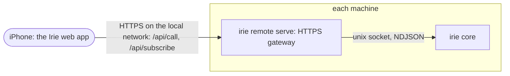

# Irie for iPhone

Date: 2026-10-31. Status: first build. Read with [DESIGN.md](DESIGN.md) and [CORE.md](CORE.md).

Irie for iPhone runs Irie from your phone: every session on each of your machines, red when one needs you, its conversation, a message box, buttons for what it asks, and a task bar that starts work on any machine. It is a web app that you add to the Home Screen, served by Irie itself on each machine over your own network. The core still runs every agent on its machine, so nothing stops when the phone sleeps or leaves.

## 1. Why a web app

A native iPhone app needs a current Xcode to install, and without a paid developer account Apple lets a sideloaded build run seven days. A web app on the Home Screen has its own icon and full screen, runs on any recent iOS, takes updates the moment a machine has them, and needs no account. A native shell can wrap the same files later.

## 2. How it works

- **The gateway** is `irie remote serve`, a client of the core's socket like the Mac app (CORE.md §2). It keeps no rules: it relays an op and its reply as the core wrote them, and a subscription's frames as they come. It serves the app's files from the binary (`internal/remote/web`), so every install brings the phone the new app. The core runs it in its own window, `irie-agents:irie-remote`, under the supervisor that restarts the core, while `remote.on` is set, and starts it again after an install or a change of its settings (`internal/core/remote.go`). Restarting it touches no agent (DESIGN §2.1, principle 6).
- **Only a phone's ops** pass (`remote.Ops`): `hello`, `list`, `input`, `complete`, `conversation`, `send`, `park`, `unpark`, `close`, `reopen`, `undo`, `redo`, `rename`, `priority`, `freeze`, `thaw`, `rate`, `result`, `route`, `dog`, `reorder`, `screen` and `keys`. What acts on the machine's own screen (`show`, `flip`), on Irie's setup (`config`, `theme`, `tool`, `local`, `preflight`, `move`, `trod`) or only agents send (`hook`, `status`) is refused with `unknown_op`, and `hello` names only the features a phone may use. A subscription takes only `session`, `agent` and `conversation`.
- **Two ops for a client without a terminal** (DESIGN §2.4): `screen` reads what a session's terminal shows, as plain text, and while it waits on you the numbered choices of the prompt at its bottom, as Claude Code draws a permission, a question or a plan (`1. Yes`, `2. Yes, and don't ask again…`). `keys` presses keys there: a digit or letter, or Enter, Escape, the arrows, Tab and the like, never Ctrl+C, and types text without Enter. So a phone answers a prompt with the key a person would press. Both go through the core, the only writer to tmux, and `keys` takes its turn with `send`.

### 2.1 The API

The HTTPS port (`remote.port`, 7387) serves the app and its API; the port below it serves only the setup page, over plain HTTP.

| Call | What |
|---|---|
| `GET /api/info` | The machine's id, name, version, API and OS. No token |
| `POST /api/pair` `{code, device}` | A paired phone's token, and the machine. A wrong code is `bad_code`, an expired or used one `expired`, the fifth wrong one `too_many` |
| `POST /api/call` `{op, args}` | The core's reply: `{ok, result}` or `{ok:false, error}`, with the core's own words. A machine whose core restarts says `core_down` |
| `POST /api/subscribe` args | A stream of NDJSON: `{ok}` first, then the core's frames (DESIGN §2.4), and `{"t":"ping"}` every 15 s |
| `DELETE /api/device` | This phone forgets itself on the machine |
| `POST /api/push` `{subscription, vapid, done}` | Notifications to this phone: its `PushSubscription`, the key it subscribed with, and whether a finished turn is news too. A first notification goes out at once, so the phone knows they work; a push service that can't be reached is `push_failed` |
| `DELETE /api/push` | No more notifications to this phone |

Every call but `info` and `pair` takes `Authorization: Bearer <token>`; an unknown token is 401 `unpaired`. The API allows any origin, since the app on one machine talks to every other machine's gateway, and a token, never a cookie, says who calls.

## 3. Trust

- **Turning it on.** `irie remote on --name Studio` sets `remote.on` and the name the phone shows, through the core's `config` op, which starts the gateway within a second; `irie remote off` stops it.
- **Pairing.** `irie remote pair` opens a six-digit code for ten minutes (`--for` longer) and prints where the phone sets up, with a QR code; `--open` shows both in the browser. The code pairs one phone, once. Five wrong codes end it, so a guess has five chances in a million. A paired phone holds a 256-bit token; the machine keeps only its SHA-256, in `remote/devices.json`. `irie remote devices` lists the phones and when each was last used, and `irie remote forget` unpairs one, or all.
- **HTTPS with Irie's own authority.** Each machine signs its certificate with Irie's certificate authority, which the phone installs once as a profile from the setup page and trusts in Settings > General > About > Certificate Trust Settings. The authority's certificate carries name constraints (RFC 5280 §4.2.1.10): it can vouch only for `.local`, `home.arpa` and `localhost` names and for private, shared, link-local and loopback addresses, so its key could not stand in for any site on the internet. The server's certificate has the machine's Bonjour name and local addresses, lasts 397 days, and is made again for an address the network gives the machine later. Apple's verifier accepts the chain for the machine's name and address and refuses it for any other (checked with `security verify-cert` on macOS 14). `irie remote ca export` and `import` share one authority between your machines, so one profile on the phone serves them all.
- **Local network only.** The gateway listens on the machine's addresses (`remote.listen` picks one). Nothing is exposed beyond the network the machine is on; a VPN such as Mullvad keeps its local-network sharing for it. Reaching it from away from home needs a network that joins the phone to the machines, which this build leaves to you (§5).

## 4. The app

- **Sessions**: a card per session in the core's order, each machine a section, parked last; a state change never moves a card. Red when it needs you.
- **A session**: its conversation, as the Mac app draws it; a message box (`send`); while it waits on you, a red card with what it asks and its choices as buttons (`screen`, `keys`), or a key pad and its terminal's text.
- **Actions**: park, freeze, promote, rate, rename, stop the turn, close, with undo.
- **A task bar** that starts a task on the machine you pick, with its repo and profile, and takes every word of the task bar's language (`input`, CORE.md §3).
- **Machines**: each paired machine, whether it answers, and Add a machine (its address and a code from that machine).

It keeps the paired machines in the browser's storage on the phone, and a service worker keeps the app's files, so it opens even while the machine that served it sleeps.

## 5. Notifications

Each gateway follows its core's sessions (a `subscribe` of its own) and tells every phone that asked when one needs you, failed or stalled, and, for a phone that asked for them too, when a turn ends. A first look after the gateway or the core starts is not news, so a restart never sends a flood; a question that changes while the session still needs you is. One kind of news about one session goes out at most every 20 s, with the session's name, what it asks or did, and the machine; a tap opens the session.

They go through the phone's own push service (Apple's, for an iPhone on iOS 16.4 or later with the app on its Home Screen), as Web Push has it: RFC 8030 for the push, RFC 8291 for encrypting each message to the phone, RFC 8292 (VAPID) for signing the request. A subscription is bound to one key, and every machine pushes to it, so the app makes that key itself, a P-256 pair, and gives each machine the subscription and the key. A machine keeps them with the phone in `devices.json`; a subscription the push service no longer has (404, 410) is dropped. Each VAPID token lasts 12 hours and is reused, as Apple asks. Pushes leave the machine for the push service over the internet, a VPN's tunnel included; nothing comes in.

## 6. Next

- Reaching the machines from away from home: a mesh network such as Tailscale joins them, but on iOS only one VPN runs at a time, so it means choosing it over Mullvad on the phone, or Mullvad through it.
- Helpers' own conversations, and teammates.

## 7. Files

| Path | What |
|---|---|
| `internal/remote` | The gateway: `remote.go` (server, relay), `certs.go` (authority, certificates, profile), `devices.go` (pairing, tokens), `push.go` (notifications), `qr.go` |
| `internal/remote/web` | The app: `index.html`, `app.js`, `app.css`, `js/`, `manifest.webmanifest`, `sw.js`, `setup.html`, and icons that `go run ./tools/mkicon -phone internal/remote/web` draws |
| `internal/core/remote.go` | The core keeps the gateway's window |
| `internal/core/screen.go` | `screen` and `keys` |
| `cmd/irie/remote.go` | `irie remote` |
| `$XDG_STATE_HOME/irie/remote/` | `ca.pem`, `ca-key.pem` (0600), `devices.json`, `pairing.json`, `machine.json`; `remote.log` beside it |
