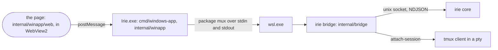

# Irie on Windows

Irie runs every agent in tmux, which is a Linux and macOS program, so on Windows it runs inside WSL 2, Windows' own Linux. There it is the same Irie as on any Linux: the same install, the same `irie setup`, the same sessions. **Irie for Windows**, `Irie.exe`, is its window: a sidebar of session cards and the shown session's terminal, as Irie.app draws them on a Mac (docs/MAC.md). A small console program, `irie.exe`, sets WSL up and runs Irie there from a Windows terminal and at sign-in. DESIGN §2.7 and §7.3 say where this sits in the design.

## 1. Install

In PowerShell, as yourself (not as an administrator):

```
powershell -ExecutionPolicy ByPass -c "irm https://irie-people.github.io/irie/install.ps1 | iex"
```

`site/install.ps1` downloads `irie-windows-amd64.zip` (or `-arm64`) from the latest release and checks its SHA-256 against the release's `SHA256SUMS`. It puts `Irie.exe`, its icon and the notices of what it carries in `%LOCALAPPDATA%\irie`, with **Irie** in the Start menu, and `irie.exe` in `%LOCALAPPDATA%\irie\bin`, which it adds to your PATH. Then it runs `irie setup` (§3) and, once that is through, opens Irie. A release from before Irie for Windows has `irie.exe` alone, and installs as it did. It reads `IRIE_VERSION`, `IRIE_NO_SETUP` and `IRIE_DOWNLOADS` from the environment, as `install.sh` does. Running it again updates both, even while Irie is open: a running program is moved aside, and the copy goes at the next update.

Irie for Windows needs Microsoft Edge WebView2, which Windows 11 has, and Windows 10 gets with its updates; without it, Irie says so and offers Microsoft's page for it.

## 2. Irie for Windows

### 2.1 What it shows

- **A card per session, in a list or a tree**, as on a Mac: **List** in the core's one order with your groups where their first session is, or **Repo**, a group for each repo by its folder's name and then Not in a repo; both end with **Parked** (folded at first), a group for each paired machine, **Outside Irie** and **Recently closed**. A card is two lines, its name, then what it needs (in red), does or how it ended, with its age and tokens in a trailing slot, which hover swaps for Pause, Park and ⋯. A working session's card is washed in its own colour, and the one that needs you tinted red. Nothing but you moves a card. A group's header folds it and says in red how many of a folded group need you. The find field narrows the list by name, branch, repo, agent and what it does.
- **The counts** beside Irie's sun: how many need you, work, wait for you to verify, are paused or are frozen; a click shows the first such session. The window's title says how many need you, so the taskbar does too.
- **The details** of the selected session above the task bar: its state and why, the step, where it runs, its agent and model, what it has spent, what a finished jot left that has not landed, its warnings, and the last screen of a spawn that went wrong.
- **The terminal**: the shown session's own, live, a tmux client of the slot as Irie.app's is (docs/MAC.md §2), in a rounded frame edged in the colour of its card: red while it needs you, green once it is done, its own colour while it works. Above it, the session's name and state, with Pause, Boost, Park and ⋯.
- **The task bar**, which takes every word the terminal sidebar takes (`input`, docs/CORE.md §3): a task with its `@repo` and `+agent`, a question such as "hows the parser?", and every `:` command, which acts on the selected card. Its two menus pick where a task runs and on which agent; a word in the text wins over them. ↑ brings back the last task sent, and one the core refuses comes back into the bar.
- **A card's menu** (right-click, or ⋯): Show, Rename (F2), Pin, Park, Pause, Boost, a group, Rate, Close, Close the others and Close all finished. Every change says what it did, with **Undo**; an undo that is not certain asks the core's question first (DESIGN §4.5). Dragging a card moves it, across Parked's or Pinned's header parks or pins it, and onto a group's puts it there.
- **Settings** (Ctrl+,): the default agent, closing finished sessions, where a new card goes, finished in red; the palette, which the core then hands Irie's status line and Claude Code's panels too; the arch agents with their status, items, actions (those that ask first ask first) and settings; the plugins and their parts, each with its switch and **Set up**; and what the app carries, with its licenses.
- **When Irie still needs something** inside Linux, such as Claude Code's sign-in (the core's `ready`), a note above the cards says so, and **Set up** starts the session that sets it up.
- **When a session comes to need you** while Irie is not in front, its taskbar button flashes until you come back, and a Windows notification says what it needs; a click on it brings Irie forward.
- **Light or dark** as Windows is, in the palette Irie uses everywhere; the title bar takes the sidebar's colour on Windows 11.

### 2.2 Keys

A key of the terminal stays the agent's: in the terminal, the app's own keys have Shift in them, as Windows Terminal's do. Elsewhere in the window the plain ones work too.

| Keys | What they do |
|---|---|
| Ctrl+Tab, Ctrl+Shift+Tab | Show the next or the previous session, in the sidebar's order |
| Ctrl+] | Move the keyboard between the list and the terminal |
| Ctrl+1 to Ctrl+9 | Show the first to ninth session |
| ↑ ↓, then Enter | Pick a session in the list, then type to it |
| Ctrl+Shift+N (Ctrl+N outside the terminal) | Type a task in the task bar |
| Ctrl+Shift+F (Ctrl+F outside the terminal) | Find a session; Esc clears it |
| F2, Ctrl+Shift+E | Rename the selected session |
| Ctrl+Shift+W; Delete in the list | Close the selected session |
| Ctrl+Shift+T | Reopen the session closed last |
| Ctrl+Z, Ctrl+Y (outside the terminal) | Undo, redo |
| Alt+Shift+↑ ↓ | Move the selected card up or down |
| Ctrl+Alt+1 to 9 | Show that space |
| Ctrl+C, Ctrl+V | Copy what is selected (Ctrl+C is the agent's while nothing is), paste |
| Drag, Shift+drag | Select in tmux, which copies as you let go; or in the terminal itself |
| Ctrl+=, Ctrl+-, Ctrl+0, Ctrl+wheel | The terminal's text bigger, smaller, the default |
| Ctrl+, | Settings |
| F1 | These keys |

### 2.3 Setting up from the app

Opened on a computer that lacks WSL, a Linux to run in, or Irie inside it, the window shows the steps of `irie setup` (§3) that block, in order, each with its button, and the extras after them. A step that asks something, such as Linux's user name and password, or Irie's installer and its questions, runs in a console window of its own, which the app waits for and then looks again; installing WSL asks an administrator's OK, then Windows needs a restart, after which the Start menu's Irie goes on. While Irie inside Linux is older than the app and has no `irie bridge` (§5), the window offers the update, which is Irie's installer again.

## 3. `irie setup` on Windows

It looks at how far the computer is set up and offers each step in order, running each one only after a yes (`--yes` takes them all; `--check` only reports):

| Step | What it does | Needs |
|---|---|---|
| Windows | Windows 10 version 2004 (build 19041) or later, or Windows 11 | an update, if older |
| WSL | `wsl --install --no-distribution` | an administrator's OK, then a restart; virtualization on in the firmware |
| Ubuntu | `wsl --install -d Ubuntu`: WSL's default distribution, which asks you to choose a user name and password for Linux; type `exit` to come back | |
| WSL 2 | `wsl --set-version <distro> 2`, for a distribution on WSL 1 | |
| Irie | `install.sh` inside the distribution, whose own `irie setup` then offers tmux, Claude Code and its sign-in | the Linux password, for `sudo apt install tmux` |
| Keep running | `instanceIdleTimeout=-1` in `[general]` of `%USERPROFILE%\.wslconfig`, so WSL keeps Linux, and your agents, running once the last window closes | |
| Start menu | an `Irie` shortcut, to Irie for Windows when it is installed beside `irie.exe` and to `irie.exe` in a terminal otherwise, and an `Irie` profile in Windows Terminal (a fragment in `%LOCALAPPDATA%\Microsoft\Windows Terminal\Fragments\Irie`) | |
| At sign-in | a shortcut in the Startup folder that runs `irie up`, minimized | |

`irie setup --distro NAME` runs Irie in another distribution you have, such as `Ubuntu-24.04` or `Debian`, and remembers it in `%LOCALAPPDATA%\irie\distro`; `IRIE_WSL_DISTRO` does the same for one shell. With neither, Irie runs in `Ubuntu`, or in your default distribution when it is on WSL 2 and is not a container tool's own, such as Docker Desktop's. Some versions of `wsl.exe` write nothing at all into a pipe (microsoft/WSL#41937); then setup and the app read WSL's own list of distributions in the registry instead (`HKCU\Software\Microsoft\Windows\CurrentVersion\Lxss`).

## 4. From a terminal

`irie` opens Irie in the terminal it is typed in, as on Linux, and Windows Terminal's Irie profile opens it in a terminal of its own. Every command but `setup` is Irie's own, run in WSL: `irie ctl list`, `irie config set profiles.helper.folder ~/Helper`, `irie version`. A Windows path among the arguments, such as `C:\Users\alice\site`, becomes its WSL path, `/mnt/c/Users/alice/site`. Agents work on Linux's own files fastest; a folder of yours on Windows is under `/mnt/c`.

Ghostty's terminals and the Mac app's panes are macOS's only. The phone app (docs/PHONE.md) runs from WSL as from any Linux, though WSL's own network is behind Windows', so a phone on your Wi-Fi reaches it only with WSL's mirrored networking (`networkingMode=mirrored` in `.wslconfig`, Windows 11 22H2 or later).

## 5. How it works



- **The window** (`cmd/windows-app`) is Win32's own, with WebView2 drawing a page in it. `github.com/wailsapp/go-webview2`'s loader, in Go, finds the WebView2 that Windows keeps up to date, and the app makes its few WebView2 calls itself (`com_windows.go`); nothing is linked from C, so it builds from any computer. The page loads from `https://app.irie.invalid/`, a name no network has, which the app answers itself with the files built into it; it may not go elsewhere: a link opens in your browser, and the page has no camera, microphone, place or files, and no browser keys, menus or zoom of its own. It keeps its state (the view, what is folded, the sidebar's width, the task's menus) in `%LOCALAPPDATA%\irie\WebView2`, the window's place in `window.json`, and what it said last run in `app.log`. A second start brings the first window forward. Each monitor draws it at its own scale.
- **The page** (`internal/winapp/web`) draws what the core says and sends what you do, as every client does (docs/CORE.md §2). It has no rules of its own, and how a row looks comes from the phone app's own module, `look.js`, with its marks, its state words and the agents' colours, so the three clients agree. xterm.js 5.5 (MIT), built into the app with its addons for fitting, WebGL drawing and Unicode 11 widths, draws the terminal, in Irie's terminal colours.
- **The way in** is one `wsl.exe` running `irie bridge` in the distribution, through the same login shell as `irie.exe` (§4), with no window. Its standard input and output carry every stream the app needs, numbered frames of package `mux` (DESIGN §2.4 says nothing of it: it is only the way into WSL): a connection to the core's socket for each call and each subscription, relayed as it is, and the terminal, which is a tmux client the bridge runs in a pty of its own in Linux, attached to the slot as the core's `attach-info` says, sized and fed by the app. So every byte tmux draws reaches xterm.js unchanged, with no console of Windows' in between. The bridge writes a line of its own first, and the app skips whatever a login shell printed before it. It starts the core when none answers, as the Mac app starts it with the irie inside it. When `wsl.exe` ends, as when Linux stops, the app starts the bridge again and every subscription and the terminal with it; the agents never notice, since they run in Linux.
- **The subscription** is the app's own (`view: "app"`), so the core keeps the slot zoomed while it watches, and `show` swaps sessions in place, as for the Mac app. The terminal tells tmux its size once a change settles, and holds it while the sidebar's edge is dragged, so the agents take one size per change rather than one per step. Closing the window closes only tmux clients; every agent keeps running.
- **The wrapper** (`cmd/windows`, with its logic in `internal/wsl`) never runs agents itself. It runs `wsl.exe -d <distro> --cd ~ -e sh -lc 'exec "$d/irie/bin/irie" "$@"'`, where `$d` is the distribution's `XDG_DATA_HOME` or `~/.local/share`, so the login shell gives Irie the PATH a terminal there has. It finds WSL by its files, `%ProgramW6432%\WSL\wsl.exe` for the Store's and `%SystemRoot%\System32\lxss\LxssManager.dll` for Windows' own, rather than by asking `wsl.exe`, which on a Windows without WSL may offer to install it and wait for a key. It reads `wsl.exe`'s output in UTF-8 (`WSL_UTF8=1`) or UTF-16, which older versions write regardless. Ctrl+C goes to Irie inside WSL; the wrapper waits for it.

Restarting Windows ends WSL, and with it every agent, as a restart of any computer does; `irie ctl history` still lists their sessions.

## 6. Remove it

Delete `%LOCALAPPDATA%\irie`, the Irie shortcuts in the Start menu and its Startup folder, and `%LOCALAPPDATA%\Microsoft\Windows Terminal\Fragments\Irie`; take `irie\bin` out of your PATH, and `instanceIdleTimeout` out of `.wslconfig`. Irie inside WSL comes out as on Linux. Removing the distribution itself (`wsl --unregister <distro>`) deletes everything in it, so that one is yours to decide.

## 7. Tests and previews

- **`internal/mux`**: streams carried both ways and apart, a write longer than a frame split and joined again, the reason a stream ended, sizes in order, a read's deadline, a shell's greeting before the bridge's line, and every stream ending with the wire.
- **`internal/bridge`**: the core's socket relayed, a subscription's frames, the core started when it does not answer and why when it can't be, and a real tmux client attached through the bridge to a private tmux server, sized, resized, typed to and detached, the session still running after it.
- **`internal/winapp`**: the app's backend against the real bridge in the test's process: calls, the core's errors in its own words, a subscription that comes back after the bridge dies, the terminal attached to a private tmux's slot, sized, typed to and closed, the setup steps until the computer is ready, and an Irie inside Linux too old for the bridge. It also builds the wrapper and the app for Windows on any computer, as a release does (`tools/release.sh`), and `tools/winpreview`, as the `windows` job does: they link all that the wire types (`internal/ipc`) import, and the stand-in core all that zen does, so code that builds on Linux and macOS alone must stay out of those. Release 1.10.0's downloads failed when the wire types came to import the lessons, and with them the harness and the host; and from 21 November the `windows` job could not build its stand-in, whose zen locked its files with flock, until `internal/filetx` locked them on Windows too.
- **`internal/wsl`**: `wsl.exe`'s list in both encodings and in another language, and from the registry when it lists nothing, the pick of a distribution, Windows' build from `ver`, Windows paths, the command line, `.wslconfig` edited key by key with its line endings kept, the shortcut's PowerShell, to the app with its icon when it is installed, the Terminal fragment, the installer's window that waits, and `irie setup`'s walk through every step against a stand-in Windows.
- **The page, on any computer**: `go run ./tools/winpreview` serves it at a local address against a stand-in for Irie in Linux (`internal/winapp/fixture`: a fake core with sessions in every state, and a terminal that draws a still Claude Code), with a script standing in for WebView2's messages; `-scene setup` or `-scene old` shows the welcome or the update, and `-dir .` reads the page from the checkout on each load. `CHROME=<a headless Chromium> node tools/winpreview/snap.mjs URL out.png [WIDTH HEIGHT [light|dark [SCRIPT]]]` draws it with no window anywhere.
- **On Windows itself**, the `windows` job of the test workflow checks the wrapper and the app, runs `install.ps1` from a local mirror twice, checks that it installed Irie for Windows and its Start menu entry, runs `irie.exe version` and `setup --check`, and checks that a wrong checksum installs nothing. Then it opens the real app with `IRIE_APP_BRIDGE` naming `winpreview -bridge`, and `Irie.exe --snapshot DIR` draws the window as WebView2 draws it, with Settings, and with a card's menu, into PNGs the run keeps. The `windows-wsl` job runs it all on a real WSL 2, as on a person's computer: Ubuntu from `wsl --install` with a user of its own, Irie put in it by `site/install.sh` from the run's own build, then `Irie.exe --snapshot` with nothing standing in, from a cold start of Linux, which must start the core through `irie bridge` and draw the window. It prints `app.log`, which says each state the window showed and why, and the core's log.

## 8. Not yet

Irie for Windows has what the core gives every client. What Irie.app has besides, and this one does not yet:

- the conversation view beside the terminal, its message box and the double ↓ (DESIGN §4.7);
- the right sidebar: Dock, Helpers, Review, Notices, Variorum and plugin panes;
- the panes beside the terminal, the notepad, mail, the markets map and Make a Theme;
- a session beside its teammates, and the terminal popped out into a window of its own;
- Notes, layouts and the menu bar's full set of commands;
- a signed app, with the icon and name its file carries (Windows' SmartScreen may ask before the first start), and the freeze dog, which on Windows would have to restart a Windows process from Linux.
