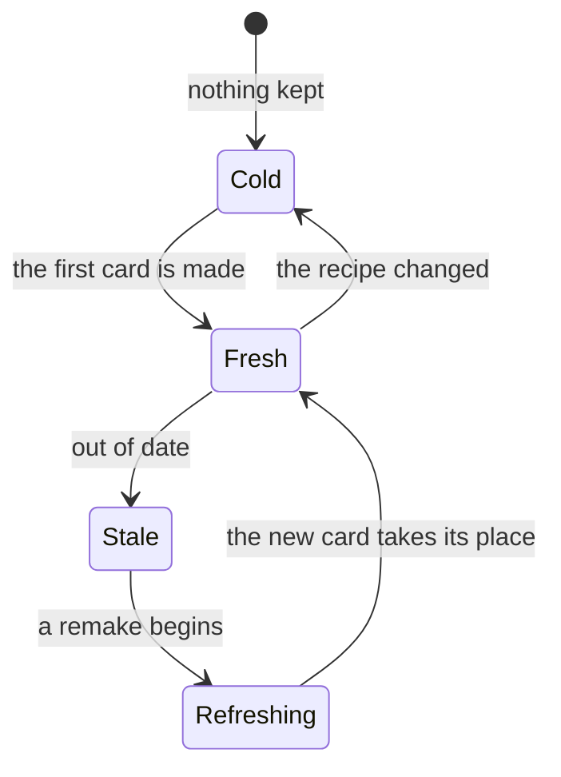

# Proposal: materialized cards

Date: 2026-11-21. Status: a proposal, with its first steps built (`internal/materialize`, `internal/genui`, the `materialize` op, `irie ctl materialize`, the session's card in the Mac app, and, on 2026-11-22, the Teach tile with the catalog's pictures). It joins two ideas: the cards of [generative-ui.md](generative-ui.md) §7.3, a small JSON tree from Irie's catalog that Irie draws in its own look, and Macro's AI projections, an AI-made view kept under a name and made again only when it is out of date. An agent (Claude Code) wrote it with the owner, in teach mode, from `live` at `53a2ce4`. Every source is listed in [PROVENANCE.md](../../PROVENANCE.md); Macro is AGPL-3.0, so Irie takes its ideas and none of its code.

**In short.** A materialized card is a card a model made once and Irie kept. A view that asks for it draws it at once, from what is kept, and the model makes it again only when what it was made from has moved on. So a card costs a model call when something changes, not each time someone looks, and it does not shift under the person reading it. While a new one is made, the old one stays on show.

| | A card an agent composes (generative-ui.md §7.3) | A materialized card |
|---|---|---|
| Who asks for it | The agent, in its turn | A view, an event or Irie itself, by the card's name |
| Who makes it | The session's own model | The router's cheapest accurate profile, local first |
| How long it lasts | Its conversation | Until its recipe changes, or it is forgotten |
| When it is made again | When the agent sends it again | When it is out of date (§2) |
| What draws it | Irie's catalog, natively | The same |

## 1. What is kept

- **A recipe** is what makes a card: its name (`session/<id>/status`), the prompt, the profile that makes it, and the catalog's version. Its hash versions the last three. A card made from another hash answers another question, so it is not shown: the card is **cold** until it is made again.
- **Inputs** are a digest of what the card reads, such as a session's turn count or a repo's head. A card made from other inputs is not wrong, only behind: it stays on show while a new one is made.
- **Every** is the most a card may age, and **Gap** the least time between two cards, which bounds what a card can cost when its inputs change every few seconds.
- **The kept card** is the model's JSON as it came, the hash and inputs it was made from, and when. The store keeps them in one file in Irie's state folder, mode 0600, so a card outlives a restart of the core and an install draws it again at once.

## 2. How a card moves

- **One remake at a time.** The ask that finds a card cold or stale claims the remake, and every other ask meanwhile draws what is kept. A claim older than five minutes is taken for dead, and a core that starts again drops every claim, since the remakes it lists ran in the core that stopped.
- **The newest remake wins.** Each remake begun gets the next number. When one finishes and a newer one has begun, as when the recipe changed meanwhile, what it made is dropped.
- **A failed remake keeps the old card**, records why, and waits a minute before another begins.
- **Out of date** means its inputs moved, or it is as old as Every; never sooner than Gap after the last card, whatever the reason, since Gap is the ceiling on what a card costs. A card held back is not lost: the next ask after the Gap remakes it.

## 3. How it reaches a view

- **Asked by name.** A view asks the core for a card by its recipe with the `materialize` op (DESIGN §2.4); the answer is what is kept and the state to draw it in: a placeholder for cold, the card for fresh, the card with a quiet "updating" mark for stale and refreshing. `irie ctl materialize ID PROMPT --context FILE` asks from a terminal and draws the card as text, and `--wait` waits while it is made.
- **Pushed, never polled** (step 4). When a remake finishes, the core will publish a `materialized` frame with the card to every view that shows it, as it publishes a session's row, so it redraws; Macro does the same through its connection gateway. Until a view draws cards, an ask that waits is enough.
- **Made cheaply.** A remake runs on a local model, the best for chat on this computer's Ollama that fits (`terms.FindModel`: at most 16B parameters and 10 GB, never a cloud model), so a card costs no tokens; one runs at a time, so models load one by one. Ollama's structured outputs hold the model to the card's own JSON schema, a title over parts that each carry a type from those its kind offers (`genui.schema`), since with JSON mode alone bonsai-2:9b wrote about one card in five with bare sentences for parts; `genui.Check` still refuses a card the catalog cannot draw, which keeps the old card, and a refused card is asked for once more, with what to fix. A sweep that remakes cards in the background (step 2b) waits while Gabriel holds work back (DESIGN §4.11); an ask someone waits on is their focus, and runs.
- **Drawn natively.** The catalog of generative-ui.md §7.3 in SwiftUI and in Lip Gloss, the same drawing for both kinds of card. A spec that fails the catalog's check is a failed remake: the old card stays.

## 4. The first cards

1. **Where a session stands**, over its message box in the conversation view (built, behind `materialize.sessions`): what it is doing, what it changed, what waits on you. Its inputs are the session's state and its newest message, so it is made again after a turn or a message, at most every two minutes. It first went in the details panel, but that panel shows three lines until it is dragged taller, so the card sits where the eyes are.
2. **A plugin's card**, from its manifest: a recipe the plugin names, drawn in its pane.
3. **The Teach tile** (built 2026-11-22, [MAC.md](../MAC.md) §1): a picture of what the person asks to have explained, in a frosted tile they can move, close and show again. The ask is the `materialize` op's `explain`; the core names the card by the question's words and the session it is asked in, and makes it from that session's newest 40 items. A card that explains is a kind of its own (`genui.KindExplain`, part of the recipe's hash), with instructions that lead with a picture and let the model explain from what it knows, while the work in the context it takes only as the context tells it. Its inputs are the session's newest message (`explainInputs`), so the same question asked after the session has said more is made again, at most every two minutes, with the old card on show meanwhile; its steps alone never put it behind, and asked with no session it is made once and kept. A card is made again only when it is asked for, so the rule prices a question asked twice, never the session's work. The owner was handed this rule in teach mode and said "continue", so the agent picked it, as the session's own card already reads its newest message. The store keeps the newest 60 such cards (`Store.Trim`), since a question is a name of its own and no sweep forgets them yet. A card that fails the catalog's check is asked for once more with what to fix, which a small model often gets right the second time; every kind of card gains that.

## 5. Order of work

1. **The store** (small, built): recipes and their hash, the states, claims, the newest remake winning, the file, the rule for out of date. Tests with a clock passed in.
2. **The core** (medium, built): the store in the state folder; the `materialize` op, with `wait` and `forget`; remakes on a local model, one at a time; the catalog's check (`internal/genui`: Text, List, Facts, Table, Progress and Divider, with §7.3's limits); `irie ctl materialize`, which draws a card as text.
   - **2b, the sweep** (small): each minute, the cards a view showed in the last ten minutes are asked for again, while Gabriel holds nothing back, and those no view has asked for in a week are forgotten.
3. **The rest of the catalog** (small, begun): catalog 2 adds the pictures, **Flow** (steps in order, joined by arrows), **Diagram** (links between named things, at most 24 links and 16 things, which Irie lays out in layers and draws itself, so even a diagram is data), **Compare** (two to four sides, each with its points) and **Code** (a short example, in a language); still to come, §7.3's other parts (Row, Column, Chart, Diff, Image, Link) and its nesting limit, shared with cards an agent composes. A new catalog leaves every kept card cold, so each is made again with what the new one holds.
4. **The Mac app** (medium, begun): the catalog in SwiftUI (`MaterializedCard.swift`) and the session's card over its message box, asked for by the view, which waits for a remake under way; still to come, the `materialized` frame, so a card made for one view redraws in every other.
5. **The terminal slot** (small): the same in Lip Gloss.

## 6. Decisions for the owner

| # | Decision | Options | Recommendation |
|---|---|---|---|
| 1 | When a kept card is out of date | a. Inputs moved or as old as Every, never sooner than Gap. b. The same, with Every allowed to break the Gap | **a**, built: Gap stays a hard ceiling on cost |
| 2 | The first card | a. Where a session stands. b. A plugin's card | **a**: every session has one to show |
| 3 | Who makes it | a. A local model on this computer's Ollama. b. The router's pick, free profiles only | **a**, built: no tokens, and nothing to set up beyond Ollama |
| 4 | A card nobody has asked for | a. Forgotten after a week. b. Kept until its recipe goes | **a**, so the file stays small |
