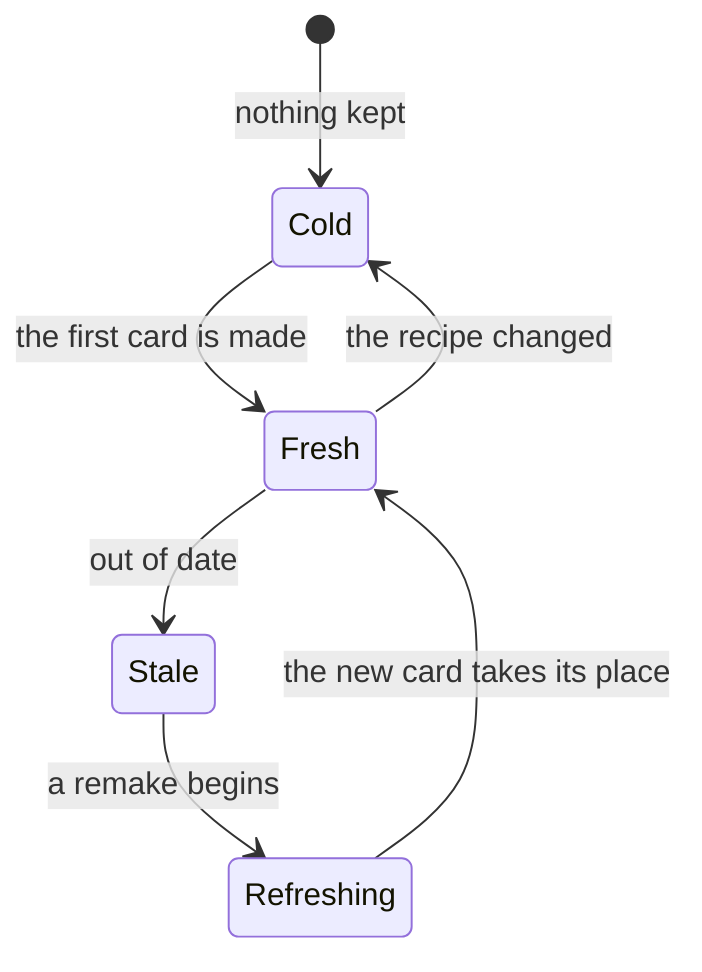

# Proposal: materialized cards

Date: 2026-11-21. Status: a proposal, with its first step built (`internal/materialize`). It joins two ideas: the cards of [generative-ui.md](generative-ui.md) §7.3, a small JSON tree from Irie's catalog that Irie draws in its own look, and Macro's AI projections, an AI-made view kept under a name and made again only when it is out of date. An agent (Claude Code) wrote it with the owner, in teach mode, from `live` at `53a2ce4`. Every source is listed in [PROVENANCE.md](../../PROVENANCE.md); Macro is AGPL-3.0, so Irie takes its ideas and none of its code.

**In short.** A materialized card is a card a model made once and Irie kept. A view that asks for it draws it at once, from what is kept, and the model makes it again only when what it was made from has moved on. So a card costs a model call when something changes, not each time someone looks, and it does not shift under the person reading it. While a new one is made, the old one stays on show.

| | A card an agent composes (generative-ui.md §7.3) | A materialized card |
|---|---|---|
| Who asks for it | The agent, in its turn | A view, an event or Irie itself, by the card's name |
| Who makes it | The session's own model | The router's cheapest accurate profile, local first |
| How long it lasts | Its conversation | Until its recipe changes, or it is forgotten |
| When it is made again | When the agent sends it again | When it is out of date (§2) |
| What draws it | Irie's catalog, natively | The same |

## 1. What is kept

- **A recipe** is what makes a card: its name (`session/<id>/status`), the prompt, the profile that makes it, and the catalog's version. Its hash versions the last three. A card made from another hash answers another question, so it is not shown: the card is **cold** until it is made again.
- **Inputs** are a digest of what the card reads, such as a session's turn count or a repo's head. A card made from other inputs is not wrong, only behind: it stays on show while a new one is made.
- **Every** is the most a card may age, and **Gap** the least time between two cards, which bounds what a card can cost when its inputs change every few seconds.
- **The kept card** is the model's JSON as it came, the hash and inputs it was made from, and when. The store keeps them in one file in Irie's state folder, mode 0600, so a card outlives a restart of the core and an install draws it again at once.

## 2. How a card moves

- **One remake at a time.** The ask that finds a card cold or stale claims the remake, and every other ask meanwhile draws what is kept. A claim older than five minutes is taken for dead, and a core that starts again drops every claim, since the remakes it lists ran in the core that stopped.
- **The newest remake wins.** Each remake begun gets the next number. When one finishes and a newer one has begun, as when the recipe changed meanwhile, what it made is dropped.
- **A failed remake keeps the old card**, records why, and waits a minute before another begins.
- **Out of date** means its inputs moved, or it is as old as Every; never sooner than Gap after the last card, whatever the reason, since Gap is the ceiling on what a card costs. A card held back is not lost: the next ask after the Gap remakes it.

## 3. How it reaches a view

- **Asked by name.** A view asks the core for a card by its recipe; the answer is what is kept and the state to draw it in: a placeholder for cold, the card for fresh, the card with a quiet "updating" mark for stale and refreshing.
- **Pushed, never polled.** When a remake finishes, the core publishes `card.updated` with the card, as it publishes a session's row, so every view that shows it redraws. Macro does the same through its connection gateway.
- **Made cheaply.** A remake runs as `irie ctl delegate` does (DESIGN §6.4): on the cheapest profile accurate enough, `+dory` and `+local` first, which cost no tokens, and never a paid model. Gabriel holds remakes back while the user's focus needs the machine (DESIGN §4.11).
- **Drawn natively.** The catalog of generative-ui.md §7.3 in SwiftUI and in Lip Gloss, the same drawing for both kinds of card. A spec that fails the catalog's check is a failed remake: the old card stays.

## 4. The first cards

1. **Where a session stands**, in its details: what it is doing, what it changed, what waits on you. Its inputs are the session's turn count and state, so it is made again after a turn, at most every Gap.
2. **A plugin's card**, from its manifest: a recipe the plugin names, drawn in its pane.

## 5. Order of work

1. **The store** (small, built): recipes and their hash, the states, claims, the newest remake winning, the file, the rule for out of date. Tests with a clock passed in.
2. **The core** (medium): the store in the state folder; a `card` op; `card.updated`; remakes through the router; a sweep each minute that asks again for the cards a view shows, and forgets those no view has asked for in a week.
3. **The catalog's check** (small): §7.3's elements and limits in Go, shared with cards an agent composes.
4. **The Mac app** (medium): the catalog in SwiftUI; the session card in the details panel.
5. **The terminal slot** (small): the same in Lip Gloss.

## 6. Decisions for the owner

| # | Decision | Options | Recommendation |
|---|---|---|---|
| 1 | When a kept card is out of date | a. Inputs moved or as old as Every, never sooner than Gap. b. The same, with Every allowed to break the Gap | **a**, built: Gap stays a hard ceiling on cost |
| 2 | The first card | a. Where a session stands. b. A plugin's card | **a**: every session has one to show |
| 3 | Who makes it | a. Local profiles only. b. The router's pick, free profiles only | **b**, with `+local` first |
| 4 | A card nobody has asked for | a. Forgotten after a week. b. Kept until its recipe goes | **a**, so the file stays small |
