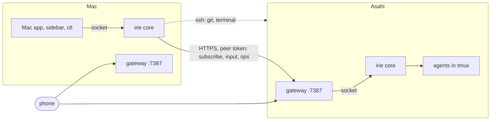

# Proposal: Irie on two machines

Date: 2026-11-01. Status: the owner chose design A, placement by you and then automatic (2026-11-01). Built: the leak fix (§1.2), adverts (step 1), peers with their sessions in the list, `^name` and the forwarded ops (steps 2 and 3), and the balancer (step 4), with the hooks check of §4.4; DESIGN §2.8 says how they work. Step 5 is built as the owner chose it (2026-11-01): the owner keeps clones on the other machine with their hooks and guard, under the same @names, and Irie fetches each finished task's branch back over ssh; Irie makes no mirror, since a mirror's worktrees would lack the guard that the owner's git hooks give the Mac's. Step 6 is not built; the core puts "on Asahi · …" in a row's detail instead of a badge. There is no issue tracker yet, so this file stands in for the issue that [AGENTS.md](../../AGENTS.md) asks for. An agent (Claude Code) wrote it from `live` at `2670fc7`, after measuring both machines. Every source is listed in [PROVENANCE.md](../../PROVENANCE.md).

The owner asked: can Irie offload CPU and memory to their Asahi Linux laptop, and can a peer-to-peer balancer manage that?

**In short.** Yes, at spawn time. Each machine keeps its own core, and the cores become peers.

- **Peering.** A core pairs with the other machine's gateway the way a phone does (`irie remote serve`, PHONE.md), then follows that machine's sessions and shows them in its own list.
- **Placement.** A new session goes to the machine with room for it, if that machine can run it exactly as this one would: same login, same repo, same hooks. You can always say where with `^Asahi`. A deterministic balancer in the core makes the choice when `peers.place = "auto"`. It is not a model: it decides in microseconds and says why.
- **Sessions don't move.** A live session stays where it started.
- **No unguarded sessions.** A session never goes to a machine whose Claude Code hooks differ from this one's, so no repo's guard is ever left behind.

The cheap fix came first. Most of the Mac's load was test leftovers, not agents (§1).

| | The Mac | The Asahi |
|---|---|---|
| Hardware | 12 CPUs, 18 GiB | Apple M2 Pro, 10 CPUs (6 performance, 4 efficiency), 16 GiB |
| 1-min load, 2026-11-01 08:00 EST | 673 | 0.01 |
| The same at 10:05, after the sweep and the leak fix | 17 | 0.01 |
| Memory free | ~43 MB at 08:00; 26 % (kernel's figure) at 10:05 | 8.0 GiB available of 15.2 |
| ptys in use | 527 of 511 at 08:00 (spawns failed); 134 at 10:05 | — |
| Claude Code | signed in | installed (2.1.309), not signed in |
| Irie | core, Mac app, gateway on 7387 | core, gateway on 7387, deployed by hand |

---

## 1. What the load was

### 1.1 Measured

On 2026-11-01 at about 08:00 EST the Mac's 1-minute load was 673 on 12 CPUs. It had 43 MB of memory free, about 6 GB compressed and 7.6 GB wired, and every pty was taken: `irie ctl spawn` failed with "fork failed: Device not configured". Most of that was not agents:

- **Test leftovers.** 65 `irie-test-*` tmux servers from killed or timed-out `go test` runs, 38 of them more than a day old, held 791 processes and 419 of the 511 ptys. When the owner killed the ones older than 6 hours, the load fell to 13 and the ptys in use to 106.
- **The iOS Simulator.** 162 processes, about 2 CPUs, running for 1 h 40 min. It is paused, not killed.
- **Agents.** About 60 `claude` processes take about 2.4 GB between them. What they run costs more than they do: `go test` of `internal/core`, language servers, builds.

So adding a machine is the second step, not the first.

### 1.2 The leak, fixed first (commit 90d30fc)

There were four ways a test run left processes behind:

| Way | Why | Before |
|---|---|---|
| A run killed by a tool's timeout, Ctrl-C or SIGTERM | Go runs no `t.Cleanup` on a signal. A test's tmux server is a daemon of its own, so nothing ended it | A whole Irie per run, running for days: the server, the core, the sidebar, the slot, hosts and fake agents |
| `go test -timeout` (10 min by default, which `internal/core` hits) | The timeout panics in a timer goroutine, and no cleanup runs | The same |
| Any run of a team test | The team server runs with `exit-empty off`. The cleanup killed only the main server, then removed the socket dir, so nothing could reach the team server again | An empty tmux server per run, for good |
| A test that ends while a frozen hook holds its agent | The hook runs in a session of its own, which the end of the pane never reaches, and the agent waits on it for up to `hold.max` | An old host, its agent and a stopped `irie hook`, for up to a day |

The fix is all in `internal/testutil`:

- **Cleanup.** It ends every tmux server in the test's socket dir, then kills whatever of their process trees is still alive after a grace period.
- **The reaper.** It is the test binary started again by `testutil.Main` and detached from the run: its own session, with init as its parent. It holds a pipe from the binary and learns each dir the binary makes. When the pipe closes, however the binary ended, it cleans what is left.
- **The sweep.** Each dir names its owner. `testutil.Main` first sweeps the dirs of runs whose owner is gone, which covers a run whose reaper was killed too.

Each run below was measured 10 s after it ended, with a run of `TestSpawnCreatesAnAgentWindow` and the team test:

| Run | Before | After |
|---|---|---|
| SIGKILL while an agent runs | 1 server, 6–7 processes, 3 ptys | nothing |
| `-test.timeout` mid-test | 1 server, 8 processes, 4 ptys | nothing |
| SIGTERM | (as SIGKILL) | nothing |
| A passing team test | 1 empty team server | nothing |

Leftovers from before the fix are still running, and nobody started them on purpose. The owner decides whether they go:

- a 5-day-old server with a sidebar and a slot;
- two old-host trees, 13–15 h old, each with a stopped hook;
- empty team servers;
- an orphaned `irie placeholder`. It has used 77 CPU-minutes in 25 h, at about 3 % of a core. A placeholder whose server ends exits at once, by kill-server or by SIGKILL, so this one's history is unknown.

## 2. Goals and non-goals

Goals:

- New sessions use the Asahi's CPU, memory and ptys while the Mac is short of them.
- One list shows every session on both machines.
- You keep control: you can say where any task runs, and the automatic choice explains itself.
- Nothing is ever disturbed (DESIGN §2.1, principle 6): placing, mirroring or losing contact with a machine never touches an agent on either one.
- Fail safe: a session never starts where it would run differently. Most of all, it never starts where your Claude Code hooks, a repo's guard among them, would not run.

Not goals:

- **Moving a live session.** It stays where it started (§4.6).
- **More plan.** Both machines sign in to the same Claude account, so they share one plan and its 5-hour and 7-day windows. A second machine adds CPU, memory and ptys, not tokens.
- **Mac-only work.** Xcode, the iOS Simulator, Irie.app and anything that drives macOS stay on the Mac.
- **Reaching a machine away from home** (PHONE.md §6). The first build is local network only, as the gateway is.

## 3. Designs considered

| | A. Peer cores (recommended) | B. One core drives both over ssh | C. Each client talks to each machine | D. A manager agent |
|---|---|---|---|---|
| What it is | Each machine's core runs its own sessions. A core pairs with the other's gateway, mirrors its rows, forwards ops for them, and places new sessions on it | The Mac's core runs tmux on the Asahi over ssh, and the Asahi runs no core of its own | The Mac app, like the phone app, connects to every machine's gateway; there is no core-to-core link | A Claude session watches both machines and starts or moves work |
| One writer (principle 2) | Yes: each core alone drives its own tmux | No: two writers to the Asahi's tmux, or its core and phone gateway go | Yes, but every client must merge lists and place work itself, so rules move into clients | It drives Irie through ctl, so yes, but decisions sit outside the core |
| When the Mac sleeps | The Asahi's sessions keep their core: pause, notes, hooks and the phone all work | Its sessions lose their core: holds fail open, notes and the phone stop | As A | As A, minus the manager |
| Cost per decision | Microseconds, in the core | An ssh round trip for every tmux call (tens of ms, every tick) | In the clients, three times over (sidebar, Mac app, phone) | Tokens and seconds per decision, and sometimes wrong |
| Terminals | ssh into the peer's tmux, swapped into the slot (§4.5) | Native: the same | Each client needs ssh itself | — |
| Work | Medium; reuses the gateway, pairing, tokens and frames | Large; every tmux call becomes remote | Medium, three times | Small to start, large to make reliable |

**A** keeps the rules in one place per machine, which is DESIGN's founding rule. It keeps the Asahi whole when the Mac sleeps, and it reuses what exists: the gateway, its pairing and tokens, its local-network rule, frames with a header, and the phone's two machines. **D** sounds like what was asked for, a "load balancer agent". But a placement choice is a few comparisons of numbers, made at every spawn. A rule in the core does that instantly, the same way every time, and can say why. A model would cost tokens to be less reliable. The core's balancer *is* the p2p balancer: each core decides for the tasks typed on it, from what its peers advertise.

## 4. The recommended design: peer cores

### 4.1 Peering

- **Pairing.** `irie remote pair` on the Asahi opens a code, as for a phone. On the Mac, `irie peer add Asahi https://<asahi>.local:7387 --code 123456` pairs with it. The Mac keeps the token in `peers.json` (mode 0600, beside `remote/`); the Asahi keeps only its SHA-256, as for a phone, so `irie remote devices` lists the Mac and `irie remote forget` unpairs it.
- **Direction.** Pairing goes one way. The Mac pairing with the Asahi lets the Mac place work there, not the reverse. The Asahi has no key to the Mac today, and nothing here gives it one.
- **TLS.** `irie remote ca export` and `import` already share one authority between machines (PHONE.md §3). A peer that doesn't share it is pinned at pairing by the fingerprint its gateway answers with, as the native iPhone app pins (PHONE.md §4.1).
- **Following.** The Mac's core keeps one `/api/subscribe` open to each peer. It gets the peer's snapshot (rows and header) and every change after, plus the gateway's ping every 15 s, which says the peer is alive.
- **A peer's ops.** A peer may send the phone's ops (`remote.Ops`), plus `spawn` with a request id (§4.7). It may never send setup ops (`config`, `tool`, `local`), screen ops (`show`, `flip`) or agent ops.

### 4.2 What each core advertises

Everything rides in the snapshot header the core already sends every client (`Header`, DESIGN §2.4). It has the plan's use and the memory, so it gains a `Load` and a `Machine`, and peers read them from the subscription they already have. There is no new endpoint, and the sidebar and the apps can show the same figures.

| Field | macOS | Linux | Used for |
|---|---|---|---|
| CPUs; 1-minute run queue | `hw.logicalcpu`; `vm.loadavg` | `/proc/loadavg` | headroom: CPUs less the work waiting to run |
| Memory total; available; pressure | `hw.memsize`; `kern.memorystatus_level`; `kern.memorystatus_vm_pressure_level` | `/proc/meminfo` MemTotal, MemAvailable; `/proc/pressure/memory` | headroom, and never placing on a machine under pressure |
| ptys in use; most | `/dev/ttys*`; `kern.tty.ptmx_max` | `/proc/sys/kernel/pty/nr`; `max` | a pty per pane: running out is what broke spawns on the Mac |
| Sessions: running, working, waiting on you | the rows | the rows | the score; the card's tooltip |
| Plan: 5-hour and 7-day use | status lines (§6.3) | status lines | shared by both machines: a machine near the cap takes no automatic work |
| Busy, and why | the focus-priority detector, once that branch lands (`ce9eebb`) | the same | one meaning of "busy" for the header, focus priority and placement |
| What it can run | profiles whose command is found, Claude Code signed in or not (`claude auth status`), the tools on PATH that repos ask for (`go`, `node`, `bun`, `tmux`, `docker`), the repos it has (§4.4) | the same | eligibility |
| Its user hooks' fingerprint | SHA-256 of the hook commands in `~/.claude/settings.json` | the same | never placing a session where its hooks would differ (§4.4) |

Every figure costs one sysctl or one small file read, and is read at most once a second. The core starts no process for them, except `claude auth status`, which runs once a minute.

### 4.3 Where a new session goes, and who decides

- **Who decides.** The origin decides: the core the task was typed into, by whatever client. It decides once, at spawn.
- **You.** `^Asahi`, or `^Mac`, is a new word in the task bar, next to `@repo` and `+profile` (core/task.go). It names the machine, by any unique prefix of its name, in any case. A `^` word that names no machine stays in the task as typed, so "why does ^C hang" still works. The Mac app's New Task sheet and the phone get a machine picker; the phone already sends a task to the machine you pick. An explicit machine always wins. When it can't take the session, the spawn fails with the reason and starts nothing anywhere.
- **The rule, `peers.place`.** `"local"` is the default: without a `^` word everything starts here, as today. `"auto"` lets the balancer choose.
- **The balancer.** A session is eligible for a machine only when all of these hold:
  - the machine answers;
  - its advert is under 10 s old;
  - its API matches;
  - it can run the profile, so Claude Code is signed in for a Claude profile and the model fits for a local one;
  - it has the repo, set up (§4.4);
  - its hooks' fingerprint matches;
  - the repo isn't marked `local_only`.

  Among the eligible machines, the session stays here unless this machine is busy and a peer has clearly more room:
  - **This machine is busy** when its run queue leaves fewer than `peers.headroom_cpus` CPUs free (default 2), when its memory pressure warns, when less memory is free than `peers.headroom_gib` (default 2), or when fewer than 64 ptys are free.
  - **The peer must have more room** by at least 2 CPUs and 2 GiB.
  - **No herding.** Each session placed on a peer but not yet running counts there as one CPU and 1 GiB, so a burst of tasks doesn't all go to the same place.
- **Why.** The card and the journal say why: `placed on Asahi: the Mac was busy (run queue 16 on 12 CPUs); Asahi had 9.6 CPUs and 8.1 GiB free` (an event `place`, with the figures).
- **Delegated subtasks** (`ctl delegate`) and helpers go where their parent runs. They share its worktree.

### 4.4 What a session needs on the other machine

| Need | How it is met | Your part |
|---|---|---|
| Claude Code signed in | The advert says so; no Claude profile is placed on a machine that is not | `claude auth login` on the Asahi, once |
| The repo, at the commit to start from | **Step 1** (§5): only repos listed for that machine (`[peers.Asahi] repos = {irie = "~/src/irie"}`), which you keep cloned there; the target makes the worktree from its own clone, after a fetch. **Step 2**: Irie brings the repo itself. Over ssh, the Mac pushes the base commit into a bare mirror on the target (`~/.local/share/irie/mirrors/<repo>.git`), the target makes the worktree from that mirror, and the files `.worktreeinclude` names are copied with it (DESIGN §4.2) | list the repos; later, nothing |
| The work coming back | Results come back the same way: the Mac fetches the session's branch from the target, when the session ends and when you open it. The target never needs to push anywhere, so it needs no GitHub login and no key to the Mac. The jot dog (DESIGN §4.8) checks the fetched branch | — |
| Your Claude Code hooks, a repo's guard among them | Each session runs with its own machine's `~/.claude/settings.json`. A session is placed only where the hook commands match this machine's and every program they start is found (the advert's fingerprint and tools). Today the Asahi has no `bun`, so a hook that runs bun could not run there, and nothing would be placed. So no session ever runs unguarded by accident | install the same hooks and their programs there |
| Irie's own hooks and settings | The target core injects them per launch, as for any of its sessions (principle 4) | — |
| MCP servers | claude.ai connectors come with the login. Servers set up locally (user scope in `~/.claude.json`, or a project's `.mcp.json`) are per machine. The advert lists each machine's server names, and a placement where they differ says so on the card | install what you use |
| Skills | Your skills folder is yours to keep in step. Irie neither reads nor copies it, and the guard keeps Irie's sessions out of it | copy it if you want |
| Tools a repo needs | `[repos.<name>] needs = ["go", "tmux"]`; a machine without them is not eligible | install them |
| Mac-only work | `[repos.<name>] local_only = true`, for the Mac app's repo, say; the core also never places a task that names a Mac-only profile or tool | mark them |

### 4.5 How the apps show and drive remote sessions

- **One list.** The Mac's core mirrors each peer's rows into its own snapshot. Each mirrored row carries `host` (the peer's name) and an id of `Asahi/s38…`, which every client sends back unchanged. So the sidebar, the Mac app and `ctl` keep no rules of their own (principle 2): they draw a machine badge and nothing else changes. A mirrored row takes its place in this machine's one order like any row, and only you move it (DESIGN §4.1).
- **Offline.** When a peer's stream ends, its cards dim and say "Asahi isn't answering since 10:41", keeping their last state. Their sessions run on there. When the stream comes back, its snapshot replaces them.
- **Ops.** Ops on a mirrored row go to its own core over the peer link: `send`, `close`, `reopen`, `rename`, `freeze`, `thaw`, `priority`, `rate`, `screen`, `keys`, and the conversation subscription that draws the working area. Freeze and promote act on that machine's processes, so priority stays per machine. Park and the order are this list's own.
- **The terminal.** `show` on a mirrored row opens a window running `ssh -t <host> tmux -L irie attach -t <a view session of its own>` and swaps it into the slot, as for any session. So both the tmux sidebar and the Mac app, which shows the slot, get the remote terminal live. The viewer is Irie's own pane, a client of the peer's tmux, so ending it detaches and touches no agent. This needs the peer's ssh name (`[peers.Asahi] ssh = "asahi"`). Without one, the working area shows the conversation, the message box and the prompt's buttons from `screen` and `keys`, as the phone does.
- **The phone.** It already shows both machines. The gateway leaves mirrored rows out of what it relays, so nothing shows twice.

### 4.6 Live sessions stay where they started

There is no migration. A running agent's processes, terminal and files are on its machine. Moving one would mean ending it and resuming its conversation elsewhere, which DESIGN §2.1 rules out as anything Irie does on its own. Reopen and move (a new profile) happen on the session's own machine. A later change could offer "continue on Asahi": a new session there, resumed from the copied transcript, while the old one ends. That would always be your step.

### 4.7 Failure modes

| Failure | What you see | What Irie does |
|---|---|---|
| The Asahi asleep or off at spawn | Nothing new; `^Asahi` says "Asahi isn't answering" | `auto` skips it (stale advert); an explicit machine fails and starts nothing |
| The network drops during a spawn | One session, not two | The spawn carries a request id, which the target keeps with the session, so a retry returns the same session |
| The network drops later | The Asahi's cards dim | Its sessions run on in its tmux. Notes and holds there work, since its own core runs them |
| The Asahi's core restarts (an install there) | Its cards dim for a few seconds | Nothing else; its agents are untouched, as on any machine |
| The Mac's core restarts, or the Mac sleeps | — | It subscribes again on start. The Asahi's sessions run on, and the phone reaches them through the Asahi's own gateway |
| Both machines place on each other at once | — | Each target answers `busy` when its own headroom is gone, and the origin starts the session at home instead |
| The Mac was off when a session there ended | Its card says "not fetched yet" | The branch is fetched at the next contact. `irie peer fetch` does it at once |
| The two cores run different API versions | The peer's cards say so | It is shown but never placed on |
| Clocks differ | — | Each row's times are its own machine's. The list's order is this machine's |
| A peer's disk is full | The spawn fails, with the reason | The advert carries free disk; `auto` needs 5 GiB free for a worktree |

### 4.8 Security

- **Who may place work where.** Only a core that holds a token the target issued. Getting one takes a one-time code read from the target's own screen (five wrong guesses end the code), from the local network only (the gateway answers nothing else), and gives only a peer's ops (§4.1). The target can revoke it at any time with `irie remote forget`.
- **Trust.** A peer is trusted as you are at that machine, like a phone: it can start tasks there, which run whatever their words say (CORE.md §3). It can't change Irie's setup there.
- **ssh.** Irie uses your existing ssh host name for git and terminals. It makes no key, adds none, and gives the Asahi no key to the Mac.
- **Tokens at rest.** They are mode-0600 files. Agents run as you, so an agent on the Mac could read the token and start work on the Asahi. An agent on the Mac can already ssh there, so this widens nothing.
- **A compromised peer.** It could show false rows and conversations in the Mac's list and run code on itself. It can't run code on the Mac: the Mac takes no ops from it unless you pair the other way too.
- **Private code.** No session ever runs where your hooks differ (§4.4), and a repo can be kept to one machine with `local_only`.

### 4.9 How to measure that it helps

- **Recorded.** Each spawn records an event `place` with the machine, the reason and both machines' figures. Each core samples its own `Load` every minute into the journal; that is the yardstick of the optimisation proposal's first iteration.
- **Compared.** Over a working day, the median and 95th percentile of the Mac's run queue, memory free and ptys in use. Also: spawns that failed, freeze dog reports (the app frozen), the core's tick time, and the wall time of comparable work on each machine (`go test ./internal/core`).
- **Target.** With the same number of sessions running, the Mac's 95th-percentile run queue stays under its CPU count, no spawn fails for a pty, and work placed on the Asahi takes no longer than it would have on a busy Mac.
- **How.** One working day with `place = "local"`, one with `"auto"`, the same kind of work, compared with `irie ctl history`.

## 5. Build plan

Each step is behind config, has its tests, and lands with `tools/live.sh`. Steps that change the Asahi's build need its Irie restarted, so each waits for your OK.

1. **Adverts.** `Header.Load` and `Header.Machine` (§4.2), always on, since they cost a sysctl a second. `irie ctl list` and the sidebar show them.
2. **Peers, read-only.** `[peers.<name>] url = …`, `irie peer add`, `list` and `remove`, the peer subscription, and mirrored rows with offline marks. Off until a peer is added.
3. **Placement by you.** `^Asahi`, `spawn` with a request id on the target, and the forwarded ops. For repos you list for that machine only.
4. **The balancer.** `peers.place = "auto"`, with tests of eligibility, headroom, the margin and reservations.
5. **Git over ssh.** The bare mirror, the worktree from it, and fetching the branch back; the jot dog sees fetched branches.
6. **Terminals and apps.** The ssh viewer in the slot; in the Mac app, the machine badge, the offline look, the picker and Settings > Machines.
7. **A week of measuring**, then a decision on the other direction (the Asahi placing on the Mac), which needs a key you would give it.

## 6. What only you can do

- **Sign in.** Run `claude auth login` on the Asahi, or `claude setup-token` for a long-lived token.
- **Start at login, if you want.** A systemd user unit would start Irie on the Asahi at login. The design doesn't need it, but sessions there need its core, so a reboot means `irie up` again.
- **Hooks.** For repos whose hooks start programs the Asahi lacks (`bun` today), install them there, or leave those repos on the Mac.
- **Pair.** Run `irie remote pair` on the Asahi, then `irie peer add` on the Mac. Irie can run both over ssh once you say so.
