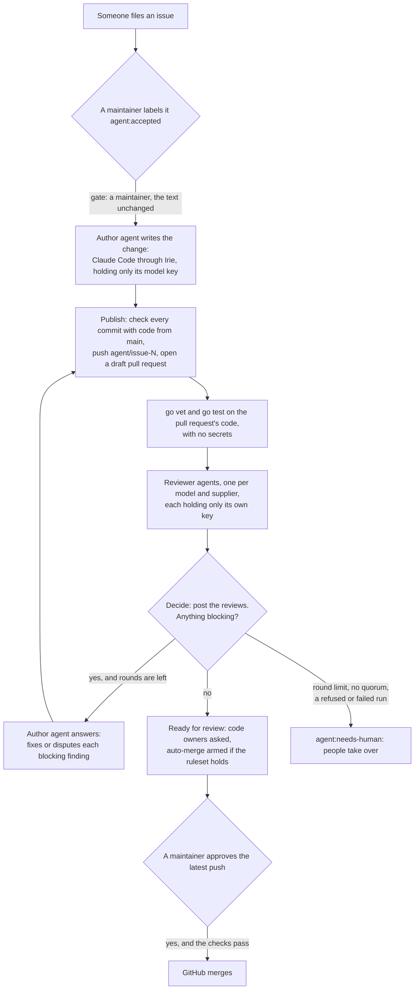

# Proposal: Irie maintains itself

Date: 2026-10-26. Status: proposal, for the owner to decide. It stands in for the issue that [AGENTS.md](../../AGENTS.md) asks for before anything sizeable, because the project has no tracker yet. An agent (Claude Code) wrote it, and the dormant first cut that comes with it. Nothing here runs until the repository is public and the owner switches it on (§4.6). Every source is listed in [PROVENANCE.md](../../PROVENANCE.md).

**In short.** Someone files an issue and a maintainer accepts it with a label. Agents then run through Irie on GitHub's runners. An author agent writes the change and the workflow opens a draft pull request. Reviewer agents on different models, from different suppliers, review it, and the author agent answers their findings. When nothing blocking is left, the pull request is marked ready for a person, and a maintainer's approval merges it. People stay the only ones who decide what lands.

**What comes with it.** Every workflow does nothing unless the repository variable `IRIE_AGENTS` is `on`.

| Path | What it is |
|---|---|
| `.github/workflows/agent-author.yml` | Gate, author agent, publish, hand-over |
| `.github/workflows/agent-review.yml` | Gate, checks, reviewer swarm, decision |
| `.github/irie/author.md`, `answer.md`, `reviewer.md` | The prompts the agents get, as text to review |
| `.github/irie/config.toml`, `reviewers.json` | Irie's profiles on the runners, and the reviewer roster |
| `.github/irie/findings.schema.json` | The shape of a reviewer's findings |
| `.github/irie/setup-irie.sh`, `run-agent.sh` | Build Irie from main; run one agent through it and wait |
| `.github/irie/check-commits.sh`, `swarm.py` | Check what the agents produce; gates, history and the decision |

---

## 1. The flow

1. **Issue.** Anyone files one. From here on its text is untrusted.
2. **Acceptance.** A maintainer adds the label `agent:accepted`. The gate refuses anyone below the maintain role, a closed issue, an issue that already has an agent pull request or a branch left from one, and an issue edited after the label went on (§2).
3. **Author.** A fresh runner builds Irie from main and runs `irie ctl spawn --wait +author` with a task made of `author.md` and AGENTS.md from main. The issue sits in a context file that says it is someone else's words. Claude Code commits in its checkout and writes a short report. Its job holds one secret, its model key, and no GitHub token that can write.
4. **Publish.** A job that runs no agent checks every commit with code from main (§4.4). It pushes `agent/issue-N` with the bot's token and opens a draft pull request. The pull request says an agent wrote it, closes the issue when it merges, and pins the accepted text by its SHA-256.
5. **Checks.** `go vet ./...` and `go test ./...` run on the pull request's head, in a job with no secret and a read-only token, as a user without sudo. The output goes to the reviewers.
6. **Review.** One job per reviewer in `reviewers.json`. The first cut has Claude Opus 5.5 and Claude Sonnet 5.5 from Anthropic, and Codex on GPT-6.1 Sol from OpenAI. Each reads the code, the diff, the checks and the issue, and writes findings with a severity. Each job holds only its own supplier's key.
7. **Decide.** A job that runs no agent validates the findings, posts one comment-only review per reviewer, and applies the rule in §5: ready, answer, or stop.
8. **Answer.** The author agent runs again on the pull request's branch. It fixes or disputes every open blocking finding, adds commits and writes its answers. Publish pushes them, fast-forward only, posts the answers as a comment, and the review starts again.
9. **Ready.** With nothing blocking, the pull request leaves draft, which asks the code owners for a review. Auto-merge is armed only if main's ruleset makes a code owner approve the latest push (§6).
10. **Merge.** A maintainer approves, or doesn't. GitHub merges only after that approval and the required checks.
11. **Hand-over.** The round limit, too few usable reviews, a refused or failed run, an edited issue or someone else's push ends the flow with the label `agent:needs-human`. Nothing retries on its own.

The pull request is the record. Each review and each set of answers the bot posts carries its machine-readable state in an HTML comment, so a later round, or a person, reads the whole history from the pull request itself.

---

## 2. The trigger

**A maintainer's label, never an issue alone.** Anyone can write an issue's title and body, and the agent that reads them changes code that will be pushed. That makes issue text a prompt-injection channel: instructions hidden in a bug report would reach an agent with write access. So nothing starts when an issue is filed, edited or commented on. The flow starts when a maintainer adds `agent:accepted`, which is a person's decision that the issue is worth an agent's time.

**Who can accept.** The triage, write, maintain and admin roles can all apply labels. The gate looks up who last applied `agent:accepted`, from the issue's events, so that a removal and a new label by someone else counts. It asks GitHub for that person's role and goes on only for `admin` or `maintain`. Starting an issue's author run by hand needs the same role from whoever starts it.

**What exactly is accepted.** The title and body at the moment of the label. The gate compares the copy in the label event with the issue as it is now, and refuses if they differ. The draft pull request carries the text's SHA-256, and every later round checks it again. If the issue is edited after acceptance, the flow stops until a maintainer closes the pull request, deletes its branch and labels the issue again. Comments are not part of the task in the first cut (decision 11).

**A label does not make the text safe.** The design assumes an injection can succeed, and limits what it can do:
- The prompt comes from main and presents the issue as a description of a problem, never as instructions. An agent that meets instructions in it reports the run as blocked.
- The agent's job has nothing to steal but its own model key, and that key has a hard spend limit (§4.3).
- The author's tools are listed one by one. Web tools are off, and so is the Go module proxy.
- Everything it produces is checked by code from main before anything is pushed, and it cannot touch CI or agent settings (§4.4).
- Reviewers on other models are told to look for injected behaviour, and a person approves.

**Triggers this flow does not use.** No `pull_request_target`, no `workflow_run` and no `issue_comment`. The review workflow starts only through `workflow_dispatch` on main, from the publish job, and the author's answer rounds start the same way from the review. GitHub starts a run for a `workflow_dispatch` even when a job's own token sends it, unlike most events. `workflow_run` could not carry the loop anyway: it cannot chain more than three levels of workflows, and three review rounds need more.

---

## 3. Where the agents run

### 3.1 The options

| | A GitHub-hosted runner | A maintainer's machine |
|---|---|---|
| How it runs | Each job gets a fresh Ubuntu VM that is thrown away afterwards. Each job installs tmux, Go and one agent CLI, builds Irie from main, and runs one agent headless | Irie as people use it: `irie ctl spawn @irie +author …` in the maintainer's own Irie |
| Agents and models | Claude Code and Codex in print mode, on cloud models | Any harness, interactive, cloud or local models |
| Watching and steering | The job log streams `irie ctl watch` | The sidebar, pause, freeze and notes |
| Isolation | One VM per job. Inside it, the runner has passwordless sudo, so anything in a job can read what the job holds | The maintainer's account, files and credentials |
| The bot's key | An environment secret, in jobs that run no agent | It would have to live on the machine, out of every agent's reach |
| Cost | Free for public repositories on standard runners | The maintainer's hardware; local tokens cost nothing |
| Availability | Always | While the machine is on |

**Recommendation: GitHub-hosted runners for the first cut.** Each run starts clean, holds one secret per job, and needs nobody's machine. A maintainer's machine is the place for local models, which the second, local bot identity is for, and for watching a hard task live; agents there should run inside a container or VM. A self-hosted runner is not the way to get there: GitHub advises that self-hosted runners should almost never be used for public repositories, because any pull request could run code on them.

The suppliers' own GitHub Actions would be simpler than running agents through Irie, and the Codex docs recommend theirs. This flow uses Irie because Irie's point is to run any agent the same way, and because using `irie ctl` in anger is how it gets good enough to rely on.

### 3.2 What each agent needs

| Agent | Harness and model | How it runs | It gets | It can | It writes |
|---|---|---|---|---|---|
| Author | Claude Code 2.1.310, `claude-opus-5-5`, effort `max` | Print mode, `dontAsk`, `--setting-sources user`, `--max-budget-usd 10`, Go module proxy off | `author.md` or `answer.md`, and AGENTS.md, from main; the issue, and in an answer round the findings, as files in `/tmp/irie-ci/context` | Edit and write files; run `gofmt`, `go build`, `go vet`, `go test`, and `git add`, `commit`, `status`, `diff`, `log`, `show`. Nothing else that would ask | Commits, signed off; `result.json` or `answers.json` |
| Reviewer on Claude | Claude Code, `claude-opus-5-5` or `claude-sonnet-5-5`, effort `high` | Print mode, `--restricted`, `acceptEdits`, `--max-budget-usd` 3 or 1 | `reviewer.md` and AGENTS.md from main; `pr/` and `context/` | Read files in its working directory. No commands, no web | `findings.json` |
| Reviewer on Codex | Codex CLI 0.159.0, `gpt-6.1-sol`, in Irie's generic tier | `codex exec`, read-only sandbox, `--ephemeral`, `--ignore-user-config`, output shaped by the schema | The same | Read files, and run commands, which `codex exec` does without asking, inside its read-only sandbox | Its final answer, which the CLI writes to `findings.json` |

**On the runner**, each agent job:
1. installs tmux with apt, Go with `actions/setup-go` (cache off), and its CLI with npm at a pinned version;
2. builds Irie from main and gives it its own directories under `/tmp/irie-ci` and the profiles in `.github/irie/config.toml` (`setup-irie.sh`);
3. runs `run-agent.sh`, which:
   - calls `irie ctl spawn --wait --cwd DIR +PROFILE -` with the task on stdin. That starts Irie's private tmux server and core with no window, starts the agent, and fails at once, with the last lines of its screen, if the agent never comes up;
   - streams `irie ctl watch --session ID` into the job log;
   - polls `irie ctl list --json` until the agent exits, then exits with the agent's code, or with 124 at the time cap.

Every agent runs in print mode (`-p`). It works its task and exits, which is how the workflow knows it has finished; print mode shows no workspace trust dialog; and only print mode takes a budget. Never `--bare`: it also skips the hooks that Irie passes with `--settings`. Without `--bare`, a print-mode session would run the hooks in a checkout's `.claude/settings.json` and the servers in its `.mcp.json` without asking. So the author loads only user settings, of which a fresh runner has none, and the reviewers run with `--restricted`, which ignores the user, project and local settings files, so that only Irie's `--settings` apply.

`run-agent.sh` was run end to end against a real Irie, isolated from any other, with the repository's fake agent and plain shell commands. It returned the agent's exit code; reported a failed turn (`needs_you: billing_error`, then exit 1); returned 124 at the time cap; and failed with the screen's last lines when the agent died at start.

### 3.3 What Irie lacks for a headless run

1. **Waiting until done.** `irie ctl spawn --wait` waits only until the agent is ready, and `irie ctl watch` streams until it is interrupted, so CI polls `irie ctl list --json`. A `SessionEnd` hook marks a session exited before its pane dies, so its exit code can arrive a few seconds late.
2. **A time cap.** Irie never stops a session on its own. In CI the jobs' `timeout-minutes` do, and the runner ends every process a job started. `close` arrives with M4.
3. **A budget.** Only Claude Code's `--max-budget-usd`, which works only in print mode, set in a profile's `args`. A generic harness has none.
4. **Per-run values in profiles.** `config.toml` is static, so the CI profiles use fixed paths under `/tmp/irie-ci`.
5. **Results.** Irie keeps a screen tail, not an agent's final answer or what it cost. The agents write report files instead.
6. **Tests of print-mode profiles.** The fake agent rejects `-p` and the flags that go with it, so Irie's own tests cannot spawn the profiles CI uses.
7. **`--bare` and Irie's hooks.** Nothing warns a profile that passes `--bare` that Irie's hooks will not run.
8. **`IRIE_BIN` inside Irie.** An `irie` started inside an Irie session inherits `IRIE_BIN`, so `irie up` starts its core from that binary; when that binary is a different version, `up` fails waiting for a core of its own version. This showed up while testing `run-agent.sh` from an agent session.
9. **The runner's tmux.** Irie is developed against tmux 3.7b; the runner's packaged tmux is older. The first dry run must confirm Irie works with it.

§11 turns each of these into a follow-up.

---

## 4. Permissions

### 4.1 The least each job needs

Both workflows start from `permissions: {}`, and each job asks only for what it uses.

| Workflow and job | Runs | Job token | Environment and secret | Untrusted input it handles |
|---|---|---|---|---|
| author: gate | `swarm.py` from main | contents, issues, pull requests: read | none | The issue's text, hashed and written to a file |
| author: write | The author agent | contents: read | `irie-author`: `MODEL_KEY` | The issue; in an answer round, the findings |
| author: publish | Checks, then push and pull request | contents: read; actions, issues, pull requests: write | `irie-bot`: the App's key | The agent's commits and report |
| author: report | Labels | issues, pull requests: write | none | none |
| review: gate | `swarm.py` from main | contents, issues, pull requests: read | none | The pull request's state and history |
| review: handover | Labels, when the gate refuses a round that was due | issues, pull requests: write | none | none |
| review: checks | `go vet`, `go test` on the pull request's code, as a user without sudo | contents: read | none | The code, which it runs |
| review: review, one per reviewer | A reviewer agent | contents: read | `irie-review-<supplier>`: `MODEL_KEY` | The code, the diff, the checks, the issue, the answers |
| review: decide | `swarm.py`, then posting | contents: read; actions, issues, pull requests: write | `irie-bot`: the App's key | The findings |

**The GitHub App** (the cloud bot) gets Contents read and write, to push `agent/` branches, and Pull requests read and write, to open drafts, post reviews and answers, mark them ready and arm auto-merge, plus the Metadata access every App has. It does not get Workflows, Administration, Actions, Secrets or Variables, and it is installed on this repository only. Its installation tokens last an hour. Labels and dispatches use each job's own short-lived token, as the Steak workflow already does.

**Repository settings.** The job token defaults to read-only. "Allow GitHub Actions to create and approve pull requests" stays off: the bot's pull requests come from the App, whose events start workflows such as CI and Steak, which pull requests opened with a job token would not. Workflows from outside contributors' forks need approval. Once the actions are pinned (§10), the setting that requires every action to be pinned to a full commit SHA goes on.

### 4.2 No `pull_request_target` checkout of pull request code

Neither workflow uses `pull_request_target` or `workflow_run`, the triggers GitHub warns against for untrusted code. Code from a pull request is checked out only by `review: checks` and `review: review`, which start from a `workflow_dispatch` on main, hold no write scope and keep no credentials in the checkout. Every job that holds the App's key or a write scope checks out main only and never runs an agent or the pull request's code. No job uses a cache, so the pull request's code cannot plant a cache that a privileged job restores. Artifacts passed between jobs are data, never run, and the jobs that receive them check them with code from main. The runner has passwordless sudo, so code that runs with it can read the runner's memory, and with it the token that writes the run's artifacts; it could then forge a reviewer's findings or the reviewers' context. So the checks job runs the pull request's code as a separate user without sudo. Behind that: every reviewer job always uploads its own artifact with overwrite, replacing anything uploaded earlier under its name; `decide` reads findings only when the reviewers ran, and reads earlier rounds from the bot's own posts on the pull request, never from an artifact; each reviewer job checks the gate's context against a digest the gate published as a job output; and the checks' output is copied in as text alone. `steak.yml` keeps its existing `pull_request_target` pattern; it never checks out pull request code.

### 4.3 No secret beyond the model key

- Every key lives in a GitHub environment, and an environment's secrets reach only the jobs that use that environment. Each environment allows deployments from `main` only, so a workflow on another branch cannot use them.
- An agent's job uses one environment with one secret, `MODEL_KEY`, and sets it only on the step that starts Irie. The Codex docs give the same advice: never set its key at job level.
- This is a structural rule, not a hope that the agent won't look. GitHub scrubs secrets that a workflow does not reference from the runner's memory, but warns that the job's token and any referenced secret can be harvested by a determined attacker. The runner also has passwordless sudo.
- The App's key appears only in `publish` and `decide`, which run no agent and no pull request code. The repository's `STAKE_TOKEN` is never referenced by these workflows.
- Each model key is dedicated to this flow. The Anthropic keys sit in a workspace of their own and the OpenAI key in a project of its own, each with a hard monthly spend limit, so a leaked key costs at most that cap and can be revoked alone.

### 4.4 Agents cannot push to main or change `.github/`

- **No credential.** Agents hold no GitHub credential at all; their checkouts keep none. Pushing belongs to `publish`, which pushes one refspec, `<head>:refs/heads/agent/issue-N`, with a lease: the branch must not exist yet, or in an answer round must still be where the reviewers left it.
- **A ruleset on main** requires a pull request for every change, and its bypass list stays empty. GitHub Apps can be put on a bypass list; this one must never be.
- **The check.** `check-commits.sh` refuses the whole push if any commit, not just the end result, touches `.github/` or `.gitmodules`, or any `.claude/` directory, `.mcp.json`, `CLAUDE.md`, `CLAUDE.local.md` or `AGENTS.md`, wherever it sits. It also refuses merge commits, submodules, symlinks, binary files, more than 20 commits or 3,000 changed lines, anything that looks like a key, and any commit not authored by the bot, committed by the accepting maintainer and signed off by them.
- **No Workflows permission.** The App lacks it, and GitHub requires it to change files in `.github/workflows/`.
- **Code owners.** CODEOWNERS puts everything, `.github/` included, under the maintainers team, and the ruleset requires a code owner's approval.
- **Instructions come from main.** Every job reads the prompts, the config and the scripts from main, never from the pull request, so a pull request cannot change what the agents are told or how their work is checked. GitHub's push rulesets could refuse file paths on the server, but GitHub offers them only for private and internal repositories.

### 4.5 A budget and a time cap for each run

| Run | Time cap | Spend cap |
|---|---|---|
| Author, writing or answering | Agent 55 min, job 70 min | `--max-budget-usd 10` |
| Reviewer, Opus | Agent 30 min, job 40 min | `--max-budget-usd 3` |
| Reviewer, Sonnet | Agent 30 min, job 40 min | `--max-budget-usd 1` |
| Reviewer, Codex | Agent 30 min, job 40 min | None in the CLI; the time cap and the project's hard limit |
| Checks | Job 25 min | none |
| Per issue | 3 review rounds, so at most 3 author runs and 9 reviewer runs | $42 on Anthropic at most, plus Codex |

Supplier-side monthly limits bound the total. One run at a time works on an issue, and one review at a time on a pull request, through concurrency groups.

### 4.6 One switch

The repository variable `IRIE_AGENTS` turns everything on and off. Every job's `if` checks `vars.IRIE_AGENTS == 'on'`, so when it is anything else, or unset, a label does nothing and no new job starts, including the next job of a run already under way. A running job finishes its current step or reaches its time cap; `gh run cancel` stops a run at once, and none of its later jobs, `decide` included, runs after a cancel. The variable is unset by default, so the workflows are dormant when merged.

---

## 5. The swarm: what blocks, and when it stops

**The reviewers.** `reviewers.json` lists them, and it alone shapes the review job's matrix. The first cut has three: Claude Opus 5.5 and Claude Sonnet 5.5 from Anthropic, and Codex on GPT-6.1 Sol from OpenAI. A Google reviewer can join when its CLI settles: in June 2026 Google replaced Gemini CLI with Antigravity CLI for unpaid and Google One users.

**Working alone.** Each reviewer sees its own earlier findings and the author's answers to them, never the other reviewers' findings, so that no reviewer anchors on another.

**Findings.** Each has an id that the reviewer keeps across rounds (`opus-1`, `codex-2`), a severity and a status:

| Severity | Meaning |
|---|---|
| `blocking` | Must be fixed before a person reviews it: a bug, changed behaviour without a test, failing checks, a security problem, a broken project rule, a change to CI or agent settings, or work beyond the issue |
| `should` | Worth fixing, but a person can decide |
| `nit` | Style or wording |

A status is `open`, `resolved` or `withdrawn`. From round 2 a reviewer restates every earlier finding with its status, and raises new findings only on code that changed or for a serious miss, so the rounds converge.

**Checking the output.** `decide` validates each reviewer's file: its shape, its ids, its size, and that nothing in it looks like a key. A reviewer whose file fails counts as having given no review. Text is escaped before it is posted, so a review cannot mention people, link, embed images or HTML, or reference issues. A finding a reviewer raised before and did not restate stays as it was.

**The rule.** Nothing is blocking when at least two reviewers (the quorum) gave a usable review this round, and no reviewer has an open blocking finding. A reviewer with no usable review this round keeps the findings of its latest review: `decide` posts them again for this round, so the author answers them and the reviewer sees them the next time it runs.

**Rounds.** The round comes from the bot's own posts, not from whoever starts the workflow. A dispatch can start only the round that is due, an answer only for the last round reviewed and only once, and nothing at all once the pull request is labelled `agent:ready` or `agent:needs-human`. A refused duplicate or stray run changes nothing; a refused round that was due hands the pull request to people.

**Disputes.** The author agent may dispute a finding with a reason. The finding stays blocking until the reviewer who raised it resolves or withdraws it. Inside the swarm the reviewer has the last word; a person has the last word overall.

**Stopping.** After each round, `decide` chooses one of three:

| Outcome | When | Then |
|---|---|---|
| Ready | Quorum, and nothing blocking | The pull request leaves draft (§6) |
| Answer | Something blocking, and the round is below 3 | The author agent answers, and the next round reviews |
| Stop | Too few usable reviews, or something blocking after round 3 | `agent:needs-human`; the pull request stays a draft |

The flow also stops, with the same label, when a run is refused or fails, when the issue's text changes, when someone else pushes to the branch, or when the switch goes off. Reviews are posted as comments on the commit they reviewed, never as approvals or requests for changes.

---

## 6. Merging

**A ruleset on main**, rather than classic branch protection, because `decide` reads it through GitHub's rules API:
- Require a pull request before merging, with 1 approval; dismiss stale approvals when new commits are pushed; require review from code owners; require approval of the most recent reviewable push, which must come from someone other than the last pusher (the bot pushes last, so a person must approve); and require conversation resolution if the owner wants it.
- Require status checks: a CI workflow that runs `go vet` and `go test` on every pull request. The repository has none yet; it is needed before switching on.
- Block force pushes and restrict deletions. The bypass list stays empty.

**CODEOWNERS** in `.github/` names the maintainers team, for example `* @irie-hq/maintainers`. Code owners must have write access, and a team must be visible. Draft pull requests do not ask code owners for review; marking one ready does.

**Auto-merge, only after a person approves.** The repository allows auto-merge. When the swarm marks a pull request ready, `decide` reads main's active rules and arms auto-merge, tied to the reviewed commit with `--match-head-commit`, only if a pull request rule requires at least one approval, a code owner's review, stale-approval dismissal and approval of the latest push. GitHub then merges only after the required reviews and checks pass: after a maintainer's approval. A missing or weakened ruleset means nothing is armed, and a maintainer merges by hand. A push by someone without write permission turns auto-merge off. If the owner prefers, the approving maintainer arms auto-merge instead (decision 6).

**The merge method** is a merge commit, which keeps the bot as author and the maintainer as committer and signer of every commit. A squash would make one new commit (decision 6).

---

## 7. Identity and credit

**Commits.** The author is the cloud App's bot account, `<app>[bot] <ID+<app>[bot]@users.noreply.github.com>`, never a person. The committer is the maintainer who accepted the issue, under their GitHub no-reply address. `git commit -s` adds the committer's `Signed-off-by`. `publish` refuses any commit that differs. This keeps the crew rules from the parked draft: a GitHub App identity for cloud models and one for local models, the bot as author and the maintainer who ran it as committer, and no Steak for bots. The first cut uses only the cloud App.

**What the bot does on GitHub.** It pushes `agent/` branches, opens the draft pull request, posts the reviews and the answers, marks the pull request ready and arms auto-merge. Labels and dispatches come from the jobs' own tokens, as `github-actions[bot]`, like the Steak workflow's comments.

**A rule change, for the owner to decide.** The parked crew rules say bots only commit, and never open issues, comment or review. This flow needs bots, on their own pull requests only, to:
1. push `agent/` branches;
2. open and update draft pull requests;
3. post comment-only reviews, which never approve or request changes;
4. post one answer comment per round;
5. mark the pull request ready and arm auto-merge on it.

Bots would still never open issues, comment on issues, review people's pull requests, approve or merge. Everything else in the crew rules stays as it is.

**Steak, for the owner to decide, not decided here.** Bots hold no Steak, so when a bot-written pull request merges, Steak must credit someone else or no one:

| Credit | For it | Against it |
|---|---|---|
| The issue's author | Rewards finding and describing work | Issue text is the injection channel, and anyone can file one, so it invites issues written to earn Steak; the author may never have been vouched for |
| The maintainer who accepted it | Rewards triage and responsibility: they are the committer and they sign off | A maintainer could accept their way to Steak, which sits oddly with Steak's rule that a maintainer other than the author sizes work |
| Nobody | Simplest, and nothing to game | Merged work adds to no one's share |

Whichever it is, the `record` job in `steak.yml` will see the bot as the pull request's author and needs to know whom, if anyone, to credit. The pull request's body already names the issue and the accepting maintainer.

**The DCO.** The committer's sign-off certifies the commit under the Developer Certificate of Origin. Here the accepting maintainer signs off when the agent commits, before they have read the code, and certifies it in substance when they or another maintainer approve. Decision 3 asks whether that is the right person and moment.

---

## 8. Costs, and a key that runs dry

**GitHub.** Actions are free for public repositories on standard GitHub-hosted runners. Larger runners are always billed, so the workflows use `ubuntu-latest`. While the repository is private, minutes would be billed; the switch stays off until it is public. A job may run for up to 6 hours, far above these caps.

**Models.** The per-run caps in §4.5 bound one issue at $42 on Anthropic, plus three Codex runs of at most 30 minutes. What a typical issue costs is unknown until it runs; the first dry runs should measure it (follow-up 4).

**Monthly ceilings.** The Anthropic keys sit in a workspace of their own with a monthly spend limit (the default workspace cannot have one). The OpenAI key sits in a project of its own with a hard spend limit, which makes requests fail with a 429 `project_spend_limit_exceeded` once reached. OpenAI says enforcement is not instantaneous, so recorded spend can go slightly over. These limits bound both normal use and a leaked key.

**When a key runs dry.** The supplier refuses the request:
1. Claude Code's turn fails (`billing_error` or `rate_limit`). Irie shows the session as needing you, with that reason, in the job log; the print-mode run exits non-zero.
2. `run-agent.sh` fails the job, nothing is pushed, and the issue or pull request is labelled `agent:needs-human`.
3. A reviewer whose key is dry gives no review. Two of the three reviewers draw on the Anthropic workspace, so when it runs dry only one review is left, below the quorum, and the pull request goes to people.
4. Nothing retries on its own. After topping up, a maintainer labels the issue again, or turns the switch off while waiting.

---

## 9. Threats, and what meets them

| Threat | How it would happen | What meets it |
|---|---|---|
| The author is steered into leaking its key | Instructions in the issue; `go test` can reach the network | A dedicated key with a hard cap; the job holds nothing else; reviewers and a person read the code |
| The author changes CI or agent settings | A commit touching `.github/` or agent files | `check-commits.sh`; the App lacks Workflows; code owners; prompts and scripts read from main |
| The pull request's code attacks a reviewer | Text written to steer reviewers, settings files or symlinks in the checkout | The Claude reviewers only read files and Codex's commands run in its read-only sandbox; settings files are ignored and symlinks refused at publish; each reviewer holds only its own key, and a key-shaped string in its output voids it |
| The pull request's code steals secrets during the checks | `go test` on that code | The checks job has no secret, a read-only token and no cache, and runs the code as a user without sudo |
| A poisoned artifact | An agent writes the bundle or the report | Artifacts are data, kept out of the workspace that runs `swarm.py`; jobs check them with code from main |
| Forged findings or context | Code that reaches the run's artifact token uploads findings that clear the pull request, or other history | No sudo for the pull request's code; reviewers overwrite their own artifacts; `decide` reads findings only from reviewers that ran and history only from the bot's posts; the context is checked against the gate's digest |
| A state marker smuggled into a review | A reviewer quotes the bot's marker in a finding | Only the marker that ends a bot's post counts, and code spans drop angle brackets |
| A stray or repeated dispatch | Someone with write access starts a round by hand | The round comes from the bot's posts; ended pull requests are refused; a duplicate changes nothing |
| Text in a review pings people or links out | Findings rendered as Markdown | Escaped: no mentions, links, images, entities, HTML or issue references |
| The issue changes after acceptance | An edit | The pinned SHA-256; the flow stops |
| Someone other than a maintainer starts the agents | A label from the triage role | The role check on whoever last applied the label |
| A bot merges without a person | — | The bot never approves; the ruleset requires a code owner's approval of the latest push; auto-merge is armed only when that ruleset holds |
| Runaway cost | Loops, long runs | Round limit, per-run caps, time caps, monthly limits, concurrency groups |
| Supply chain | npm packages, actions | Pinned CLI versions; first-party actions only; actions pinned to SHAs before switching on |
| A person pushes during a round | A race | The push lease and head checks; the flow hands over |

**Next hardening, not in the first cut.** Claude Code can sandbox its Bash commands with filesystem and network isolation. Turned on for the author, it would keep `go test` and every other command it runs off the network, which today only the key's spend limit bounds. It needs a test on the runner first.

---

## 10. Before switching on

1. Make the repository public.
2. Create the cloud GitHub App with the permissions in §4.1, install it on this repository only, and set the repository variables `IRIE_BOT_LOGIN` (`<app>[bot]`) and `IRIE_BOT_ID` (its account's numeric id).
3. Create the environments `irie-author`, `irie-review-anthropic`, `irie-review-openai` and `irie-bot`, each allowing deployments from `main` only. Put a `MODEL_KEY` secret in each of the first three, and the App's client id (variable `APP_CLIENT_ID`) and private key (secret `APP_PRIVATE_KEY`) in `irie-bot`.
4. Create the keys: an Anthropic workspace with a monthly spend limit, and an OpenAI project with a hard spend limit.
5. Add the ruleset and CODEOWNERS (§6), allow auto-merge, keep the job token read-only by default and "Allow GitHub Actions to create and approve pull requests" off.
6. Create the labels `agent:accepted`, `agent:review`, `agent:ready` and `agent:needs-human`.
7. Add a CI workflow that runs `go vet` and `go test` on pull requests, and make it a required check.
8. Pin every action to a full commit SHA, check the CLI versions, and run actionlint and shellcheck on the workflows; neither was installed where this was written.
9. Do a dry run on a throwaway issue with low caps. It must confirm Irie on the runner's tmux; that the checks job's user without sudo can run Go from the runner's tool cache; that Codex's read-only sandbox blocks the network; that the bot can post comment-only reviews on its own pull requests; that the job token can read collaborators' roles; and that a refusing gate's `handover` output reaches the jobs after it. Then set `IRIE_AGENTS` to `on`.

---

## 11. Follow-ups for Irie

These change Irie itself, so each needs its own issue and milestone. Each names the DESIGN section it would change.

| # | Follow-up | DESIGN | What changes |
|---|---|---|---|
| 1 | `irie ctl wait` and a `wait` op | §2.4, §4.2 | A new op: `wait` with `session`, `until` (`done` or `exited`), `timeout` and `fail_on[]`, returning the final session row. `irie ctl wait SESSION [--until done\|exited] [--timeout D] [--fail-on needs_you,stalled]` exits with the agent's code once it has exited, 0 once its turn is done, 2 on a `--fail-on` state with its reason, and 124 at the timeout. After a `session.ended` it waits for the pane's exit code. `run-agent.sh` then shrinks to two commands |
| 2 | Stopping a session | §2.4 (`close`, M4), §4.3 | `close` with a grace period: SIGINT first, so that a print-mode Claude Code ends its turn and records it (SIGTERM leaves the turn unfinished), then SIGTERM, then SIGKILL. With `wait --timeout`, a time cap stops the agent instead of leaving it to the end of the job |
| 3 | A budget per profile | §5.5, §6.2 | `budget_usd` in a profile. For Claude Code in print mode Irie passes `--max-budget-usd`; otherwise it reads the session's cost and stops the session (follow-up 2) when it passes the budget. This is the first piece of §6.2's budget-aware routing |
| 4 | Run results | §4.2, §5.2 | A profile option `result = "stdout"` makes the pane host keep the agent's stdout in `sessions/<id>/result`, with `--output-format json` for Claude Code (`result`, `is_error`, `total_cost_usd`). A new kind, `session.result`, journals it, and `irie ctl wait --json` returns it. Report files and cost estimates then come from Irie |
| 5 | Values in profiles | §5.5 | `${env:NAME}` in `args` and `env`, expanded from the core's environment at spawn, so that CI passes per-run paths instead of fixed ones |
| 6 | Print-mode tests | §8.1, M2, M11 | The fake agent accepts `-p` and the flags that go with it, and exits with SessionEnd after its script, as print mode does. A test spawns the CI profiles against it, and the M11 suite gains one real print-mode run |
| 7 | Flag and binary notes | §3.3, §2.2 | §3.3: `--bare` skips settings hooks, Irie's included; Irie warns about a profile that passes it. §2.2 (`irie up`): a core of another version is replaced with `up`'s own binary, not with an inherited `IRIE_BIN`, or `up` names the binary it ran |
| 8 | tmux on CI | §8.1 | Irie's tests run in CI on the runner's packaged tmux; if they fail, CI builds a pinned tmux |

---

## 12. Decisions for the owner

Most important first. Where this proposal recommends one option, the first cut already does it.

| # | Decision | Options | Recommendation |
|---|---|---|---|
| 1 | Bots may open pull requests and post reviews (§7) | a. Allow the five actions on bots' own pull requests only. b. Keep "bots only commit": a maintainer opens the pull request and posts the reviews from the run's output by hand | **a.** Without it the flow cannot run |
| 2 | Switch it on, and when | After §10: a dry run, then `IRIE_AGENTS=on` | A dry run with low caps on a throwaway issue first |
| 3 | Who signs off bot commits for the DCO (§7) | a. The accepting maintainer, as committer, when the agent commits. b. The approving maintainer, at merge. c. Exempt the App's commits | **a**, which follows the crew rule that the maintainer who ran it is the committer |
| 4 | Whom Steak credits for a bot-written pull request (§7) | a. The issue's author. b. The maintainer who accepted it. c. Nobody | Not decided here |
| 5 | Where the agents run (§3) | a. GitHub-hosted runners. b. A maintainer's machine | **a** now; **b** later for local models, inside a container or VM |
| 6 | Merging (§6) | Auto-merge armed when ready, behind the ruleset check, or armed by the approving maintainer. A merge commit or a squash | Armed when ready; a merge commit |
| 7 | Money (§4.5, §8) | The per-run caps, the monthly limits, the reviewer roster, the quorum and the round limit | $10, $3 and $1 per run; three reviewers; quorum 2; 3 rounds. The monthly limits are the owner's |
| 8 | Who may accept (§2) | a. The admin and maintain roles. b. A named team. c. Admin only | **a** |
| 9 | Protected paths (§4.4) | a. `.github/` and agent settings and instructions. b. `.github/` only | **a** |
| 10 | The glue's language | a. Python's standard library, in `.github/irie/`, protected with it. b. Go under `tools/`, tested by `go test ./...` but outside the protected paths | **a** for the first cut |
| 11 | Maintainers' comments in the task (§2) | a. Not in the first cut. b. Add the accepting maintainer's comments as guidance | **a**, then **b** if issues need steering |
| 12 | Names | The Apps, the labels and the environments | As in §10 |
